# Canvas: the game in the Notebook look

Still pictures of how Pinfold will really look. They follow the game-screen brief
([`game-screens.md`](../game-screens.md)), the screens and flows ([`flows.md`](../flows.md)) and the
wireframes, and use every colour and size from the [Notebook theme](../theme-notebook.md) and
[Piece shapes](../pieces.md).

The frames live on [Pinfold canvas](https://claude.ai/artifact/GpJSNGSjeJGhZQCCojXNNj), a Claude
design canvas: light on the top row, dark below. The canvas opens only for people the owner has
shared it with. The PNGs on this page are exported from the same drawing.

## The frames

The four game frames are one game of Level 7, Siege: the mission is to capture 8 dots, and the
computer starts 6 dots ahead. Each frame adds to the one before, so the board tells one story.

| Frame | Light | Dark |
| --- | --- | --- |
| **Game: the level opens.** The mission shows big under the opponent while the head-start dots sit on the board. | 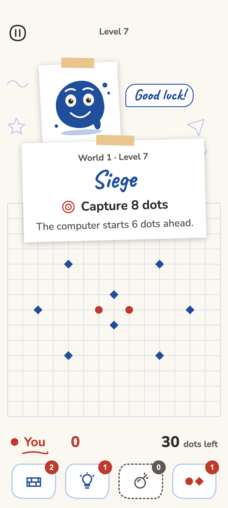 | 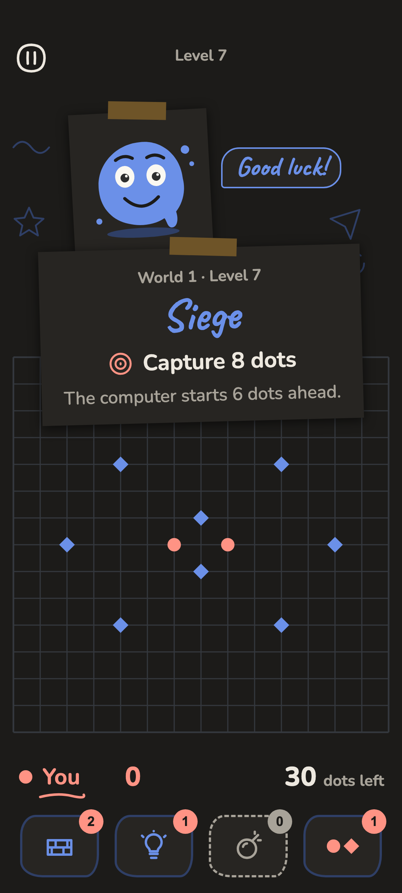 |
| **Game: a threat.** Your pair and blue's six are each one move from capture. Highlighter rings mark them, and a small circle marks the point that closes each ring. Your move. | 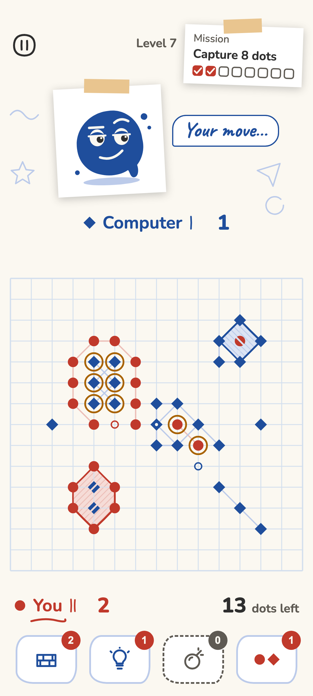 | 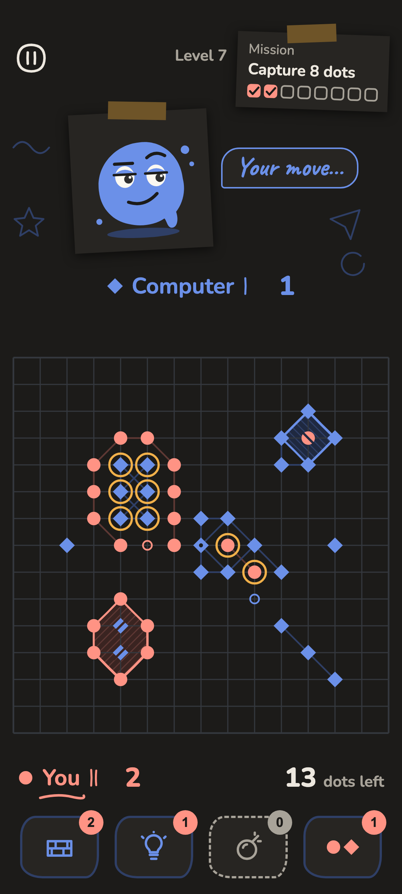 |
| **Game: right after a big capture.** Six blue dots at once: the ring, the wash and hatching, the cuts, +6 on its way to your tally, the mission note full, the opponent's face falls. | 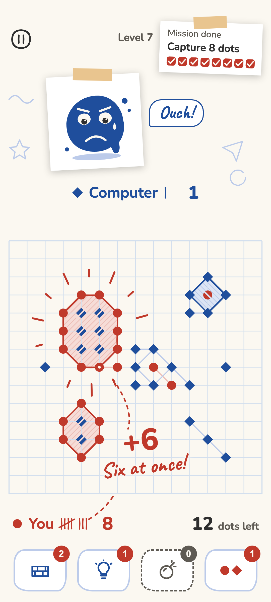 | 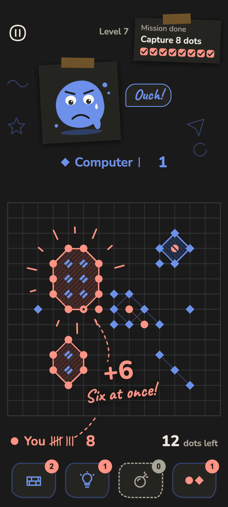 |
| **Result.** A note taped over the final board: two stars of three, Next as the one big button, Retry as a small one. | 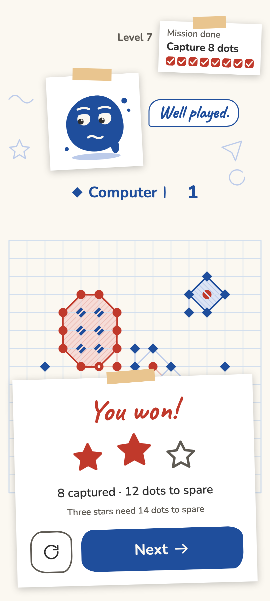 | 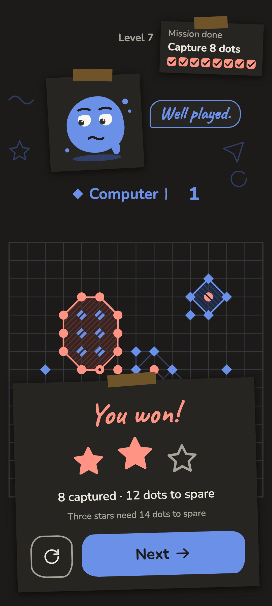 |
| **World map, the home screen.** The game opens here. World 1's path, finished levels with their stars, level 7 circled near the thumb, the boss castle and the chest, today's puzzle, small icons. | 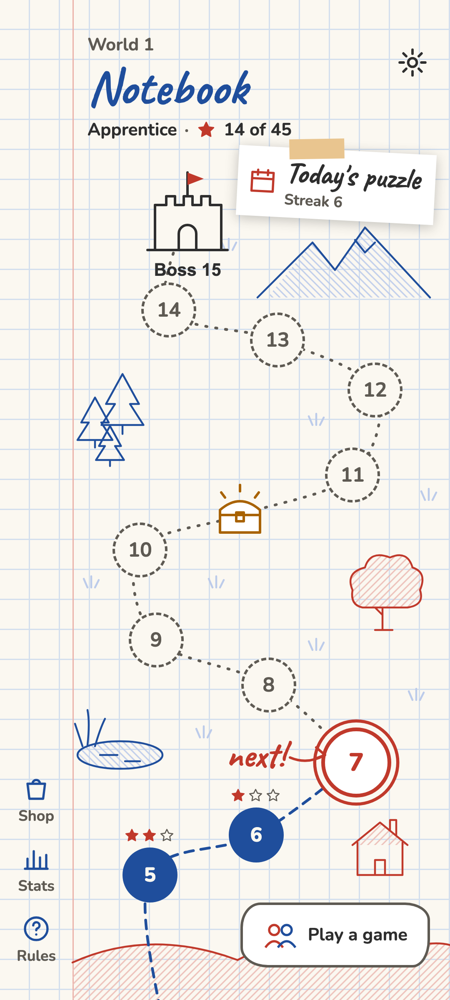 | 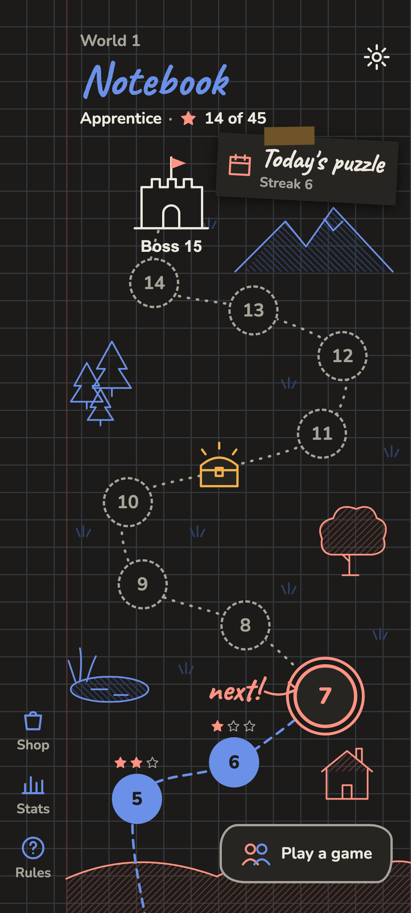 |
| **Level card.** Tapping level 7 lays this page over the map: the mission, the board at the start, the opponent's face, the boosters, the star targets and one button, Start. | 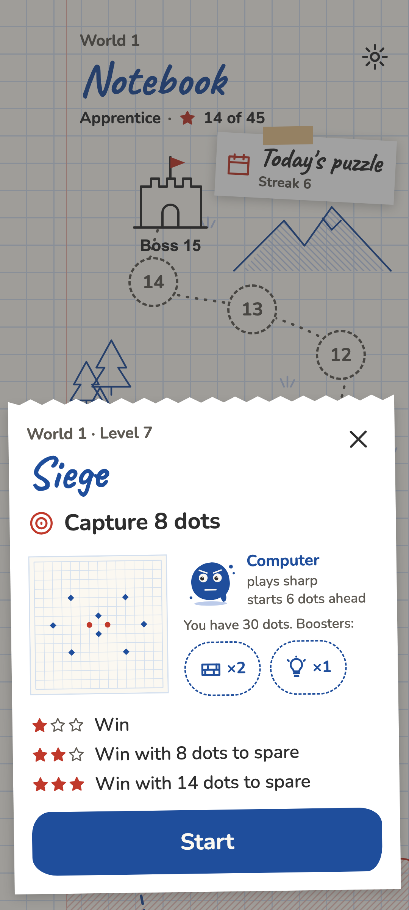 | 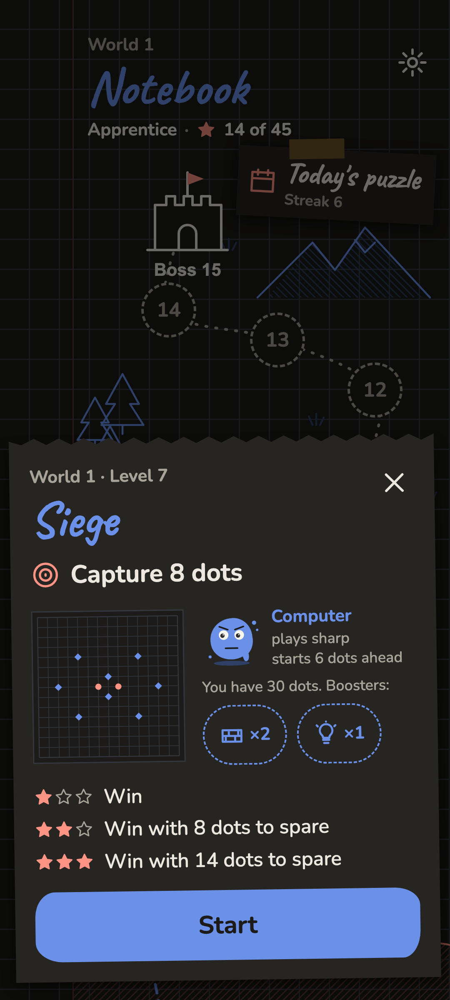 |

## Real size

Every frame is 360 x 800 dp, the screen of a common Android phone. The board is 15 x 15 points at
24 dp spacing, edge to edge, and all text uses the theme's sizes. The PNGs are 3 px per dp
(1080 x 2400 px).

**On a phone.** Open a PNG on the phone and fit it to the screen width. On a phone about 360 dp
wide (most phones with a 1080 px screen) it then shows at the size the game will have. Check that
the dots, the cuts and the smallest text (12 sp: "Streak 6", the map icons' names) are easy to read
at arm's length.

## What the frames add to the theme

These choices are new here. They are proposals for the owner to accept or change:

- **The opponent is a face with a name, a tally and a speech bubble.** The computer is drawn as a
  round blot of blue ink, taped into the notebook like a photo. Its face changes with the game:
  happy at the start, smug at a threat, upset after a capture.
- **Whose turn it is** shows as a pen stroke under the name of the side to move.
- **The mission note** shows one box per dot to capture, ticked as they fall.
- **The one big button** on a card or note uses the Title style (Nunito 700, 20 sp). The theme
  gives buttons the Label style (14 sp), which the smaller buttons keep.
- **Speech bubbles and "next!"** on the map use Caveat at 24 sp or more, as the theme allows for
  short handwritten words.
- **Notes and cards** have a strip of tape in Highlighter faint and a soft shadow.

## Art

The opponent's face and the map's trees, pond, house, mountains, castle and chest are simple ink
doodles drawn in code. They show where the illustrations go and how big they are. The prompts for
the illustrations are on [Illustrations](../illustrations.md).

## Redrawing

[`draw.py`](draw.py) draws every frame from the values on the theme and piece pages, and renders
the PNGs with Google Chrome:

```sh
python3 docs/design/canvas/draw.py                  # the PNGs on this page
python3 docs/design/canvas/draw.py --canvas DIR     # also the canvas files, in DIR/project/
```

It needs Python 3, Google Chrome and a network connection (the fonts come from Google Fonts). A
change made by hand on the canvas does not reach the script, so change the script and redraw.
