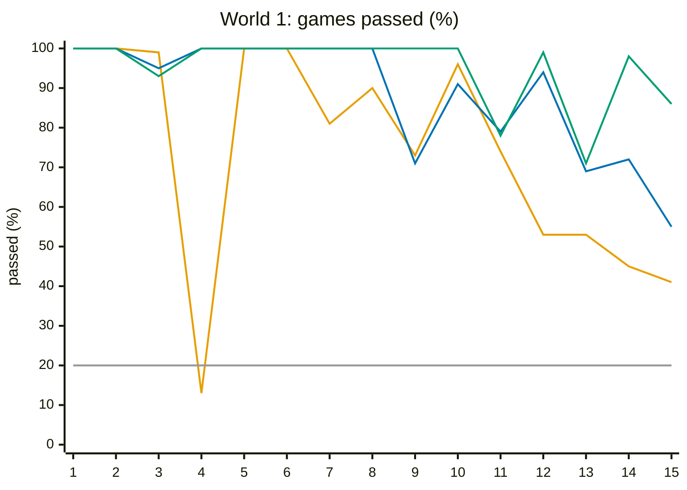
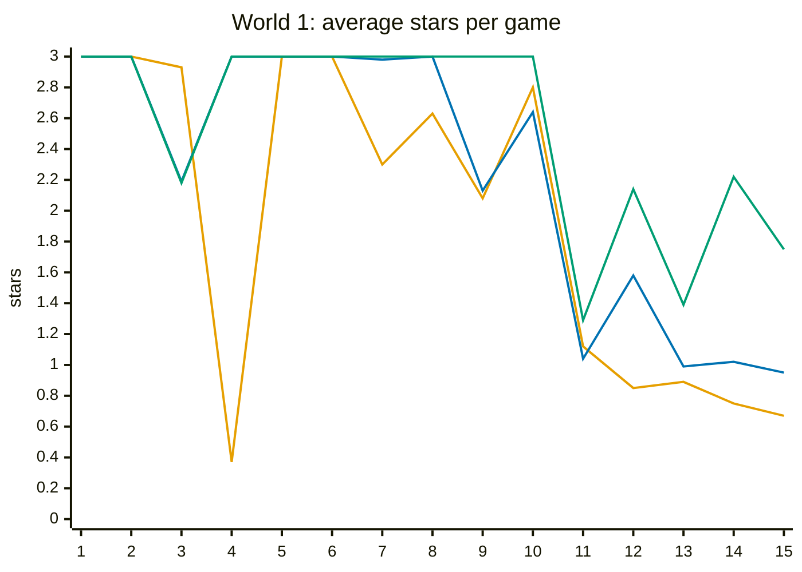
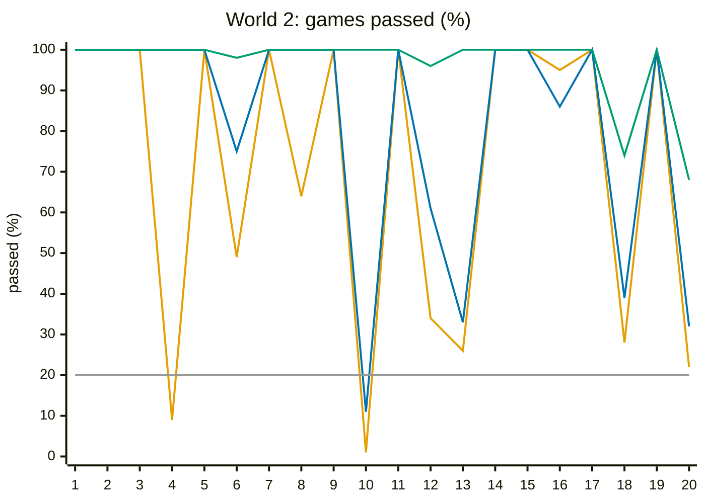
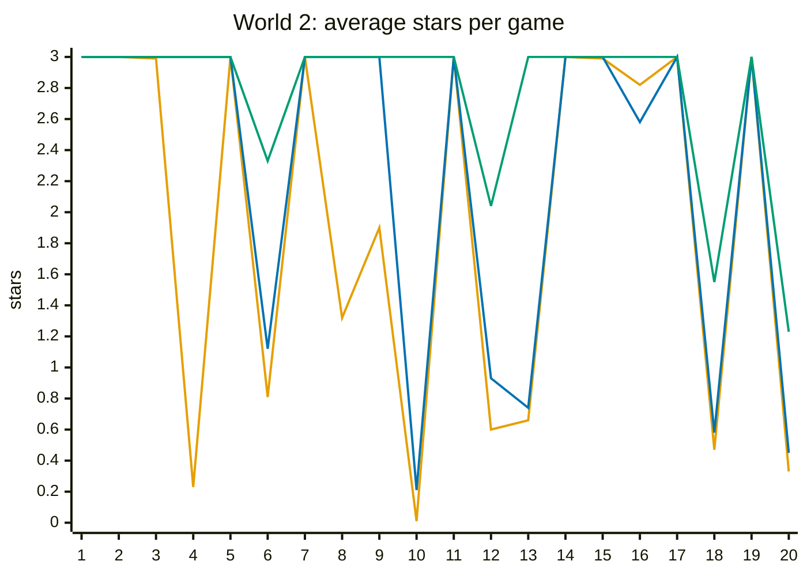
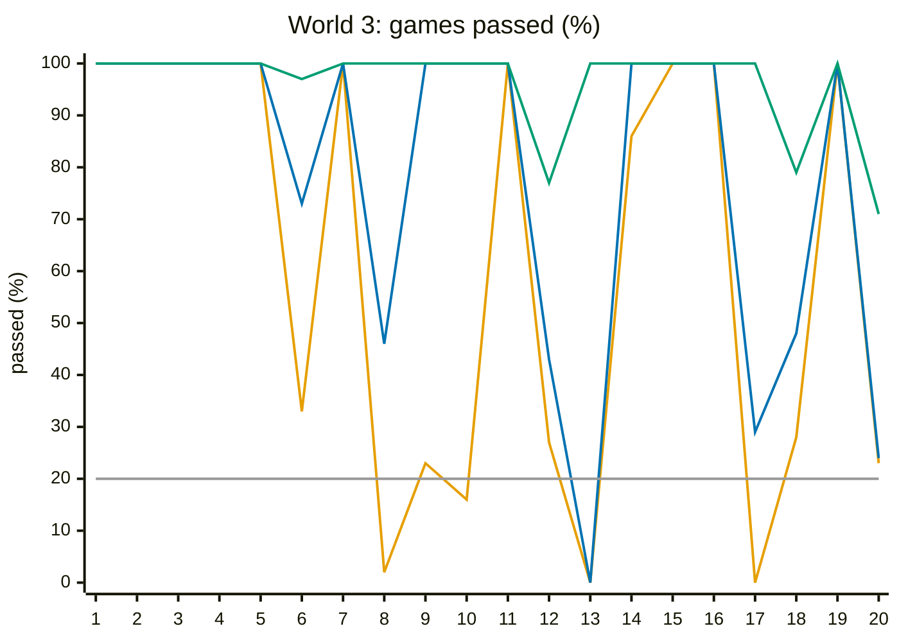
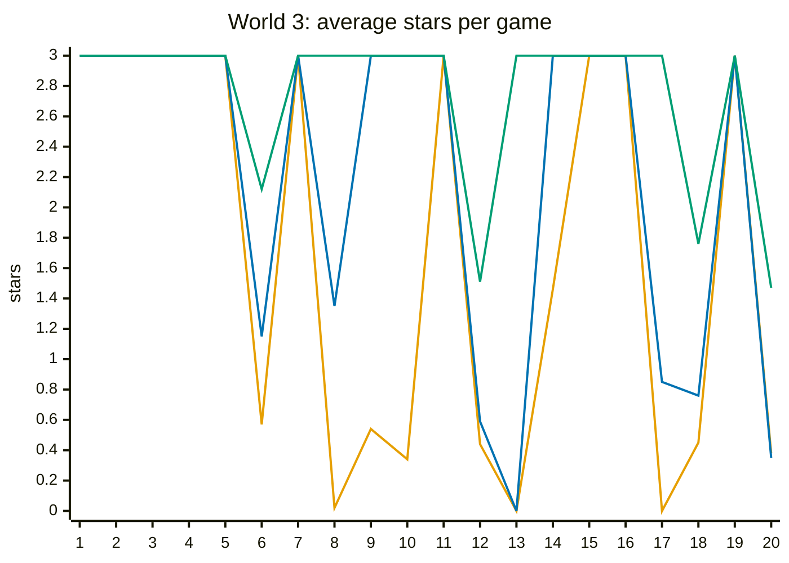
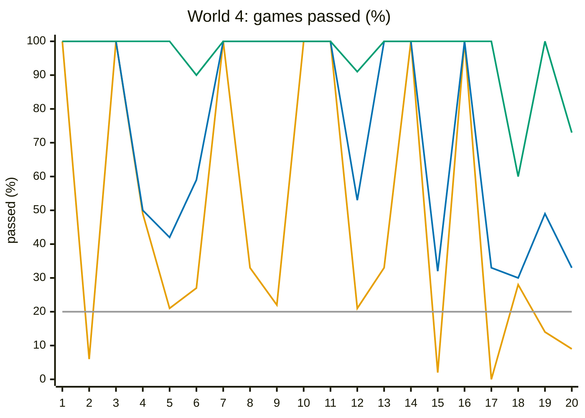
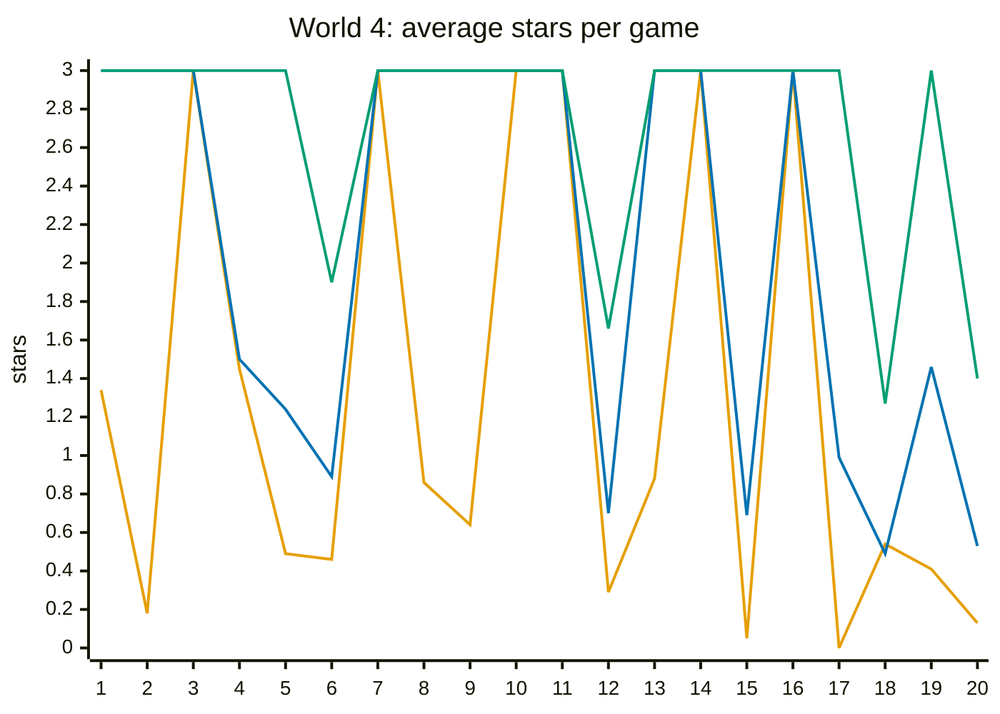

# Difficulty curve

How hard each level of the campaign is, measured before people play it: three stand-in players,
a weak, an average and a strong one, play every level 200 times against the level's own
computer, which plays against the mission. This page has the share of games each one passes,
the stars they earn, the checks the curve must pass, and what stands out.

The stand-ins are computers, not people. The numbers say which levels are hard compared with
the others, not how a person will feel about them; the campaign play-tests (Q-04) say that.

## The stand-ins

Each stand-in plays like one strength step of the computer (README, "Strength steps") and, unlike
the computer, reads the level's mission. Before each move it looks a fixed number of its own
moves ahead:

| Stand-in | Plays like | Reads the mission |
| --- | --- | --- |
| Weak | the easy step: one move ahead, sees a ring two dots from closing | 1 move ahead |
| Average | the normal step: checks the answer to each move | 2 moves ahead |
| Strong | the hard step: three moves ahead, the whole board | 3 moves ahead |

Reading the mission means, in a puzzle (capture, survive, rescue, target):

- If it sees a way to pass the mission within that many moves whatever the computer does, it
  plays it.
- In "survive" and "rescue", it does not play a move that lets the computer fail the mission
  within that many moves.
- In "capture" and "target", it does not play a move after which the computer's reply puts the
  mission out of reach, for example by letting the target run to the border.
- Otherwise it plays its step's move.

In whole games it plays its step's move. The puzzle solver does the reading
(`Solver.lookAhead`), with a fixed budget of positions per move, so a run gives the same numbers
on every machine.

The stand-ins never use boosters and never play a level twice. A person who fails a puzzle
usually tries again, now knowing where the computer runs.

## Running it

```sh
./gradlew :cli:installDist
cli/build/install/cli/bin/cli bench levels 200            # every level; about 10 minutes on 8 cores
cli/build/install/cli/bin/cli bench levels 200 3-20 4-20  # only these levels
```

It prints the table, the charts below and the checks, as Markdown for this page.

## The checks

- **A wall** is a level the average stand-in passes in under 20% of its games. Every wall must
  be deliberate: its level file's `note` starts with `Wall:`, saying why.
- **No world has two walls in a row.**

The bench prints both checks and whether they pass. Today they pass: the walls are 2-10 Rose
Bush (22 of 200) and 3-13 Reflection (0 of 200), both noted, and they are not next to each other.

## What the curve shows

**Whole games get harder through each world and across the worlds.** The share of games the
average stand-in passes:

| World | First whole game | Second | Third | Boss |
| --- | ---: | ---: | ---: | ---: |
| 1 | 1-11: 79%, then 1-12: 94% | 1-13: 69% | 1-14: 72% | 1-15: 55% |
| 2 | 2-6: 75% | 2-12: 61% | 2-18: 39% | 2-20: 32% |
| 3 | 3-6: 73% | 3-12: 43% | 3-18: 48% | 3-20: 24% |
| 4 | 4-6: 59% | 4-12: 53% | 4-18: 30% | 4-20: 33% |

- Each world opens easier than the boss before it, then climbs. Two steps go the other way or
  stay level: 3-18 is a little easier than 3-12, and 4-18 and the Kraken are equal within the
  noise (see "Limits").
- The bosses get harder from World 1 to World 3. The Comet (3-20) is the hardest whole game for
  the average stand-in (24%); the Kraken (4-20) is the hardest whole game for the weak one (9%).
- The strong stand-in passes most whole games of Worlds 1 to 3 (68% to 99%) and the last ones of
  World 4 less often (60% for Reef, 73% for the Kraken).

**The computer's steps on the ladder (decision 0003).** The beginner plays 1-1 to 1-3, the easy
step 1-4 to 1-13, the steady step 1-14 to 4-19 and the normal step only the Kraken. The steady
step carries most of the campaign; the whole games get harder through fewer dots for the player,
head starts and faster boss rules, not a stronger computer. The curve above shows that this is
enough to make them climb. Where each step sits stays as it is until the play-tests (Q-04) say
otherwise.

**Puzzles get harder from world to world.** The mean share of games passed over each world's
puzzles (every level that is not a whole game):

| World | Puzzles | Passed, weak | Passed, average | Passed, strong |
| --- | ---: | ---: | ---: | ---: |
| 1 | 10 | 85.1% | 95.6% | 99.3% |
| 2 | 16 | 80.8% | 89.4% | 100.0% |
| 3 | 16 | 70.3% | 85.9% | 100.0% |
| 4 | 16 | 54.9% | 81.6% | 100.0% |

- **The climb comes from the hard puzzles,** and each world has more of them: for the average
  stand-in, 2-10 and 2-13 in World 2; 3-8, 3-13 and 3-17 in World 3; 4-4, 4-5, 4-15, 4-17
  and 4-19 in World 4. Each answer is three moves deep, one more than the average stand-in reads,
  and its first move is not the one its step would play: a quiet move away from the capture, or
  a move beyond a rock while one next to the dot looks right. In 4-17 a second fight at the top
  draws the eye. Only one first move passes each of them (`cli check-levels`).
- **The strong stand-in passes every puzzle of Worlds 2 to 4,** because it reads three moves
  ahead. The hard puzzles ask for depth, not luck.
- **Survive and rescue puzzles are passed every time by all three,** although the computer plays
  against the mission (README, "Playing for the mission"). To fail a player who reads the
  mission, the computer has to set up a capture the player cannot see coming, and the steady
  step, which plays them, thinks only two moves ahead. Even HARD as the computer failed the weak
  stand-in in only 1 of 460 survive and rescue games (20 games of each level). They are the easy
  steps between the hard puzzles.

**Stars.** In a puzzle, a stand-in that passes nearly always finds the shortest answer, so it
earns three stars; a person will often take a longer way. In whole games the average stand-in
earns 0.4 to 1.6 stars a game, and the strong one 1.2 to 2.3.

## Outliers

- **2-10 Rose Bush (average 11%) and 3-13 Reflection (average 0%) are walls.** Each has one
  first move that passes, a quiet one three moves before the ring closes; the strong stand-in,
  which reads three moves ahead, passes every game. Both levels offer a booster the stand-ins do
  not use (a wall in 2-10, a double dot in 3-13). They are noted as walls; if the play-tests find
  them too hard, give them an answer the player can read in two moves.
- **2-13 Greenhouse (average 33%)** is hard on purpose: its note says the block right next to the
  marked dot fails.
- **3-20 Comet** gives the player 23 dots against the computer's 26. With 22 it sat on the wall
  line for the average stand-in (19.5% in a run of 200 games, 22% in a run of 400), a wall that
  was not meant. With 23 the average stand-in passes 24%, still the least of World 3.
- **1-3 First Capture** is passed a little less often by the average and strong stand-ins (95%
  and 93%) than by the weak one (99%). Its mission has 8 moves, more than the puzzle solver reads, so all
  three play their step's moves. Why the deeper steps do worse here is not known; it matters
  little, because in the game the tutorial guides this level (A-06).
- **1-11 First Game** is passed by the strong stand-in in only 78% of games, less than the harder
  1-12. On a 9x9 board with 10 dots each, many games end level, and a draw does not pass.
- **1-4 Door** is passed by the weak stand-in in only 13% of games. The check is for the average
  stand-in, which passes it every time.

## Limits

- **Noise.** With 200 games, a share near 50% is known to within about 7 points either way (95%
  of the time), one near 20% or 80% to within about 6. Two levels closer than that may be equally
  hard.
- **The hard puzzles of Worlds 3 and 4 are tuned against the stand-ins:** each board is set so
  that the stand-in's own step prefers a wrong first move. Whether that move tempts a person too
  is for the play-tests (Q-04).
- **The stand-ins do not use boosters and do not retry,** so puzzles are harder for them than for
  a person who does both.
- The `bench levels <stand-in>` tables in the README and the world pages use stand-ins that do
  not read the mission, and were measured against the computer that played only for captures
  (G-25).

## Charts

Pass rate and average stars per level, world by world. Orange is the weak stand-in, blue the
average, green the strong; the grey line in the pass-rate charts is the 20% wall line. The x-axis
is the level number within the world.

### World 1





### World 2





### World 3





### World 4





## Every level

200 games per level for each stand-in. Passed: the share of games that passed the mission.
Stars: the average stars per game, a failed game counting 0.

| Level | Name | Mission | Computer | Passed, weak | Passed, average | Passed, strong | Stars, weak | Stars, average | Stars, strong |
| --- | --- | --- | --- | ---: | ---: | ---: | ---: | ---: | ---: |
| 1-1 | First Dot | capture 1 in 3 moves | beginner | 100% | 100% | 100% | 3.0 | 3.0 | 3.0 |
| 1-2 | Two Rings | capture 1 in 4 moves | beginner | 100% | 100% | 100% | 3.0 | 3.0 | 3.0 |
| 1-3 | First Capture | capture 1 in 8 moves | beginner | 99% | 95% | 93% | 2.9 | 2.2 | 2.2 |
| 1-4 | Door | capture 2 in 4 moves | easy | 13% | 100% | 100% | 0.4 | 3.0 | 3.0 |
| 1-5 | Edge | capture 2 in 5 moves | easy | 100% | 100% | 100% | 3.0 | 3.0 | 3.0 |
| 1-6 | Marked Dot | target d4 | easy | 100% | 100% | 100% | 3.0 | 3.0 | 3.0 |
| 1-7 | Chase | capture 2 in 5 moves | easy | 81% | 100% | 100% | 2.3 | 3.0 | 3.0 |
| 1-8 | Cut | target d5 | easy | 90% | 100% | 100% | 2.6 | 3.0 | 3.0 |
| 1-9 | Three in a Row | capture 3 in 5 moves | easy | 73% | 71% | 100% | 2.1 | 2.1 | 3.0 |
| 1-10 | Long Chase | target f4 | easy | 96% | 91% | 100% | 2.8 | 2.6 | 3.0 |
| 1-11 | First Game | win | easy | 74% | 79% | 78% | 1.1 | 1.0 | 1.3 |
| 1-12 | Two Crosses | win | easy | 53% | 94% | 99% | 0.8 | 1.6 | 2.1 |
| 1-13 | Head Start | win | easy | 53% | 69% | 71% | 0.9 | 1.0 | 1.4 |
| 1-14 | Four Crosses | win | steady | 45% | 72% | 98% | 0.8 | 1.0 | 2.2 |
| 1-15 | Ink Bottle | win | steady | 41% | 55% | 86% | 0.7 | 0.9 | 1.8 |
| 2-1 | Weeds | survive 2 moves | steady | 100% | 100% | 100% | 3.0 | 3.0 | 3.0 |
| 2-2 | Path Home | rescue b4 | steady | 100% | 100% | 100% | 3.0 | 3.0 | 3.0 |
| 2-3 | Snail | survive 4 moves | steady | 100% | 100% | 100% | 3.0 | 3.0 | 3.0 |
| 2-4 | Ladybug | target e4 | steady | 9% | 100% | 100% | 0.2 | 3.0 | 3.0 |
| 2-5 | Fence Line | rescue c3 | steady | 100% | 100% | 100% | 3.0 | 3.0 | 3.0 |
| 2-6 | Flower Beds | win | steady | 49% | 75% | 98% | 0.8 | 1.1 | 2.3 |
| 2-7 | Bramble | survive 3 moves | steady | 100% | 100% | 100% | 3.0 | 3.0 | 3.0 |
| 2-8 | Seedling | capture 1 in 4 moves | steady | 64% | 100% | 100% | 1.3 | 3.0 | 3.0 |
| 2-9 | Side Step | rescue d5 | steady | 100% | 100% | 100% | 1.9 | 3.0 | 3.0 |
| 2-10 | Rose Bush | target d4 | steady | 1% | 11% | 100% | 0.0 | 0.2 | 3.0 |
| 2-11 | Watering Can | survive 3 moves | steady | 100% | 100% | 100% | 3.0 | 3.0 | 3.0 |
| 2-12 | Hedge | win | steady | 34% | 61% | 96% | 0.6 | 0.9 | 2.0 |
| 2-13 | Greenhouse | target g6 | steady | 26% | 33% | 100% | 0.7 | 0.7 | 3.0 |
| 2-14 | Stepping Stone | rescue c4 | steady | 100% | 100% | 100% | 3.0 | 3.0 | 3.0 |
| 2-15 | Thorns | survive 4 moves | steady | 100% | 100% | 100% | 3.0 | 3.0 | 3.0 |
| 2-16 | Tulips | target e6 | steady | 95% | 86% | 100% | 2.8 | 2.6 | 3.0 |
| 2-17 | Garden Gate | rescue d3 | steady | 100% | 100% | 100% | 3.0 | 3.0 | 3.0 |
| 2-18 | Few Seeds | win with 18 dots | steady | 28% | 39% | 74% | 0.5 | 0.6 | 1.6 |
| 2-19 | Trellis | survive 3 moves | steady | 100% | 100% | 100% | 3.0 | 3.0 | 3.0 |
| 2-20 | Mole | win with 20 dots | steady | 22% | 32% | 68% | 0.3 | 0.5 | 1.2 |
| 3-1 | Lake Shore | survive 3 moves | steady | 100% | 100% | 100% | 3.0 | 3.0 | 3.0 |
| 3-2 | Shoreline | target e3 | steady | 100% | 100% | 100% | 3.0 | 3.0 | 3.0 |
| 3-3 | Night Swim | survive 4 moves | steady | 100% | 100% | 100% | 3.0 | 3.0 | 3.0 |
| 3-4 | Crescent | capture 2 in 4 moves | steady | 100% | 100% | 100% | 3.0 | 3.0 | 3.0 |
| 3-5 | Lantern | survive 4 moves | steady | 100% | 100% | 100% | 3.0 | 3.0 | 3.0 |
| 3-6 | Full Moon | win | steady | 33% | 73% | 97% | 0.6 | 1.1 | 2.1 |
| 3-7 | Fireflies | survive 3 moves | steady | 100% | 100% | 100% | 3.0 | 3.0 | 3.0 |
| 3-8 | Owl | target f6 | steady | 2% | 46% | 100% | 0.0 | 1.3 | 3.0 |
| 3-9 | Crater Rim | capture 2 in 5 moves | steady | 23% | 100% | 100% | 0.5 | 3.0 | 3.0 |
| 3-10 | Telescope | capture 1 in 4 moves | steady | 16% | 100% | 100% | 0.3 | 3.0 | 3.0 |
| 3-11 | Shooting Star | survive 4 moves | steady | 100% | 100% | 100% | 3.0 | 3.0 | 3.0 |
| 3-12 | Crater | win with 20 dots | steady | 27% | 43% | 77% | 0.4 | 0.6 | 1.5 |
| 3-13 | Reflection | target f3 | steady | 0% | 0% | 100% | 0.0 | 0.0 | 3.0 |
| 3-14 | Pole Star | capture 1 in 4 moves | steady | 86% | 100% | 100% | 1.5 | 3.0 | 3.0 |
| 3-15 | Black Pool | survive 4 moves | steady | 100% | 100% | 100% | 3.0 | 3.0 | 3.0 |
| 3-16 | Moon Bay | survive 4 moves | steady | 100% | 100% | 100% | 3.0 | 3.0 | 3.0 |
| 3-17 | Dusk | target d4 | steady | 0% | 29% | 100% | 0.0 | 0.9 | 3.0 |
| 3-18 | Twin Stars | win with 19 dots | steady | 28% | 48% | 79% | 0.5 | 0.8 | 1.8 |
| 3-19 | Stargazer | capture 1 in 4 moves | steady | 100% | 100% | 100% | 3.0 | 3.0 | 3.0 |
| 3-20 | Comet | win with 23 dots | steady | 23% | 24% | 71% | 0.4 | 0.4 | 1.5 |
| 4-1 | Rocks | capture 1 in 4 moves | steady | 100% | 100% | 100% | 1.3 | 3.0 | 3.0 |
| 4-2 | Oyster | capture 3 in 4 moves | steady | 6% | 100% | 100% | 0.2 | 3.0 | 3.0 |
| 4-3 | Tide Pool | survive 4 moves | steady | 100% | 100% | 100% | 3.0 | 3.0 | 3.0 |
| 4-4 | Anchor | target c5 | steady | 49% | 50% | 100% | 1.5 | 1.5 | 3.0 |
| 4-5 | Rock Pool | capture 2 in 5 moves | steady | 21% | 42% | 100% | 0.5 | 1.2 | 3.0 |
| 4-6 | Rocky Shore | win | steady | 27% | 59% | 90% | 0.5 | 0.9 | 1.9 |
| 4-7 | Seagull | survive 4 moves | steady | 100% | 100% | 100% | 3.0 | 3.0 | 3.0 |
| 4-8 | Coral | capture 2 in 4 moves | steady | 33% | 100% | 100% | 0.9 | 3.0 | 3.0 |
| 4-9 | Shipwreck | capture 2 in 5 moves | steady | 22% | 100% | 100% | 0.6 | 3.0 | 3.0 |
| 4-10 | Harbour | capture 1 in 4 moves | steady | 100% | 100% | 100% | 3.0 | 3.0 | 3.0 |
| 4-11 | Buoy | survive 4 moves | steady | 100% | 100% | 100% | 3.0 | 3.0 | 3.0 |
| 4-12 | Pearls | win | steady | 21% | 53% | 91% | 0.3 | 0.7 | 1.7 |
| 4-13 | Starfish | capture 1 in 4 moves | steady | 33% | 100% | 100% | 0.9 | 3.0 | 3.0 |
| 4-14 | Lighthouse | survive 4 moves | steady | 100% | 100% | 100% | 3.0 | 3.0 | 3.0 |
| 4-15 | Whirlpool | capture 1 in 5 moves | steady | 2% | 32% | 100% | 0.0 | 0.7 | 3.0 |
| 4-16 | Sandbar | survive 4 moves | steady | 100% | 100% | 100% | 3.0 | 3.0 | 3.0 |
| 4-17 | Driftwood | target e6 | steady | 0% | 33% | 100% | 0.0 | 1.0 | 3.0 |
| 4-18 | Reef | win with 19 dots | steady | 28% | 30% | 60% | 0.5 | 0.5 | 1.3 |
| 4-19 | Cove | capture 1 in 5 moves | steady | 14% | 49% | 100% | 0.4 | 1.5 | 3.0 |
| 4-20 | Kraken | win | normal | 9% | 33% | 73% | 0.1 | 0.5 | 1.4 |
