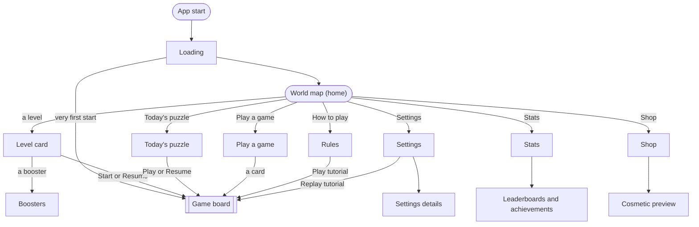
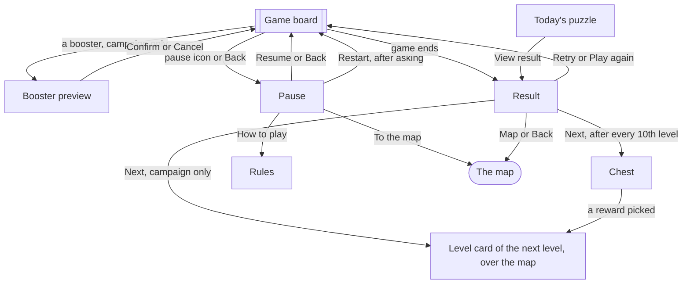
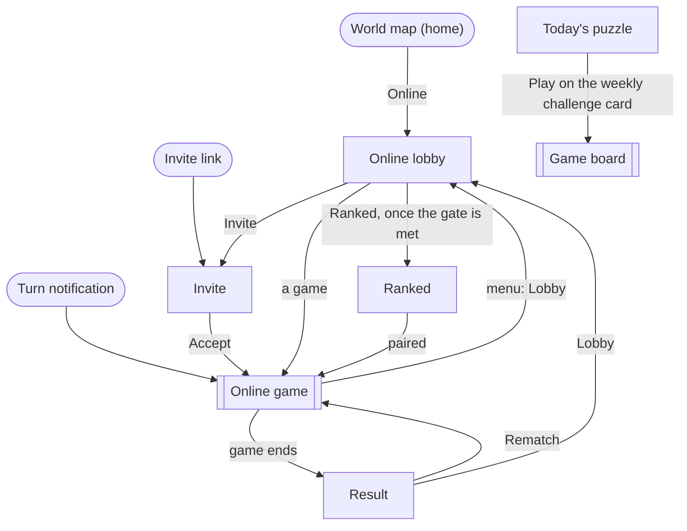

# Screens and flows

This page lists every screen in Pinfold and how a player moves between them. The app's navigation
(A-01) is built from it, the [wireframes](#wireframes) (D-06) draw one frame per screen listed
here, and the prototype (D-10) follows these flows.

Three decisions shape it: no difficulty picker (decision 0003), boosters only in the solo campaign
(decision 0006), and two players on one phone at launch with online play after it (decision 0014).

## Navigation in short

- **The map is home.** The game opens on the world map, at the world the player is in, with the
  next level low on the screen, near the thumb. There is no tab bar.
- **No Play buttons on the map.** Tapping a level opens its Level card; Start is there.
- **Small labelled icons on the map** lead to everything else: Today's puzzle (a note pinned to the
  page), Play a game (free play or two players), How to play, Stats, Shop and Settings. After
  launch, Online joins them.
- **One main action.** Every card and note has one big button. Anything else is a small icon or
  link. On the board, the only button above it is the pause icon.
- **Over the map or the board, not instead of it.** The Level card, the chest, Today's puzzle, Play
  a game, Pause, the booster preview and Result are laid over the map or the board, so the player
  always sees where they are. Rules, Stats, Shop and Settings are full screens on the same paper.
- **Two taps.** From the map, a player reaches every feature in at most two taps. Settings details
  are the only exception. The full count is under [The two-tap check](#the-two-tap-check).
- **One board, one result.** Every mode uses the same game board and the same Result. Only the
  controls differ: boosters appear only in the campaign.

## Flow diagrams

### The app at launch

### Around the board

Leaving a game always returns to the map, scrolled to the level the game belonged to. The game is
saved first, so nothing is lost.

### After launch

## Screens

One line per screen. "Built in" names the task that builds it. "Over" means the screen is laid
over the map or the board, which stay visible around it.

### At launch

| Screen | Opens from | What the player sees and does | Built in |
| --- | --- | --- | --- |
| Loading | App start | The app icon on paper, as on Android's own start-up screen, with its red ring drawing itself as the game loads, and a one-line tip. No buttons. Then the map; until Level 1 is finished, Level 1 instead. | A-01, A-06, A-18 |
| World map (home) | Loading; Back from Rules, Stats, Shop or Settings; leaving a game | One scrolling map with a section per world. Finished levels with their stars, the next level circled and marked "next", boss levels as fortresses, a chest every 10 levels, locked worlds with the stars they need. No Play buttons: a level opens its Level card. Labelled icons for Today's puzzle, Play a game, How to play, Stats, Shop and Settings; the player's title and stars. | A-01, A-02, A-04 |
| Level card | A level on the map, Next on Result | Over the map: the mission in one line, a small picture of the board, the computer's face for its strength, its head start, allowed boosters and star targets. A boss level adds the boss's name, face and rule. One button: Start, or Resume when the level's game is saved. Tapping a booster opens Boosters. | A-03 |
| Boosters | A booster on the Level card | Wall, Hint, Bomb, Double dot and Undo: how many the player has, what each does, how to earn more. Close returns to where it opened. | A-05 |
| Chest | Next on the Result of every 10th level | Over the map: pick one of two rewards. | A-04 |
| Game board | Start, Play, Resume, Retry, Play again | The opponent above the board, with a face and a tally; the player below it, with a tally and the tool bar. Whose turn, dots left, the last move (A-14), the mission note, special points and any boss countdown. In the campaign, the boosters sit in the tool bar, Undo among them (decision 0023). In free play, the tool bar holds an Undo button with no count; two players and the daily puzzle have no undo. A pause icon opens Pause. | A-03, A-05, A-13, A-14 |
| Booster preview | A booster on a campaign board | Over the board: one line on what the booster does, the points it can act on, and its effect at the chosen point. Confirm or Cancel. One booster per turn. | A-05 |
| Pause | Pause icon or Back on the board | Over the board: Resume, Restart (asks first, where the mode allows it) and To the map. Small icons for sound on or off and How to play. | A-01 |
| Result | The end of a game, View result on Today's puzzle | Over the final board: the captured areas light up and the score counts up, then a note with the outcome, score, stars and anything newly unlocked. Campaign win: Next, with a small Retry. Campaign failure: Retry, with a small Map. Daily: Share, or Retry after a failed attempt, with a small Map. Free play and two players: Play again, with a small Map. | A-03, A-07, A-08 |
| Tutorial | Levels 1 to 3 of World 1, Play tutorial on Rules, Replay tutorial in Settings | The game board with a few dots placed and one sentence at a time: placing, linking, capturing. Threat highlights are on. Hints can be skipped. A replay is practice and does not change campaign progress. | A-06 |
| Today's puzzle | The puzzle's note on the map | Over the map: the date, the mission, the streak, whether a freeze is left this week, and the time to the next puzzle. Play, Resume or View result. | A-07 |
| Play a game | Play a game on the map | Over the map: two big cards, Free play (against the computer) and Two players (two people on one phone). A card starts a game at once with the defaults, or resumes the saved one. A small link changes board size and game length. The computer plays at the strength reached in the campaign; two players use the pure rules. | A-08 |
| Rules | How to play on the map or in Pause | Placing, capturing, empty rings, the border and how a game ends, with small board pictures. Play tutorial. | A-06 |
| Stats | Stats on the map | Games played and won, captures, best capture, longest streak, stars per world, the player's title. Opens Leaderboards and achievements. | A-11 |
| Leaderboards and achievements | Stats | The daily puzzle and total-star leaderboards and the achievements, shown by Google Play Games. Asks to sign in when the player is not. Closing returns to Stats. | O-02 |
| Shop | Shop on the map | Themes, piece styles and ring effects, each on a small board; owned items marked. Restore purchases. | C-02 |
| Cosmetic preview | An item in Shop | The item on a sample board, its price or how to earn it, and whether it is owned or in use. Buy or Use. | C-02 |
| Settings | Settings on the map | The controls listed under [Settings](#settings). | A-09 |
| Settings details | A row in Settings | Language, privacy (the policy and ad choices), Play Games backup, credits and licences. | A-09, A-10 |
| Developer menu | Seven taps on the version line at the bottom of Settings | The POC's difficulty picker and test-only settings. Not for players, so it is left out of the two-tap check. | A-01 |
| Android screens | An action in the game | Not drawn by us: the share screen, the feedback email, the review prompt (A-12), Play Games sign-in, Google Play purchase, a rewarded ad, the ad consent form. Closing one returns to the screen that opened it. | A-07, A-12, O-02, C-02, C-03 |

### After launch

| Screen | Opens from | What the player sees and does | Built in |
| --- | --- | --- | --- |
| Online lobby | Online on the map | Games grouped as Your turn, Waiting and Finished. Invite a friend or open a game. | O-03 |
| Invite | Invite in the lobby, an invite link | Share an invite link, or see who invited you and accept. An expired or broken link offers the lobby. | O-03 |
| Online game | A game in the lobby, a turn notification | The game board with the pure rules and no boosters. Shows waiting and reconnecting. The menu offers Lobby, Resign, Report and Block. It does not pause the game. | O-03, O-06 |
| Ranked | Ranked in the lobby, once the gate is met | Rating and season; Find a game or Cancel. A found game uses the online game board and Result. | O-07 |
| Weekly challenge | A card on Today's puzzle | The card shows the rule, the end date and the cosmetic reward. Tap it for details, or Play on the card to start. | R-08 |

## Settings

Settings is one scrolling screen. Changes take effect at once and survive a restart. Back returns
to the map.

- **Sound and vibration:** music volume, sound-effects volume, vibration on or off.
- **Board:** high-contrast pieces, threat highlights.
- **Help and app:** Replay tutorial, Send feedback (an email, A-12), Language (shown once a second
  language ships, A-10), Privacy (the policy and ad choices, C-03), Play Games backup (O-02),
  Credits and licences.
- **After launch:** notifications (O-05), delete my online data (O-06).

## The two-tap check

Taps are counted from the map to the first screen where the feature can be used. For a mode that
plays, the count runs to a board with the default choices. Scrolling is not a tap. Confirmations
(replacing a saved game, signing in, buying, ad consent) are not counted. Settings details and
the developer menu are left out.

| Destination | From the map | Taps |
| --- | --- | --- |
| World map, and the stars a locked world needs | (home) | 0 |
| A Level card, or why a level is locked | The level | 1 |
| The board of any unlocked level, the next one included | The level → Start | 2 |
| The saved campaign game | The level → Resume | 2 |
| Boosters | A level → a booster | 2 |
| Daily puzzle and streak | Today's puzzle | 1 |
| The daily board or today's result | Today's puzzle → Play, Resume or View result | 2 |
| A free play board | Play a game → Free play | 2 |
| A two-player board | Play a game → Two players | 2 |
| Rules | How to play | 1 |
| Tutorial | How to play → Play tutorial | 2 |
| Stats | Stats | 1 |
| Leaderboards or achievements | Stats → Leaderboards or Achievements | 2 |
| Shop and an item's preview | Shop → the item | 2 |
| Settings | Settings | 1 |
| Online lobby, a game or an invite (after launch) | Online → the game or Invite | 2 |
| Ranked (after launch) | Online → Ranked | 2 |
| Weekly challenge (after launch) | Today's puzzle → Play on the challenge card | 2 |

## First launch

The first tap a new player makes is a move on the board.

1. The loading screen, then straight into Level 1: no map and no Level card. Once ads ship,
   players in the EU and the UK first see Google's consent form (C-03). No sign-in is needed for
   anything offline.
2. Level 1 starts with guided steps (A-06). Levels 1 to 3 teach placing, linking and capturing,
   one step at a time, with threat highlights on. Level 1 teaches the placement method that A-13
   picks.
3. Result shows the stars over the final board. Next opens the map for the first time: the stars
   fly to Level 1, and the Level card of Level 2 opens. Retry plays Level 1 again.
4. Until Level 1 is finished, the app opens straight into it, where the player left off. To the
   map in Pause shows the map early; Level 1 is circled there.

## Returning player

- **A campaign game is saved.** The map opens at that level. Its card says Resume, which brings back
  the board, the turn, the dots left, the boosters and the tutorial step.
- **No campaign game is saved.** The map opens at the next unlocked level. After the last
  level that exists, the end of the path says that more worlds are coming.
- **Saved games.** Each mode keeps one unfinished game: the campaign, the daily puzzle, free play
  and two players. Starting a different game in the same mode asks before replacing the saved
  one. A saved game in one mode never blocks the others.

## Campaign

- **Win.** Stars and unlocks are saved before Result opens. Result shows the new stars, a newly
  unlocked world and any reward over the final board. Next is the main button, with a small Retry
  beside it. Next returns to the map, where the stars fly to the level; when a world opens, its
  page turns and the path goes on.
- **Fail or draw.** Result says how close it was. Retry is the main button, with a small Map.
  After the third failure on the same level, Result offers a hint or a booster (A-03). If C-01
  places a rewarded ad here, its offer sits below Retry.
- **Starting a level.** Every level starts from its Level card. The board then shows the mission,
  and any boss rule, big for a moment before it shrinks into the corner note. No tap is needed.
- **Boss levels.** The boss rule shows on the Level card and on the board before the first move.
  The boss's face sits above the board, with a countdown to its special turn (G-05).
- **Chests.** After every 10th level, Next opens a chest over the map: the player picks one of two
  rewards (A-04).

## Back and interruptions

- Back closes an open card, chest, preview or Android screen first.
- On the board, Back opens Pause. Back in Pause resumes the game.
- To the map in Pause, and Map or Back on Result, return to the map (see
  [Around the board](#around-the-board)).
- Back on Rules, Stats, Shop or Settings returns to the map (Rules opened from Pause returns to
  Pause). Back on the map leaves the app.
- Confirmed moves, stars, unlocks and rewards are saved the moment they happen (Q-07). After a
  short interruption the same screen comes back. After the app is closed, it opens with the loading
  screen, then the map at the saved level.
- Restart always asks before it replaces a board.

## Daily puzzle

- Today's puzzle opens the puzzle's note over the map, with Play or Resume. A failed attempt
  offers Retry on Result. After a solve, the button becomes View result.
- The streak allows one free freeze a week (A-07). Share sends the puzzle number and a summary
  without spoilers through Android's share screen.
- The puzzles ship with the app, so the daily puzzle works offline (G-12). A leaderboard score
  that waits for a connection is marked as waiting.
- An attempt belongs to its date. If midnight passes during an attempt, it finishes as that day's
  puzzle, and Today's puzzle then shows the new one.

## Free play and two players

- Play a game on the map opens one sheet with two cards. A card starts a game at once with the
  defaults, or resumes the saved one. A small link changes board size and game length first.
- Two players on one phone shows whose turn it is with both names in their inks and the piece
  shape (D-04), and a banner at each change of turn.
- Play again keeps the same setup. How a free play game ends follows X-06.

## Shop and rewarded ads

- The Shop is separate from play. A preview shows the price in local currency, or how to earn the
  item. Owned items can be put to use offline.
- A purchase returns to the same preview and shows whether it is owned, pending, cancelled or
  failed. A failure offers Retry. Restore purchases sits in Shop. If a purchase is refunded, the
  default look comes back.
- A rewarded ad names its reward before the player chooses to watch. Declining, or an ad that
  fails, never blocks play. The reward is given once, after the ad completes. C-01 sets where ads
  appear. Every ad reward can also be earned by playing (decision 0004), and boosters go to the
  campaign's stock.

## Leaderboards at launch

Signing in to Google Play Games is optional. Without it, Stats and every offline mode still work.
The game asks to sign in only where a feature needs it, and closing a Play Games screen returns to
the same place in Stats. Settings shows the Play Games backup.

## Online after launch

- Online joins the icons on the map. Online games use the pure rules, without boosters
  (decision 0006).
- An invite link opens Invite. A turn notification opens that game. If sign-in is needed, the
  invite or game continues after it.
- Android's notification permission is asked when the first online game starts (O-05). The lobby
  works with notifications off.
- If the connection drops, the board keeps the last confirmed position and catches up when the
  connection returns.
- A finished game offers Rematch and Lobby. Ranked appears once the player-count gate (X-08) is
  met.

## Decided by other tasks

These tasks change what some screens show:

- **A-13** picks how a dot is placed; the tutorial teaches that method.
- **X-06** decides how a free play game ends.
- **G-18** decides on timed games. A timed mode would be a new choice in Play a game.
- **C-01** sets the cosmetics, the prices and where rewarded ads appear.
- **X-08** sets the gate for ranked games.

## Wireframes

The wireframes (D-06) sketch every screen above, and every moment of a level, in the Notebook look:
[Pinfold wireframes](https://claude.ai/artifact/NpxuGodPYwFGjgB6kpipR4), a Claude design canvas.
They are drawn from the [game-screen brief](game-screens.md). Each frame carries the name of its
screen in the tables above; the game board has one frame per moment. The canvas opens only for
people the owner has shared it with.

- **Four rows.** Loading, the map and the way into a level; the play, one level moment by moment;
  around the game; after launch.
- **Two phone sizes.** Every frame is 360 x 800 dp. Under each of the first three rows, the same
  screens on a small phone, 320 x 568 dp.
- **Sketches, not art.** Paper, red and blue ink, hand-drawn icons and Caveat headings. Faces, the
  map's landscape and world pictures are doodles that mark where art goes.
- **States.** Some frames show more than one state, picked in the frame's Tweaks: the map (home,
  a world opens), Today's puzzle (play, resume, solved, weekly challenge), Play a game (a saved
  game), the game board (every moment), Cosmetic preview, Settings details, Invite and Ranked.
- **Screens Google draws.** Leaderboards and achievements, and the other Android screens, are drawn
  by Google. Their frame shows only what we draw: the sign-in question over Stats.

The frames follow these layout rules:

- **One main action.** Every card and note has one big button, 56 dp tall; anything else is a
  small icon or link. The map has no Play buttons, and the board has only a pause icon above it.
- **Touch targets** are at least 48 x 48 dp.
- **Thumb reach.** Main actions sit in the lower two thirds of the screen. Only things to read, the
  pause icon and close sit in the top third; Android's Back gesture does the same job as those two.
- **The board** takes the largest whole-dp spacing that fits 15 points across the width and in the
  height left between the top row and the player's line and tool bar: 24 dp on 360 x 800 (a 360 dp
  board, edge to edge) and 21 dp on 320 x 568 (315 dp). The player's line and tool bar sit under
  the board, near the thumb. Spare height goes above the board, to the opponent's face and name.
  Opening a booster preview does not move the board.
- **Bars.** 24 dp at the top for the status bar and at least 12 dp at the bottom for the gesture
  bar. With three-button navigation the bottom bar is 48 dp, and the board takes the next smaller
  spacing.
- **Notes over the map or the board.** The Level card, the chest, Today's puzzle, Play a game,
  Pause and Result are notes laid over what the player was looking at, with their main button at
  the bottom.

## How to check the flows

On the prototype (D-10), and later on the app:

- **Find a mode.** On a fresh install, ask a player to start Level 1, open the daily puzzle and
  start a two-player game. With saved progress, ask them to resume, then play a named level in
  another world. Count every tap.
- **Know what to do next.** Try a win, a draw, three failures, a boss level and an unlock. Next,
  Retry and Map should be easy to find; a locked world shows what it needs; the boss rule shows on
  both ways into a level.
- **Leave and come back.** Try Back everywhere, a phone call mid-turn, a cold start, and midnight
  passing offline. The right board, date and map position come back. Close the Play Games sign-in
  and cancel a purchase and an ad.
- **Reach and read.** Buttons and controls are at least 48 x 48 dp. Try large text and TalkBack.
  Players and states differ by shape and text, not by colour alone.

## Sources

- [Android navigation patterns](https://developer.android.com/design/ui/mobile/guides/layout-and-content/layout-and-nav-patterns):
  icons with labels for the main destinations, and Back that behaves the same everywhere.
- [Android predictive Back](https://developer.android.com/guide/navigation/custom-back/predictive-back-gesture)
  and [saving screen state in Compose](https://developer.android.com/develop/ui/compose/state-saving):
  predictable Back and coming back after an interruption.
- [Compose accessibility defaults](https://developer.android.com/develop/ui/compose/accessibility/api-defaults):
  touch targets and screen-reader labels.
- [Android settings design](https://developer.android.com/design/ui/mobile/guides/patterns/settings)
  and [per-app languages](https://developer.android.com/guide/topics/resources/app-languages):
  the Settings layout and the language choice.
- [Apple: onboarding for games](https://developer.apple.com/app-store/onboarding-for-games/):
  teaching by playing.
- [Play Billing](https://developer.android.com/google/play/billing/integrate),
  [AdMob rewarded ads](https://developers.google.com/admob/android/rewarded),
  [AdMob privacy choices](https://developers.google.com/admob/android/privacy) and
  [Play Games leaderboards](https://developer.android.com/games/pgs/android/leaderboards):
  purchases, ads, consent and leaderboards.
- The design references ([`references.md`](references.md)): the world map, level card and result
  screens of other puzzle games.
