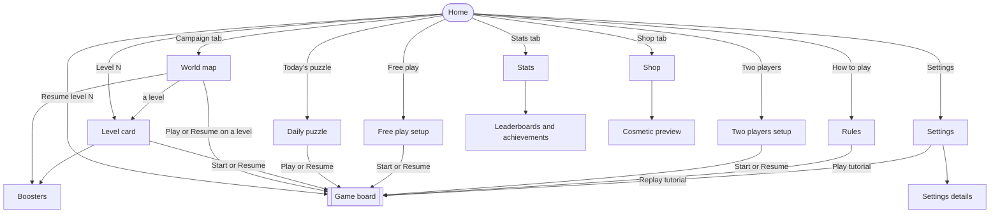
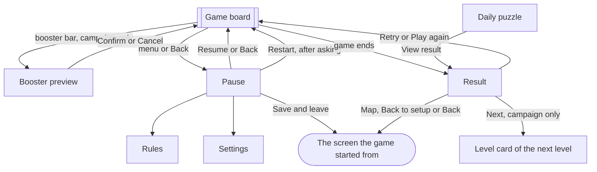
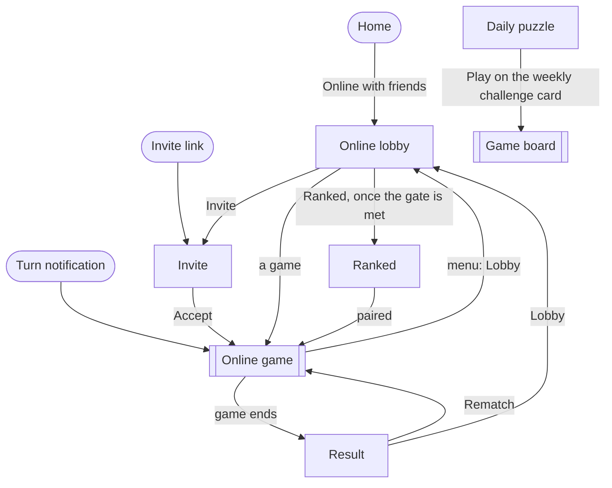

# Screens and flows

This page lists every screen in Pinfold and how a player moves between them. The app's navigation
(A-01) is built from it, the [wireframes](#wireframes) (D-06) draw one frame per screen listed
here, and the prototype (D-10) follows these flows.

Three decisions shape it: no difficulty picker (decision 0003), boosters only in the solo campaign
(decision 0006), and two players on one phone at launch with online play after it (decision 0014).

## Navigation in short

- **Four tabs** sit at the bottom of the main screens: Home, Campaign, Stats and Shop. Each tab has
  an icon and a label. The tabs are hidden on the board, in Pause, on Result and in Settings.
- **Home** shows, from top to bottom: the campaign card ("Level N", or "Resume level N" when a
  campaign game is saved), Today's puzzle, Free play and Two players. How to play and a Settings
  gear are smaller, labelled buttons. After launch, Online with friends joins the list of modes.
- **Two taps.** From Home, a player reaches every feature in at most two taps. Settings details
  are the only exception. The full count is under [The two-tap check](#the-two-tap-check).
- **One board, one result.** Every mode uses the same game board and the same Result screen. Only
  the controls differ: the booster bar appears only in the campaign.

## Flow diagrams

### The app at launch

### Around the board

"The screen the game started from" is Home, the World map at that level, Daily puzzle, the setup
screen of Free play or Two players, or Rules for a tutorial replay.

### After launch

## Screens

One line per screen. "Built in" names the task that builds it.

### At launch

| Screen | Opens from | What the player sees and does | Built in |
| --- | --- | --- | --- |
| Home | App start, Home tab, Back from another tab | Resumes or opens the campaign; opens Today's puzzle, Free play, Two players, How to play and Settings. | A-01 |
| World map | Campaign tab, Map on Result | One scrolling map with a section per world: stars per level, the next level marked, boss levels marked, locked worlds with the stars they need. A level opens its Level card; Play or Resume on a level opens the board. Opens Boosters. | A-02, A-04 |
| Level card | Campaign card on Home, a level on the World map, Next on Result | The mission in one line, a small picture of the board, the computer's face for its strength, its head start, allowed boosters, star targets and any boss rule. Start, Resume or close. | A-03 |
| Boosters | World map, Level card | Wall, Hint, Bomb and Double dot: how many the player has, what each does, how to earn more. Close returns to where it opened. | A-05 |
| Game board | Start, Play, Resume, Retry, Play again | Scores, whose turn, dots left, the last move (A-14), mission progress, special points and any boss countdown. In the campaign, a booster bar. A menu button opens Pause. | A-03, A-05, A-13, A-14 |
| Booster preview | Booster bar on a campaign board | Shows where the chosen booster will act and its effect; Confirm or Cancel. One booster per turn. | A-05 |
| Pause | Menu button or Back on the board | Resume, Rules, Settings, Restart (asks first, where the mode allows it), Save and leave. | A-01 |
| Result | The end of a game, View result on Daily puzzle | Outcome, score, stars and anything newly unlocked. Campaign: Next, Retry, Map. Daily: Retry after a failed attempt, Share. Free play and Two players: Play again, Back to setup. | A-03, A-07, A-08 |
| Tutorial | Levels 1 to 3 of World 1, Play tutorial on Rules, Replay tutorial in Settings | The game board with one-sentence guided steps: placing, linking, capturing. Threat highlights are on. Hints can be skipped. A replay is practice and does not change campaign progress. | A-06 |
| Daily puzzle | Today's puzzle on Home | The date, the mission, the streak, whether a freeze is left this week, and the time to the next puzzle. Play, Resume or View result. | A-07 |
| Free play setup | Free play on Home | Board size and game length, already set to defaults, so Start plays at once. Resume when a game is saved. The computer plays at the strength reached in the campaign. | A-08 |
| Two players setup | Two players on Home | Start a game for two people on one phone, with the pure rules, or Resume one. | A-08 |
| Rules | How to play on Home, Rules in Pause | Placing, capturing, empty rings, the border and how a game ends, with small board pictures. Play tutorial. | A-06 |
| Stats | Stats tab | Games played and won, captures, best capture, longest streak, stars per world, the player's title. Opens Leaderboards and achievements. | A-11 |
| Leaderboards and achievements | Stats | The daily puzzle and total-star leaderboards and the achievements, shown by Google Play Games. Asks to sign in when the player is not. Closing returns to Stats. | O-02 |
| Shop | Shop tab | Themes, piece styles and ring effects; owned items marked. Restore purchases. | C-02 |
| Cosmetic preview | An item in Shop | The item on a sample board, its price or how to earn it, and whether it is owned or in use. Buy or Use. | C-02 |
| Settings | Settings on Home, Settings in Pause | The controls listed under [Settings](#settings). | A-09 |
| Settings details | A row in Settings | Language, privacy (the policy and ad choices), Play Games backup, credits and licences. | A-09, A-10 |
| Developer menu | Hidden; A-01 picks how it opens | The POC's difficulty picker and test-only settings. Not for players, so it is left out of the two-tap check. | A-01 |
| Android screens | An action in the game | Not drawn by us: the share screen, the feedback email, the review prompt (A-12), Play Games sign-in, Google Play purchase, a rewarded ad, the ad consent form. Closing one returns to the screen that opened it. | A-07, A-12, O-02, C-02, C-03 |

### After launch

| Screen | Opens from | What the player sees and does | Built in |
| --- | --- | --- | --- |
| Online lobby | Online with friends on Home | Games grouped as Your turn, Waiting and Finished. Invite a friend or open a game. | O-03 |
| Invite | Invite in the lobby, an invite link | Share an invite link, or see who invited you and accept. An expired or broken link offers the lobby. | O-03 |
| Online game | A game in the lobby, a turn notification | The game board with the pure rules and no boosters. Shows waiting and reconnecting. The menu offers Lobby, Resign, Report and Block. It does not pause the game. | O-03, O-06 |
| Ranked | Ranked in the lobby, once the gate is met | Rating and season; Find a game or Cancel. A found game uses the online game board and Result. | O-07 |
| Weekly challenge | A card on Daily puzzle | The card shows the rule, the end date and the cosmetic reward. Tap it for details, or Play on the card to start. | R-08 |

## Settings

Settings is one scrolling screen. Changes take effect at once and survive a restart. Back returns
to Home, or to Pause when Settings was opened from a game.

- **Sound and vibration:** music volume, sound-effects volume, vibration on or off.
- **Board:** high-contrast pieces, threat highlights.
- **Help and app:** Replay tutorial, Send feedback (an email, A-12), Language (shown once a second
  language ships, A-10), Privacy (the policy and ad choices, C-03), Play Games backup (O-02),
  Credits and licences.
- **After launch:** notifications (O-05), delete my online data (O-06).

## The two-tap check

Taps are counted from Home to the first screen where the feature can be used. For a mode that
plays, the count runs to a board with the default choices. Scrolling is not a tap. Confirmations
(replacing a saved game, signing in, buying, ad consent) are not counted. Settings details and
the developer menu are left out.

| Destination | From Home | Taps |
| --- | --- | --- |
| World map, and the stars a locked world needs | Campaign | 1 |
| A Level card, or why a level is locked | Campaign → the level | 2 |
| The board of any unlocked level | Campaign → Play on the level | 2 |
| The board of the next level | Campaign card → Start | 2 |
| The saved campaign game | Resume level N | 1 |
| Boosters | Campaign → Boosters | 2 |
| Daily puzzle and streak | Today's puzzle | 1 |
| The daily board or today's result | Today's puzzle → Play, Resume or View result | 2 |
| A free play board | Free play → Start or Resume | 2 |
| A two-player board | Two players → Start or Resume | 2 |
| Rules | How to play | 1 |
| Tutorial | How to play → Play tutorial | 2 |
| Stats | Stats | 1 |
| Leaderboards or achievements | Stats → Leaderboards or Achievements | 2 |
| Shop and an item's preview | Shop → the item | 2 |
| Settings | Settings | 1 |
| Online lobby, a game or an invite (after launch) | Online with friends → the game or Invite | 2 |
| Ranked (after launch) | Online with friends → Ranked | 2 |
| Weekly challenge (after launch) | Today's puzzle → Play on the challenge card | 2 |

## First launch

1. The app opens on Home. Once ads ship, players in the EU and the UK first see Google's consent
   form (C-03). No sign-in is needed for anything offline.
2. The campaign card shows Level 1. Daily puzzle, Free play, Two players and How to play are open
   too.
3. Tapping the card opens the Level card for Level 1. Start opens Level 1 with guided steps
   (A-06). Levels 1 to 3 teach placing, linking and capturing, one step at a time, with threat
   highlights on. Level 1 teaches the placement method that A-13 picks.
4. Result shows the stars earned. Next opens the Level card of Level 2. Retry plays Level 1 again.

## Returning player

- **A campaign game is saved.** Home shows "Resume level N". One tap brings back the board, the
  turn, the dots left, the boosters and the tutorial step.
- **No campaign game is saved.** Home shows the next unlocked level. After the last level that
  exists, the card says "View campaign" and opens the World map at the last world visited.
- **Saved games.** Each mode keeps one unfinished game: the campaign, the daily puzzle, free play
  and two players. Starting a different game in the same mode asks before replacing the saved
  one. A saved game in one mode never blocks the others.

## Campaign

- **Win.** Stars and unlocks are saved before Result opens. Result shows the new stars, a newly
  unlocked world and any reward. Next is the main button.
- **Fail or draw.** Result says which goal was missed. Retry is the main button, Map is beside it.
  After the third failure on the same level, Result offers a hint or a booster (A-03). If C-01
  places a rewarded ad here, its offer sits below Retry.
- **Play from the map.** Play on a level skips the Level card. The board then shows the mission
  and any boss rule before the first move, so the player never starts blind. The Level card stays
  one tap away for the details.
- **Boss levels.** The boss rule shows on the Level card and on the board before the first move.
  A countdown to the boss's special turn sits beside the board (G-05).

## Back and interruptions

- Back closes an open preview or Android screen first.
- On the board, Back opens Pause. Back in Pause resumes the game.
- Save and leave in Pause, and Back on Result, return to the screen the game started from (see
  [Around the board](#around-the-board)).
- Back on the Campaign, Stats or Shop tab returns to Home. Back on Home leaves the app.
- Confirmed moves, stars, unlocks and rewards are saved the moment they happen (Q-07). After a
  short interruption the same screen comes back. After the app is closed, it opens on Home with
  Resume.
- Restart always asks before it replaces a board.

## Daily puzzle

- Today's puzzle opens the Daily puzzle screen with Play or Resume. A failed attempt offers Retry
  on Result. After a solve, the button becomes View result.
- The streak allows one free freeze a week (A-07). Share sends the puzzle number and a summary
  without spoilers through Android's share screen.
- The puzzles ship with the app, so the daily puzzle works offline (G-12). A leaderboard score
  that waits for a connection is marked as waiting.
- An attempt belongs to its date. If midnight passes during an attempt, it finishes as that day's
  puzzle, and the Daily puzzle screen then shows the new one.

## Free play and two players

- Both setup screens start a game with one tap on Start; the choices are optional. When a game is
  saved, Resume is the main button.
- Two players on one phone shows whose turn it is with a label and the piece shape (D-04) before
  each move.
- Play again keeps the same setup. How a free play game ends follows X-06.

## Shop and rewarded ads

- The Shop is separate from play. A preview shows the price in local currency, or how to earn the
  item. Owned items can be put to use offline.
- A purchase returns to the same preview and shows whether it is owned, pending, cancelled or
  failed. A failure offers Retry. Restore purchases sits in Shop. If a purchase is refunded, the
  default look comes back.
- A rewarded ad names its reward before the player chooses to watch. Declining, or an ad that
  fails, never blocks play. The reward is given once, after the ad completes. C-01 sets where ads
  appear. Every ad reward can also be earned by playing (decision 0004), and boosters go to the
  campaign's stock.

## Leaderboards at launch

Signing in to Google Play Games is optional. Without it, Stats and every offline mode still work.
The game asks to sign in only where a feature needs it, and closing a Play Games screen returns to
the same place in Stats. Settings shows the Play Games backup.

## Online after launch

- Online games use the pure rules, without boosters (decision 0006).
- An invite link opens Invite. A turn notification opens that game. If sign-in is needed, the
  invite or game continues after it.
- Android's notification permission is asked when the first online game starts (O-05). The lobby
  works with notifications off.
- If the connection drops, the board keeps the last confirmed position and catches up when the
  connection returns.
- A finished game offers Rematch and Lobby. Ranked appears once the player-count gate (X-08) is
  met.

## Decided by other tasks

These tasks change what some screens show:

- **A-13** picks how a dot is placed; the tutorial teaches that method.
- **X-06** decides how a free play game ends.
- **X-11** decides whether Undo becomes a campaign booster, and what happens to undo in free play
  and two players. If it does, Undo joins the booster bar.
- **G-18** decides on timed games. A timed mode would be a new entry on Home.
- **C-01** sets the cosmetics, the prices and where rewarded ads appear.
- **X-08** sets the gate for ranked games.

## Wireframes

The wireframes (D-06) draw every screen above in grey boxes, without colours, fonts or pictures:
[Pinfold wireframes](https://claude.ai/artifact/NpxuGodPYwFGjgB6kpipR4), a Claude design canvas.
Each frame carries the name of its screen in the tables above. The canvas opens only for people the
owner has shared it with.

- **Two phone sizes.** Every frame is drawn at 360 x 800 dp. The screens at launch are drawn again
  at 320 x 568 dp, a small phone. On the small phone, content below the bottom edge scrolls.
- **States.** Some frames show more than one state, picked in the frame's Tweaks: Game board
  (campaign, free play, two players, tutorial, online, booster preview), Result (campaign win,
  campaign fail, daily puzzle, free play), Daily puzzle, Cosmetic preview, Settings details, Invite
  and Ranked.
- **Screens Google draws.** Leaderboards and achievements, and the other Android screens, are drawn
  by Google. Their frame shows only what we draw: the sign-in question over Stats.

The frames follow these layout rules:

- **Touch targets** are at least 48 x 48 dp. Main buttons are 56 dp tall.
- **Thumb reach.** Main buttons sit below the top third of the screen, most of them in the bottom
  third. Only things to read, and Back, menu and close, sit in the top third; Android's Back
  gesture does the same job as those three.
- **The board** takes the largest whole-dp spacing that fits 15 points across the width and in the
  height left between the bars: 24 dp on 360 x 800 (a 360 dp board, edge to edge) and 21 dp on
  320 x 568 (315 dp). It sits low, just above the turn line and the booster bar. Spare height goes
  above it, where the world background shows. Opening a booster preview does not move the board.
- **Bars.** 24 dp at the top for the status bar. The tabs are 64 dp, plus 16 dp for the gesture
  bar. With three-button navigation the bottom bar is 48 dp, and the board takes the next smaller
  spacing.
- **Sheets.** The Level card, Pause and the sign-in question rise from the bottom, so their buttons
  stay near the thumb.

## How to check the flows

On the prototype (D-10), and later on the app:

- **Find a mode.** On a fresh install, ask a player to start Level 1, open the daily puzzle and
  start a two-player game. With saved progress, ask them to resume, then play a named level in
  another world. Count every tap.
- **Know what to do next.** Try a win, a draw, three failures, a boss level and an unlock. Next,
  Retry and Map should be easy to find; a locked world shows what it needs; the boss rule shows on
  both ways into a level.
- **Leave and come back.** Try Back everywhere, a phone call mid-turn, a cold start, and midnight
  passing offline. The right board, date and map position come back. Close the Play Games sign-in
  and cancel a purchase and an ad.
- **Reach and read.** Buttons and controls are at least 48 x 48 dp. Try large text and TalkBack.
  Players and states differ by shape and text, not by colour alone.

## Sources

- [Android navigation patterns](https://developer.android.com/design/ui/mobile/guides/layout-and-content/layout-and-nav-patterns):
  labelled tabs for the main destinations.
- [Android predictive Back](https://developer.android.com/guide/navigation/custom-back/predictive-back-gesture)
  and [saving screen state in Compose](https://developer.android.com/develop/ui/compose/state-saving):
  predictable Back and coming back after an interruption.
- [Compose accessibility defaults](https://developer.android.com/develop/ui/compose/accessibility/api-defaults):
  touch targets and screen-reader labels.
- [Android settings design](https://developer.android.com/design/ui/mobile/guides/patterns/settings)
  and [per-app languages](https://developer.android.com/guide/topics/resources/app-languages):
  the Settings layout and the language choice.
- [Apple: onboarding for games](https://developer.apple.com/app-store/onboarding-for-games/):
  teaching by playing.
- [Play Billing](https://developer.android.com/google/play/billing/integrate),
  [AdMob rewarded ads](https://developers.google.com/admob/android/rewarded),
  [AdMob privacy choices](https://developers.google.com/admob/android/privacy) and
  [Play Games leaderboards](https://developer.android.com/games/pgs/android/leaderboards):
  purchases, ads, consent and leaderboards.
- The design references ([`references.md`](references.md)): the world map, level card and result
  screens of other puzzle games.
