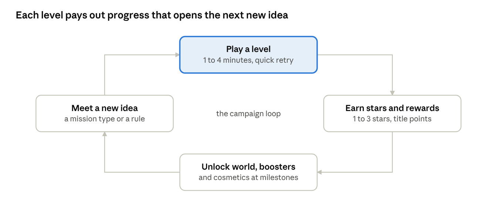

# Dots: game design investigation

> **Copy of a Claude Doc.** The working copy is the [investigation doc](https://claude.ai/artifact/DyiSkrrx3hwARfRpyxNGRP); this file is a snapshot of it, exported on 2026-11-05 and refreshed whenever the doc changes. Status values appear as plain text here.

Nov 5, 2026 · @Pavel

The paper game becomes exciting on a phone through three things: **varied goals** (missions and bosses instead of the same game every time), **a capture that feels great** (animation, sound, vibration), and **reasons to return** (worlds, stars, a daily puzzle). All six of your directions fit, each in a clear role; the decisions are in section 10.

**Agreed defaults** (from your answers): free to play with cosmetic purchases and optional rewarded ads, no paid advantages; casual adults, playful but not childish; boosters only in the solo campaign; English first, then Russian, Ukrainian and Polish; free tools plus the $25 Play account and one month of paid music; Android first; the POC test week continues. Being copied is acceptable; being accused of using others' work is not, so every asset gets a recorded, clean source.

**Recommended direction in brief:**

- **Campaign:** worlds of 15 to 20 levels, each world teaching one new idea; difficulty from head-start dots, board shapes and missions; announced boss levels with double moves.
- **Boosters:** earned, never sold; the computer never uses them; every level passable without them.
- **Look:** a Notebook launch theme (ink on squared paper) that honours the paper game; simple piece shapes, characters only around the board.
- **Multiplayer:** same phone now, online with friends turn by turn next, ranked only once there are players.
- **Sound:** our own recorded pen-and-paper effects, music from a paid Suno month.
- **Name:** our own name; "Dots" is a registered game trademark of another company.

Search results supplied the facts about licences and trademarks. This session could not open the source pages themselves, so the Sources list marks them for checking before any money or launch decision.

## 1. Playing the computer

Difficulty should come mostly from the level's situation (board shape, head start, mission), not from a dumber or a cheating computer. All four of your ideas fit, each in its own role.

| Idea | What the player feels | Risk | Recommendation |
| --- | --- | --- | --- |
| Computer gets less "stupid" level by level | The opponent grows up with me | Our tests found only three really different strengths (Easy, Normal, Hard). Random blunders feel fake. | Yes, as a hidden knob. Its mistakes should look human: missing a threat far away, not a random move. |
| Missions ("capture 5 dots in 3 moves") | A puzzle with a clear goal; quick win or quick retry | A puzzle needs exactly one clever answer, or it is too easy or impossible | Yes, the core of the campaign and of a daily puzzle. The engine's search can check every puzzle has a solution before it ships. |
| Computer places two dots at once | A boss fight | Constant double moves make defence impossible, so it feels like cheating | Only on boss levels, and announced: "every 4th turn the boss moves twice", with a counter on screen. |
| Computer starts with dots already placed | It is ahead, I must catch up | Too many dots and the board is lost before move one | Yes, the main difficulty dial (it already works in the prototype's 8 levels). |

**Mission types worth testing** (each is a different way of thinking, so levels don't feel like the same game 60 times):

- **Capture N dots in M moves:** pure attack puzzle.
- **Survive:** lose no dot for 10 moves while the computer attacks.
- **Rescue:** a group of yours is half-surrounded; save it.
- **Target:** capture one marked dot (a "king" or a "treasure").
- **Win by a margin:** classic game, but 3 stars only for winning by 5 or more.
- **Few dots:** win with only 8 dots against the computer's 15.

**Level ingredients**, mixed per level: board size and shape (holes, walls, odd outlines), the opening, the computer's head start, its strength, a mission, and at most one special rule (double move, bonus cells, blocked cells).

What good puzzle games do: levels of 1 to 4 minutes, a quick retry, a saw-tooth difficulty curve (a hard level, then two easier ones), and 1 to 3 stars so a passed level can still be replayed. A time limit per move is stressful on a phone; keep it out of the campaign and offer it only as an optional quick mode.

## 2. Special features (boosters)

Boosters belong in the solo campaign only, earned by playing and never sold, so two-player and ranked games stay pure skill (agreed default 3). They also make the campaign feel different from the paper game.

| Booster | What it does | Strength | Watch out for |
| --- | --- | --- | --- |
| Bomb | Removes the computer's dots in a small area (for example a plus shape of 5 points) | Very high | Must not touch captured areas, or it undoes captures. Defined in the engine, shown before use. |
| Double dot | Place 2 dots in one turn | High | Lets the player close a ring the computer could not block. Limit to 1 per level. |
| Recolour | One enemy dot becomes yours | Very high | It can complete a ring and also break one. Probably too strong except as a level's special rule. |
| Shield | One of your groups cannot be captured for 5 turns | Medium | Clear timer on screen. |
| Wall | Mark one empty point that nobody can use | Low to medium | Easy to understand; good first booster. |
| Scout | Shows the threat highlight for 3 turns, with closing points | Low | Reuses the POC's threat feature as a reward. |
| Hint | The computer suggests your best move | Low | Uses the existing search. Good for stuck players. |

**How boosters are given:**

- A few for free in the tutorial, so players learn each one.
- As rewards: stars, daily puzzle, chests every 10 levels.
- Optionally one free booster for watching a rewarded ad (default 1), never as a purchase.
- Some levels hand out a fixed booster as part of the puzzle ("you have one bomb: capture 6 dots").

**Rules that keep it fair:** at most one booster per turn, a visible count of what is left, the computer never uses boosters (except a boss with its announced rule), and every level can be passed without any booster. The last point also keeps the game fair for players who never watch ads.

Why "never sold": pay-to-win is a frequent complaint in reviews of puzzle and strategy games, and in a skill game it makes a win feel bought. Random paid rewards (loot boxes) also bring extra Google Play rules, such as showing the odds. Cosmetics carry neither problem.

## 3. Look and animation

The board limits everything: on a 15x15 board a phone gives each point about 4 to 5 mm. A goblin or an orc that small is a coloured blob, so **pieces must be simple shapes, and characters live around the board**: opponent portraits, boss faces, the level map.

**Theme directions** (one launch theme, the others as unlockable cosmetics):

| Theme | Pieces | Feel | Art cost |
| --- | --- | --- | --- |
| Notebook (recommended launch theme) | Ink dots on squared paper; rings drawn like a pen stroke | Honours the paper game; nostalgic for players who know it; unusual in the store | Low |
| Night sky | Stars against comets; rings become constellations | Calm, elegant | Low to medium |
| Garden | Ladybugs against bees, as round tokens | Friendly, casual | Medium |
| Neon arcade | Glowing discs; captures burst in light | Energetic | Low (mostly drawn in code) |
| Goblins against orcs | Faction shields on the board, characters in portraits | Story-driven campaign | High: characters need many poses and animations |

**The moments that need animation** (this is where the paper game becomes exciting):

1. **Placing a dot:** drops in with a small bounce and a soft tick (about 0.2 s). The input never waits for it.
2. **Chains forming:** a thin line grows between new neighbours, so the player sees the structure being built.
3. **Capture (the big moment):** the ring is traced around the area like a pen stroke, the area fills with colour, the captured dots shrink or turn to "prisoners", and +N flies to the score (about 1 s, skippable by the next tap). A big capture gets a stronger version: a short shake, a burst of light, a louder sound.
4. **Threat:** a group in danger pulses slowly; the point that would close the ring glows.
5. **Boosters:** each has its own short effect (bomb blast, shield bubble, double-dot sparkle).
6. **End of game:** the captured areas flash in turn while the score counts up, then stars appear.

**Background:** behind and around the board, never under the points. The board itself stays calm and low in contrast, or dots get lost.

**Colour-blind safety:** about 1 in 12 men see colours differently. Red against blue is the safest common pair, but the two sides should also differ by shape (round against diamond, or filled against ring), with a high-contrast option in settings.

**Feel ("juice"):** a light vibration on placing, a stronger one on capture, and an option to turn vibration off. These cost little and add a lot.

Most board animations can be drawn in code, which needs no art files and raises no ownership questions. Art is needed for backgrounds, piece styles per theme, portraits, the level map, icons and the logo.

## 4. Levels and progression

Change the background per **world** of about 15 to 20 levels, not per level. Each world also brings one new idea (a mission type, a board shape, a booster), so the player always has something new to learn. Every level changing its look costs a lot of art and makes the game feel restless.

**A suggested campaign shape** (sizes to be tuned by play tests):

| World | Look | New idea it teaches | Levels |
| --- | --- | --- | --- |
| 1 Notebook | Squared paper | The rules, step by step; first capture missions | 15 |
| 2 Garden | Grass, flowers | Survive and rescue missions; the wall booster | 20 |
| 3 Night sky | Stars | Odd board shapes; bomb and double dot | 20 |
| 4 Sea | Islands | Blocked and bonus points; the first boss | 20 |
| Later worlds | Seasonal | One new rule each | 20 each |

About 75 levels are enough for a launch; good puzzle games then add a world every month or two.

**Before a level**, one card: the mission in one line, a small picture of the board, the computer's head start and strength (shown as a face, not a number), the boosters allowed, and what earns 1, 2 or 3 stars. **After a level:** stars, the score, "next" and "retry" side by side.

**Progression, three layers:**

1. **Stars** unlock the next world (for example 40 stars for world 3). A hard level can be skipped by earning stars elsewhere.
2. **A player title** from points earned in every mode: Novice, Apprentice, Strategist, Master, Grandmaster. It costs nothing and gives a sense of growth.
3. **Rewards:** boosters, and cosmetics (themes, dot styles, ring effects) at milestones.

The daily puzzle and the streak run beside this loop, so a player who is stuck in the campaign still has a reason to open the game.

**Reasons to come back each day** (these matter most for H1, "people come back"):

- **Daily puzzle:** the same puzzle for everyone, with a result that can be shared as a small grid of symbols without spoilers. Wordle made this pattern famous.
- **Streak** of days played, with one free "freeze" a week so a missed day does not destroy it.
- **Weekly challenge:** a special board or rule for a week, with a cosmetic reward.

Difficulty comes only from the levels; there is no difficulty picker (decision 0003). A player stuck 3 times on one level gets offered a hint or a booster.

## 5. Multiplayer

Yes to multiplayer, but in steps. Launch with same-phone play, then add turn-by-turn online games with friends, and add ranked matchmaking only once enough people play. A new, niche game rarely has enough players online at the same moment for instant matches.

| Mode | How it plays | Needs | Fits Dots? |
| --- | --- | --- | --- |
| Same phone | Pass the phone | Nothing (done in the POC) | Yes, at launch |
| Online with friends, turn by turn | Invite by link; each player moves when they like; a notification says "your turn" | A small server, notifications | Yes. A 66-move game over a day suits the paper game's calm pace. |
| Real-time online | Both players live, a clock per move | Players online at the same time; a real-time server | Later. It fails when only a few people are waiting. |
| Ranked matchmaking | Strangers matched by rating (Elo or Glicko) | Enough players, rating, cheat protection | Only after the game has a real player base |
| Leaderboards | Daily puzzle score, stars, titles | Google Play Games leaderboards, or a small server | Yes, early. It gives competition without needing opponents. |

**Cheating:** a rated game must be checked on a server, because a modified app could make illegal moves. The engine is plain Kotlin without Android code, so the same rules can run on a server. A player who gets moves from a stronger program cannot be fully stopped; casual games accept this, ranked play limits it with reports and unusual-strength checks.

**Bots in disguise:** some games fill empty queues with bots presented as people. It hurts trust once noticed. If bots fill gaps, label them.

**Cost:** Firebase's free Spark plan covers a turn-by-turn game for a small audience (about 50,000 reads and 20,000 writes a day in Firestore). Server-side move checking needs Cloud Functions, which require the pay-as-you-go Blaze plan; it has a free monthly allowance. Google Play Games Services provides sign-in, leaderboards and achievements. I found no fee for it, but could not open Google's page to confirm. The technical choice belongs to the architecture discussion.

## 6. Music and sound

Sound effects matter more than music here: many mobile players mute music, but a satisfying "click" and capture sound is a big part of the feel. The game must still work fully on mute (the vibration and animations carry the moment).

**What to make:**

| Kind | Items | Length |
| --- | --- | --- |
| Board sounds | Select, place, chain link, small capture, big capture, area fill, score tick, threat warning | 0.1 to 1 s each, about 10 sounds per theme |
| Boosters | One per booster | 0.5 to 1.5 s |
| Moments | Star 1, 2 and 3, level won, level lost, world unlocked, daily streak | 1 to 4 s |
| Interface | Button, open, close, error | under 0.3 s |
| Music | Menu theme, one calm loop per world, a short boss theme | 1 to 3 min loops that repeat without a seam |

Music should be calm, because players are thinking. Volume sliders for music and effects separately, and the game follows the phone's silent mode.

**Where it comes from, safest first:**

1. **Recorded by us:** pen taps and strokes on paper, a marker on a whiteboard, pebbles. Unique, fully ours, and perfect for the Notebook theme. Free tools: Audacity to edit, a phone to record.
2. **Generated by us:** sfxr or jsfxr make retro sounds from sliders; the result is ours.
3. **CC0 sound libraries:** [Kenney](https://kenney.nl/support)'s packs are public domain (CC0), commercial use allowed, no credit needed. On Freesound, take only sounds marked CC0 and save each sound's page link; skip anything "non-commercial".
4. **Suno for music:** only on a paid plan. According to Suno's help pages (seen in search results, not opened from here), songs made on the free plan stay Suno's and are for non-commercial use with credit to Suno. Songs made while on Pro or Premier carry commercial rights that last after cancelling. Upgrading later does not cover earlier free songs. So: subscribe for the month the music is made, then cancel.
5. **A composer:** a person writes the world themes with a written transfer of rights. This costs money but gives the strongest ownership and a unique sound.

**The risk you named (someone claims we used theirs):** AI music can, by chance, sound close to an existing song, and YouTube's Content ID can then flag videos of the game. To lower it: keep every Suno prompt and output, listen for familiar melodies, prefer instrumental and ambient styles over pop, and test each track with a song-recognition app before release. Sound effects from options 1 to 3 carry almost no such risk.

## 7. Name and brand

We need our own name. "Dots" as the app's name is risky: "DOTS" and "TWO DOTS" are US trademarks for mobile games, filed by PlayDots, Inc. (the makers of *Dots* and *Two Dots*, a well-known puzzle series), and one DOTS registration for game software is listed under Take-Two Interactive, which bought PlayDots. That owner could ask Google to remove an app called "Dots".

Those facts come from trademark search results ([Justia](https://trademarks.justia.com/owners/playdots-inc-2852989), [Markinton](https://markinton.com/trademark/dots-86540534)); the listings disagree on which registrations are still live, and I could not open them from here. Either way, the risk is real enough to avoid the name.

**What stays safe:** using "dots" as an ordinary word to describe the game. A store title like "\<OurName>: the dots and rings game" and a description that explains the classic paper game are fine, because no one can own the description of a game's rules.

**What a good name needs:**

- Distinctive (an invented or unusual word, not "Dots", "Dot Game" or "Dots Battle")
- Short, easy to say in English, Russian, Ukrainian and Polish, with no bad meaning in any of them
- Free on Google Play, as a domain, and as a social handle
- No similar trademark for games (classes 9, 28 and 41) in the US, the EU and the target countries

**Free checks:** a Google Play search, the [USPTO trademark search](https://tmsearch.uspto.gov), [EUIPO eSearch](https://euipo.europa.eu/eSearch), the [WIPO Global Brand Database](https://branddb.wipo.int), and a domain registrar. Registering our own trademark is optional and costs money (roughly a few hundred euros or dollars per country and class); it can wait until the game shows promise.

**Directions to brainstorm** (only examples, none checked yet): words about enclosing (Encircle, Corral, Lasso), about the paper origin (Inkfield, Margin), or an invented word with a soft sound. Next step: I list about 20 candidates, check them, and you pick from the ones that pass.

## 8. Assets, tools and ownership

Your goal is that nobody can claim we used their work; being copied is acceptable. That calls for **clean sources and a record for every asset**, not for copyright registration.

**Tools, all free or already owned:**

| Need | Tool | Plan and cost | Who owns the result |
| --- | --- | --- | --- |
| Concept art, backgrounds, portraits | ChatGPT (image generation) | Your Pro plan | You. OpenAI's terms assign their rights in outputs to the user, and note that other users may get similar outputs. |
| Cleaning up, piece shapes, icons | Krita, Inkscape, GIMP | Free, open source | You (the program's licence does not cover what you draw) |
| Screen mock-ups, the visual canvas | Figma | Free plan | You |
| Fonts | Google Fonts (Open Font License) | Free | The font's authors; the licence allows shipping it in an app. Keep the licence file. |
| Interface icons | Material Symbols (Apache 2.0) | Free | Google; the licence allows commercial use with the licence notice |
| Sound effects | Our recordings, sfxr, Kenney (CC0), Freesound (CC0 only) | Free | Ours, or public domain |
| Music | Suno | Pro, one month (about $10, approximate) | Commercial rights for songs made while subscribed |
| Store video | Phone screen recording, Shotcut or DaVinci Resolve | Free | You |
| Store account | Google Play Console | $25 once | Needed to publish |

**Rules for AI images and music:**

- Never name a living artist, a studio, a game or a brand in a prompt ("in the style of ..."). Describe the look in plain words instead.
- Never upload images we do not own as references.
- Check each output for logos, letters, signatures or a known character; reject any that has them.
- For key art (logo, icon, main backgrounds), run a reverse image search (Google Lens, TinEye; both free) before use.
- A person finishes the logo and app icon, so they are clean and consistent.

**The asset register:** one file in the repository with a row per asset: file name, what it is, tool and plan used, date, prompt or source link, licence, who made it, what was changed. Kept from the first asset on, it answers any claim in minutes.

**Never use:** images from search results or Pinterest, assets from other games, music from YouTube or streaming, fonts from "free font" sites without a clear licence, anything marked "personal use only" or "non-commercial".

**Copyright, briefly:** the US Copyright Office's report of January 2025 says purely AI-generated material cannot be copyrighted, while human selection, arrangement and real edits can be. That matches your choice: AI art may be copied by others, and our register still proves where it came from.

## 9. Also needed

These are easy to forget and several are required by Google Play. None needs paid tools.

| Topic | What to do | Why |
| --- | --- | --- |
| Tutorial | The first 3 to 5 levels teach by doing: place a dot, build a chain, close a ring, capture. One sentence per step, never a wall of text. | People learn a game faster by playing than by reading; H2 in the POC measures how well the current rules screen works. |
| Sharing | Daily puzzle result as a spoiler-free emoji grid; later, a short clip of a big capture | Free word of mouth, which a niche game depends on |
| Offline | Everything except online games works without internet | Players on the underground or a plane |
| Store listing | Icon, feature graphic, phone screenshots, short and full description, optional video, per language | Required to publish; the first screenshot sells the game |
| Closed test before launch | New personal Play accounts must run a closed test with a minimum number of testers for about two weeks before going public (12 testers for 14 days at the last rule change I know of; verify in Play Console) | Required; the POC testers can be this group |
| Age rating | Fill in the IARC questionnaire in Play Console (free) | Required. Aim at teens and adults, not "Designed for Families", which has strict ad rules. |
| Privacy | A privacy policy page (a free GitHub Pages site works) and the Data safety form | Required; must match what the app collects |
| Ads and consent | If rewarded ads come: Google AdMob, plus Google's consent message for players in the EU and UK | GDPR consent is required for personalised ads there |
| Analytics | Keep the POC's game log idea, or Firebase Analytics (free); declare it in Data safety | To see where players get stuck and leave |
| Accessibility | Shape as well as colour, text scaling, screen reader labels, vibration toggle | Wider audience, better reviews |
| Low-end phones | Test on an old, cheap Android phone; animations drop gracefully | Most of the target markets use mid- and low-end phones |
| Languages | Text kept out of the code (already so), plural forms per language | Russian, Ukrainian and Polish plurals differ from English |
| Support | A contact email shown in the store | Required, and answers reviews |

## 10. Decisions and next steps

**Decisions, all recommendations accepted on 2026-11-05 and carried into the full plan**:

| # | Decision | Recommendation | Alternatives |
| --- | --- | --- | --- |
| 1 | Launch theme | Notebook: ink on squared paper | Night sky; Neon; goblins against orcs (costly) |
| 2 | First boosters | Wall, Hint, Bomb, Double dot | Add Shield and Recolour later as level rules |
| 3 | Name | Our own invented name; I prepare and check about 20 candidates | Keep "Dots" (not advised, section 7) |
| 4 | Music | Suno Pro for one month, plus our own recorded sound effects | A composer for the world themes |
| 5 | Multiplayer order | Same phone, then online with friends, ranked only later | Online at launch (more work, few players at first) |
| 6 | Launch size | About 75 levels in 4 worlds, plus a daily puzzle | Fewer levels, more frequent updates |

**Next steps, all without code:**

- [ ] Name: 20 candidates checked against the store, trademarks and domains
- [ ] Mood board: 3 theme directions as images made with ChatGPT under the prompt rules above; you pick one
- [ ] Canvas: still pictures of the game screen, level map, level card and a capture moment in the chosen theme
- [ ] World 1 on paper: 15 levels with their missions; the engine checks every puzzle can be solved
- [ ] Sound list and the first pen-on-paper recordings
- [ ] Asset register file started in the repository
- [ ] Keep the POC test week going: if testers do not come back, levels and missions are the first fix to try

After your decisions, the parked [full plan](https://claude.ai/artifact/9GaGRbXg9qwJsYMswwE7ZF) gets re-written around them, and the technical architecture is discussed then.

## Sources

Seen in web search results on 2026-11-05. The pages themselves could not be opened from this session, so check each one before relying on it.

- Suno, [Does Suno own the music I make?](https://help.suno.com/en/articles/2416769) (free plan against Pro and Premier rights)
- PlayDots, Inc. trademarks: [Justia owner listing](https://trademarks.justia.com/owners/playdots-inc-2852989), [Markinton, DOTS 86540534](https://markinton.com/trademark/dots-86540534)
- OpenAI, [Terms of Use](https://openai.com/policies/terms-of-use/) (ownership of outputs)
- US Copyright Office, [Copyright and AI, Part 2: Copyrightability](https://www.copyright.gov/ai/Copyright-and-Artificial-Intelligence-Part-2-Copyrightability-Report.pdf) (January 2025)
- Fenwick, [Google Play now requires disclosure of loot box odds](https://www.fenwick.com/insights/publications/google-play-now-requires-disclosure-of-loot-box-odds)
- Firebase, [pricing](https://firebase.google.com/pricing) (Spark and Blaze plans)
- Kenney, [support and licence](https://kenney.nl/support) (CC0 assets)
- Earlier project work: [POC charter](https://github.com/Pavelya/dots/blob/claude/gifted-tesla-dmmchd/docs/poc/README.md) and the variant benchmark in the repository README
