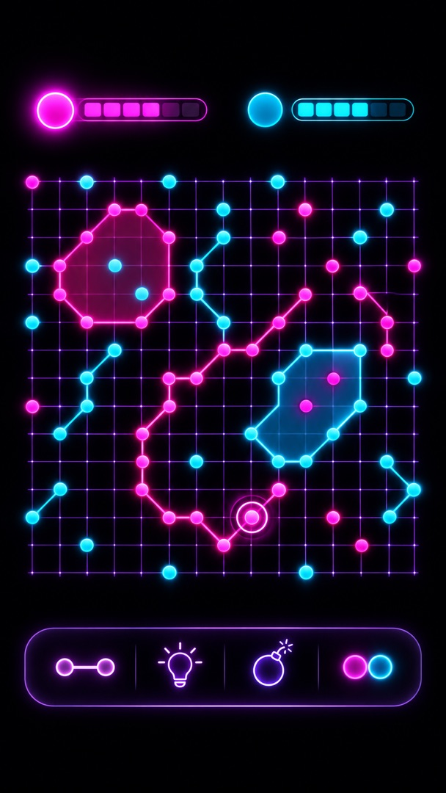
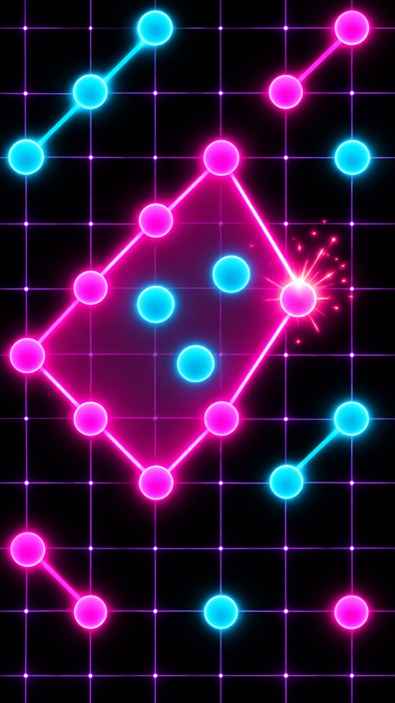
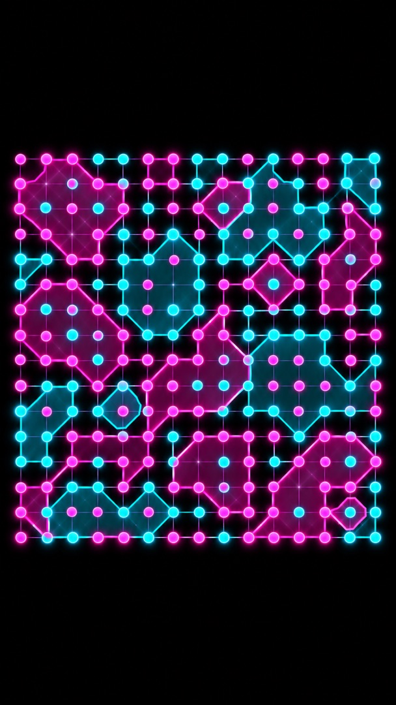
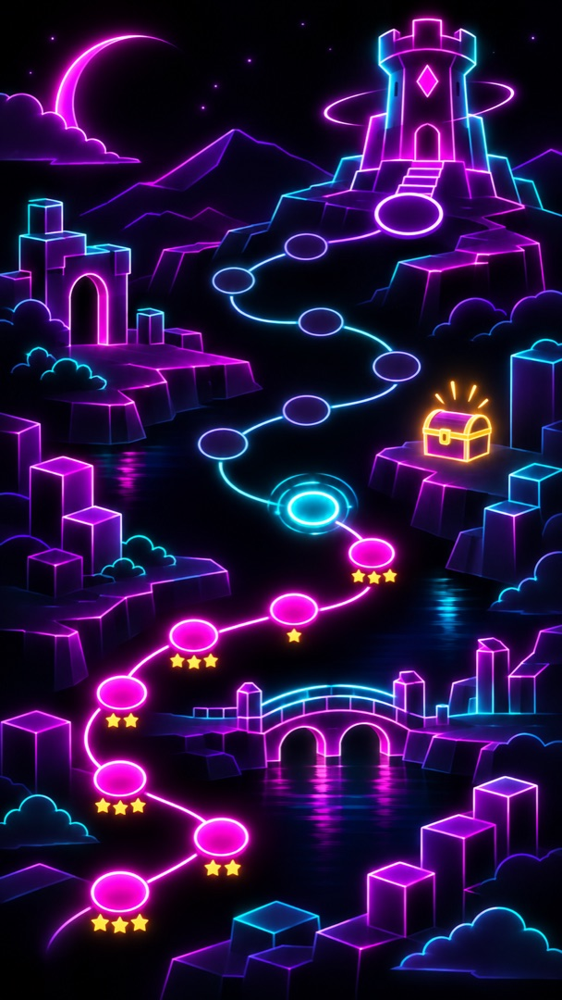
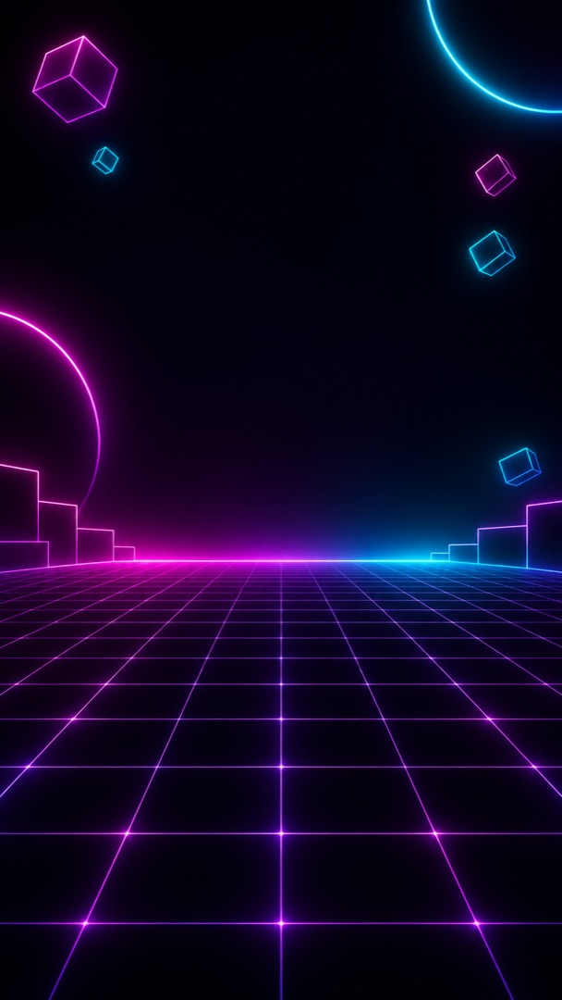
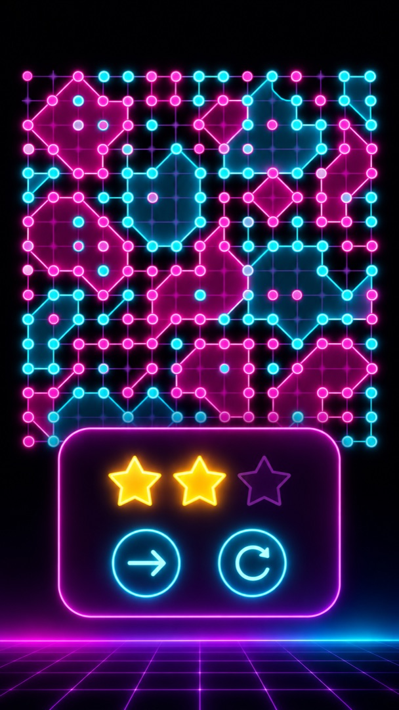
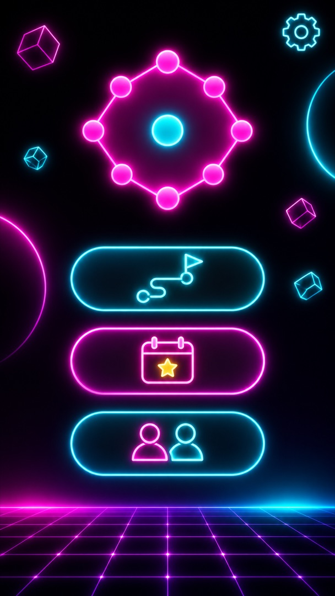
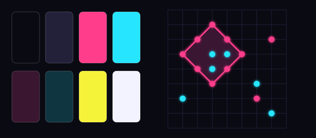

# Mood board: Neon arcade

Light on a dark screen. Magenta and cyan discs glow, rings are bright tubes, and a capture bursts
with sparks. Most of it could be drawn in code.

Part of the [mood boards](README.md). Pictures 1 to 7 come from the prompts below, pasted into
ChatGPT exactly as written. Picture 8 is drawn in code.

## 1. The board in play



Prompt:

```text
Tall portrait image, shaped like a phone screen. A mobile game screen, seen straight on, flat and clean. The look is glowing neon on a near-black screen: a thin dark-violet grid; pieces are small glowing discs, hot magenta for one player and electric cyan for the other; lines are bright glowing tubes with a soft bloom of light. Energetic, bold and playful, with high contrast. It shows a two-player board game: players take turns placing pieces on the crossings of the grid lines. When one player's pieces form a closed loop around the other player's pieces, the loop is drawn as an outline and the area inside is lightly shaded in the capturing player's colour; the surrounded pieces stay visible inside. The board fills the middle of the screen: a square grid of about 15 by 15 thin lines with around 40 discs placed, two small captured areas, and the most recent disc marked with a small pulsing ring around it. Above the board, a magenta disc and a cyan disc with short glowing bars for each player's score; the player whose turn it is glows brighter. Below the board, a slim bar with four simple neon icons: a short wall, a light bulb, a round bomb and two discs side by side. No text, letters, numbers, logos or signatures anywhere in the image.
```

## 2. A capture



Prompt:

```text
Tall portrait image, shaped like a phone screen. A close-up of part of a mobile game board, seen straight on. The look is glowing neon on a near-black screen: a thin dark-violet grid; pieces are small glowing discs, hot magenta for one player and electric cyan for the other; lines are bright glowing tubes with a soft bloom of light. Energetic, bold and playful, with high contrast. It shows a two-player board game: players take turns placing pieces on the crossings of the grid lines. When one player's pieces form a closed loop around the other player's pieces, the loop is drawn as an outline and the area inside is lightly shaded in the capturing player's colour; the surrounded pieces stay visible inside. The moment of a capture: a magenta glowing tube is just closing a diagonal loop of magenta discs around three cyan discs, with a burst of small sparks where it closes. Inside the loop, a faint magenta glow fills the area. The three cyan discs stay clearly visible inside. A few other magenta and cyan discs are scattered around. No text, letters, numbers, logos or signatures anywhere in the image.
```

## 3. A crowded late game



Prompt:

```text
Tall portrait image, shaped like a phone screen. A mobile game screen, seen straight on, flat and clean. The look is glowing neon on a near-black screen: a thin dark-violet grid; pieces are small glowing discs, hot magenta for one player and electric cyan for the other; lines are bright glowing tubes with a soft bloom of light. Energetic, bold and playful, with high contrast. It shows a two-player board game: players take turns placing pieces on the crossings of the grid lines. When one player's pieces form a closed loop around the other player's pieces, the loop is drawn as an outline and the area inside is lightly shaded in the capturing player's colour; the surrounded pieces stay visible inside. The whole board late in a game: the grid of about 15 by 15 thin lines is crowded with about 150 magenta and cyan discs and many captured areas of both colours, some large and irregular with narrow necks, some tiny pockets around a single disc. Every disc is still easy to see: the area glow is faint and the tubes are crisp. No text, letters, numbers, logos or signatures anywhere in the image.
```

## 4. The world map



Prompt:

```text
Tall portrait image, shaped like a phone screen. A mobile game world map, seen from above, in neon light on a near-black background. A winding glowing path of about twelve round level stops runs through a landscape of simple glowing outlines: blocks, towers, a bridge over dark water. Finished stops glow magenta and carry one to three tiny yellow stars; the next stop pulses cyan; later stops are dim outlines. A bigger stop near the top is a tall glowing tower for the boss level, and a small glowing chest sits beside the path. Energetic, bold and playful. No text, letters, numbers, logos or signatures anywhere in the image.
```

## 5. A world background



Prompt:

```text
Tall portrait image, shaped like a phone screen. A background for a mobile game menu: near-black, with a faint perspective grid of violet lines fading toward a horizon, a soft magenta and cyan glow along the horizon, and a few floating geometric shapes in thin neon outlines. The centre stays mostly empty and dark. No text, letters, numbers, logos or signatures anywhere in the image.
```

## 6. A won level



Prompt:

```text
Tall portrait image, shaped like a phone screen. A mobile game screen after a won level, seen straight on, flat and clean. The look is glowing neon on a near-black screen: a thin dark-violet grid; pieces are small glowing discs, hot magenta for one player and electric cyan for the other; lines are bright glowing tubes with a soft bloom of light. Energetic, bold and playful, with high contrast. The finished board stays visible underneath, slightly dimmed: a grid of about 15 by 15 thin lines with magenta and cyan discs and several glowing captured areas. Over its lower half, a small dark card with a glowing magenta border shows three stars, two lit bright yellow and one dim outline only, and below them two round glowing buttons with simple icons: an arrow pointing right and a circular arrow. No text, letters, numbers, logos or signatures anywhere in the image.
```

## 7. The home screen



Prompt:

```text
Tall portrait image, shaped like a phone screen. A mobile game home screen, seen straight on, flat and clean. The look is glowing neon on a near-black screen: a thin dark-violet grid; pieces are small glowing discs, hot magenta for one player and electric cyan for the other; lines are bright glowing tubes with a soft bloom of light. Energetic, bold and playful, with high contrast. In the upper part, a large emblem: a glowing magenta ring closing around a single cyan disc. Below it, three large rounded buttons in glowing neon outline, one above the other, each with one simple icon: a winding path with a flag, a calendar page with a star, and two small figures side by side. A small gear icon in one corner. No text, letters, numbers, logos or signatures anywhere in the image.
```

## 8. Colours and type



| Role | Colour |
| --- | --- |
| Screen | `#0A0A12` |
| Grid | `#23203A` |
| Magenta | `#FF3D8B` |
| Cyan | `#26E5FF` |
| Magenta glow (captured area) | `#3A1630` |
| Cyan glow (captured area) | `#0E3540` |
| Accent yellow | `#F5F23A` |
| White light (text) | `#F3F3FF` |

Fonts (Google Fonts, Open Font License):

- [Orbitron](https://fonts.google.com/specimen/Orbitron): headings, wide and geometric
- [Exo 2](https://fonts.google.com/specimen/Exo+2): everything else, technical but readable

The colours and fonts are a first proposal. D-03 sets the final ones and checks the contrast.
