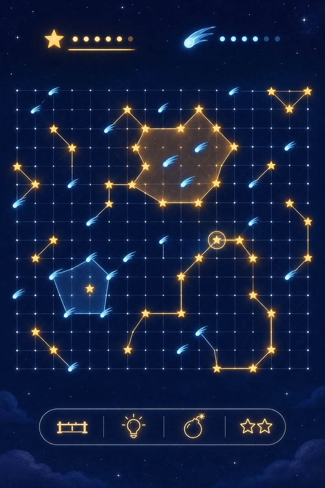
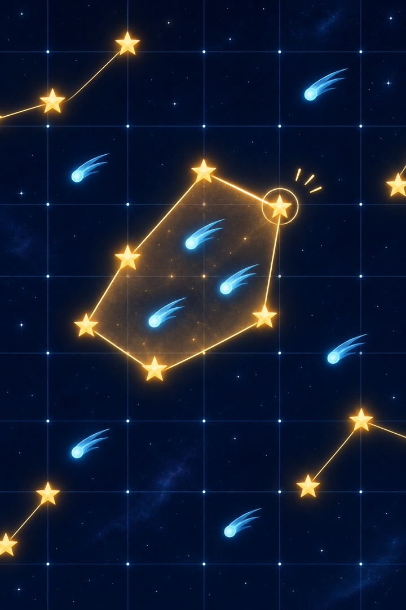
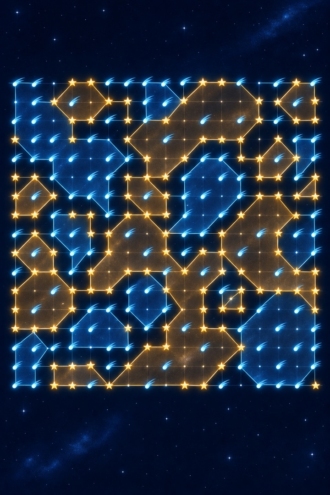
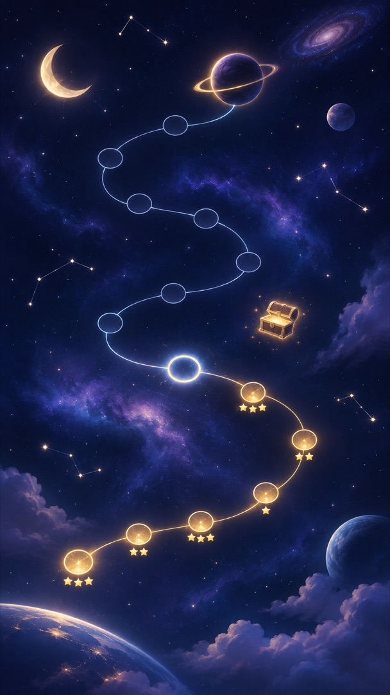
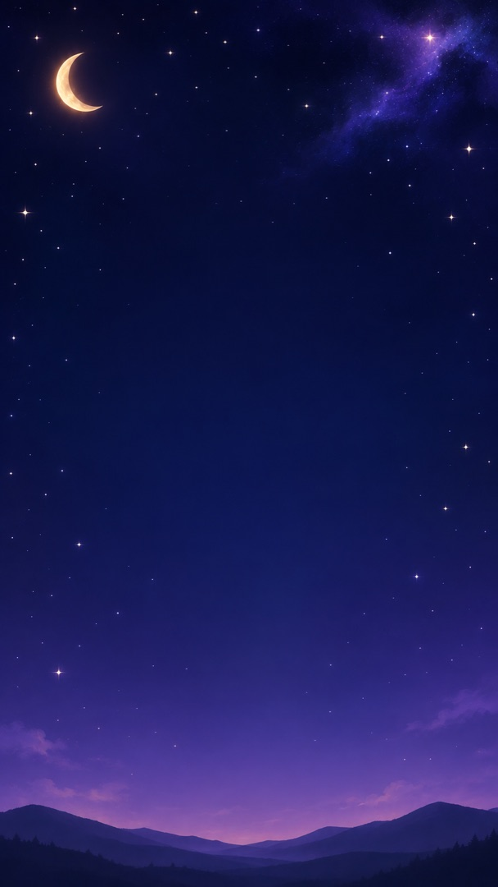
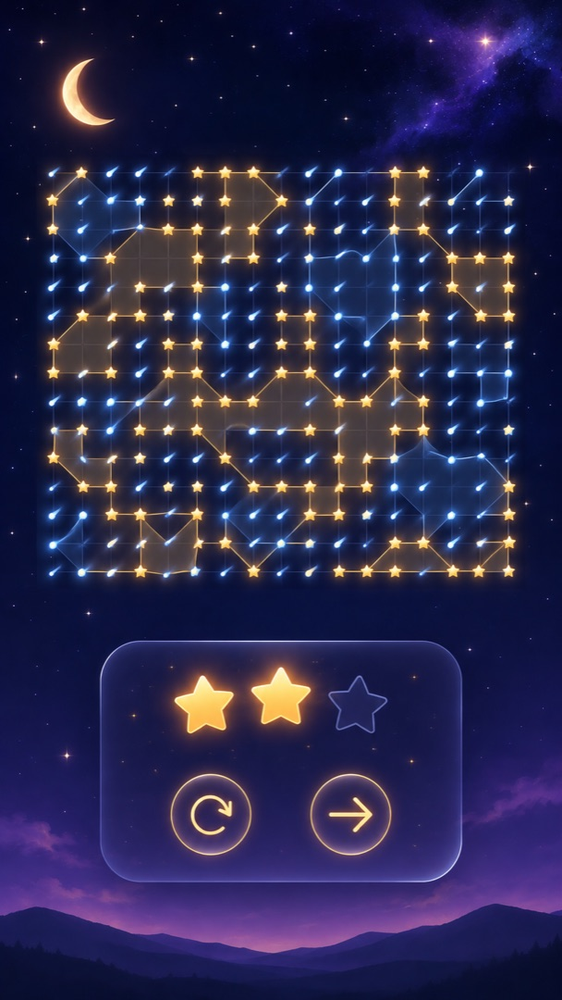
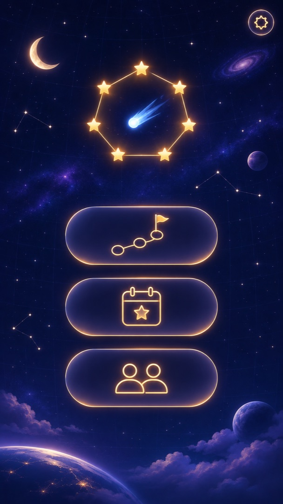
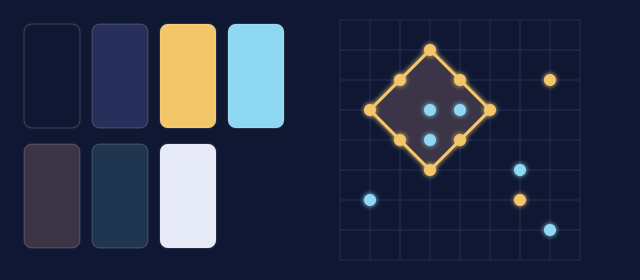

# Mood board: Night sky

A calm star chart. One side places gold stars, the other ice-blue comets. Rings are drawn as
constellation lines, and captured areas glow faintly like a nebula.

Part of the [mood boards](README.md). Pictures 1 to 7 come from the prompts below, pasted into
ChatGPT exactly as written. Picture 8 is drawn in code.

## 1. The board in play



Prompt:

```text
Tall portrait image, shaped like a phone screen. A mobile game screen, seen straight on, flat and clean. The look is a calm night sky: deep navy blue with a very faint lighter-blue grid like a star chart, and a few tiny distant stars in the background. One player's pieces are small warm-gold stars with a soft glow; the other player's pieces are small ice-blue comets with short tails. Lines between pieces look like constellation lines, thin and softly glowing. Elegant, quiet and dreamy. It shows a two-player board game: players take turns placing pieces on the crossings of the grid lines. When one player's pieces form a closed loop around the other player's pieces, the loop is drawn as an outline and the area inside is lightly shaded in the capturing player's colour; the surrounded pieces stay visible inside. The board fills the middle of the screen: a square grid of about 15 by 15 faint lines with around 40 pieces placed, two small captured areas, and the most recent piece marked with a small ring of light around it. Above the board, a gold star and an ice-blue comet with small rows of light points for each player's score; the player whose turn it is glows brighter. Below the board, a slim bar with four simple glowing icons: a short wall, a light bulb, a round bomb and two stars side by side. No text, letters, numbers, logos or signatures anywhere in the image.
```

## 2. A capture



Prompt:

```text
Tall portrait image, shaped like a phone screen. A close-up of part of a mobile game board, seen straight on. The look is a calm night sky: deep navy blue with a very faint lighter-blue grid like a star chart, and a few tiny distant stars in the background. One player's pieces are small warm-gold stars with a soft glow; the other player's pieces are small ice-blue comets with short tails. Lines between pieces look like constellation lines, thin and softly glowing. Elegant, quiet and dreamy. It shows a two-player board game: players take turns placing pieces on the crossings of the grid lines. When one player's pieces form a closed loop around the other player's pieces, the loop is drawn as an outline and the area inside is lightly shaded in the capturing player's colour; the surrounded pieces stay visible inside. The moment of a capture: a gold constellation line is just closing a diagonal loop of gold stars around three ice-blue comets. Inside the loop, a faint golden haze fills the area like a small nebula. The three comets stay clearly visible inside. A few other stars and comets are scattered around. No text, letters, numbers, logos or signatures anywhere in the image.
```

## 3. A crowded late game



Prompt:

```text
Tall portrait image, shaped like a phone screen. A mobile game screen, seen straight on, flat and clean. The look is a calm night sky: deep navy blue with a very faint lighter-blue grid like a star chart, and a few tiny distant stars in the background. One player's pieces are small warm-gold stars with a soft glow; the other player's pieces are small ice-blue comets with short tails. Lines between pieces look like constellation lines, thin and softly glowing. Elegant, quiet and dreamy. It shows a two-player board game: players take turns placing pieces on the crossings of the grid lines. When one player's pieces form a closed loop around the other player's pieces, the loop is drawn as an outline and the area inside is lightly shaded in the capturing player's colour; the surrounded pieces stay visible inside. The whole board late in a game: the grid of about 15 by 15 faint lines is crowded with about 150 gold stars and ice-blue comets and many captured areas of both colours, some large and irregular with narrow necks, some tiny pockets around a single piece. Every piece is still easy to see: the haze is faint and the constellation lines are crisp. No text, letters, numbers, logos or signatures anywhere in the image.
```

## 4. The world map



Prompt:

```text
Tall portrait image, shaped like a phone screen. A mobile game world map, seen from above, as a calm deep-navy night sky. A winding path of about twelve small round level stops is drawn like a constellation through a starry landscape: a crescent moon, soft nebula clouds, a few small planets. Finished stops glow gold and carry one to three tiny stars; the next stop has a bright ring of light; later stops are dim outlines. A bigger stop near the top is a dark planet with a ring around it for the boss level, and a small glowing chest floats beside the path. Elegant, quiet and dreamy. No text, letters, numbers, logos or signatures anywhere in the image.
```

## 5. A world background



Prompt:

```text
Tall portrait image, shaped like a phone screen. A background for a mobile game menu: a deep navy night sky with a soft gradient to violet at the bottom, scattered tiny stars, a faint nebula in one corner and the dark outline of gentle hills along the bottom edge. The centre stays mostly empty and calm. No text, letters, numbers, logos or signatures anywhere in the image.
```

## 6. A won level



Prompt:

```text
Tall portrait image, shaped like a phone screen. A mobile game screen after a won level, seen straight on, flat and clean. The look is a calm night sky: deep navy blue with a very faint lighter-blue grid like a star chart, and a few tiny distant stars in the background. One player's pieces are small warm-gold stars with a soft glow; the other player's pieces are small ice-blue comets with short tails. Lines between pieces look like constellation lines, thin and softly glowing. Elegant, quiet and dreamy. The finished board stays visible underneath, slightly dimmed: a grid of about 15 by 15 faint lines with gold stars, ice-blue comets and several captured areas glowing faintly. Over its lower half, a small translucent dark-blue card with a soft glow shows three stars, two glowing gold and one dim outline only, and below them two round glowing buttons with simple icons: an arrow pointing right and a circular arrow. No text, letters, numbers, logos or signatures anywhere in the image.
```

## 7. The home screen



Prompt:

```text
Tall portrait image, shaped like a phone screen. A mobile game home screen, seen straight on, flat and clean. The look is a calm night sky: deep navy blue with a very faint lighter-blue grid like a star chart, and a few tiny distant stars in the background. One player's pieces are small warm-gold stars with a soft glow; the other player's pieces are small ice-blue comets with short tails. Lines between pieces look like constellation lines, thin and softly glowing. Elegant, quiet and dreamy. In the upper part, a large emblem: a ring of gold constellation lines closing around a single ice-blue comet. Below it, three large rounded buttons with softly glowing outlines, one above the other, each with one simple icon: a winding path with a flag, a calendar page with a star, and two small figures side by side. A small gear icon in one corner. No text, letters, numbers, logos or signatures anywhere in the image.
```

## 8. Colours and type



| Role | Colour |
| --- | --- |
| Sky | `#0F1733` |
| Grid | `#26305A` |
| Gold star | `#F4C66A` |
| Ice-blue comet | `#8ED8F2` |
| Gold haze (captured area) | `#3B3546` |
| Blue haze (captured area) | `#1F3550` |
| Starlight (text) | `#E6EAF7` |

Fonts (Google Fonts, Open Font License):

- [Fraunces](https://fonts.google.com/specimen/Fraunces): headings, a soft and elegant serif
- [Inter](https://fonts.google.com/specimen/Inter): everything else, plain and clear

The colours and fonts are a first proposal. D-03 sets the final ones and checks the contrast.
