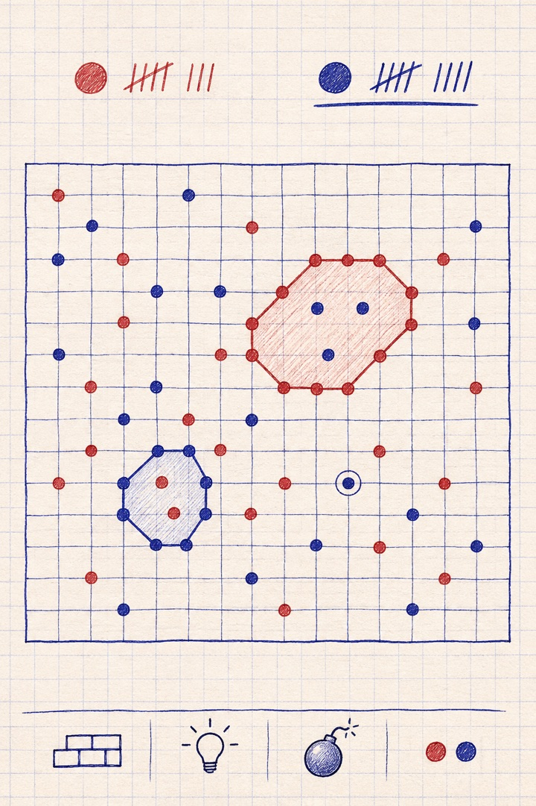
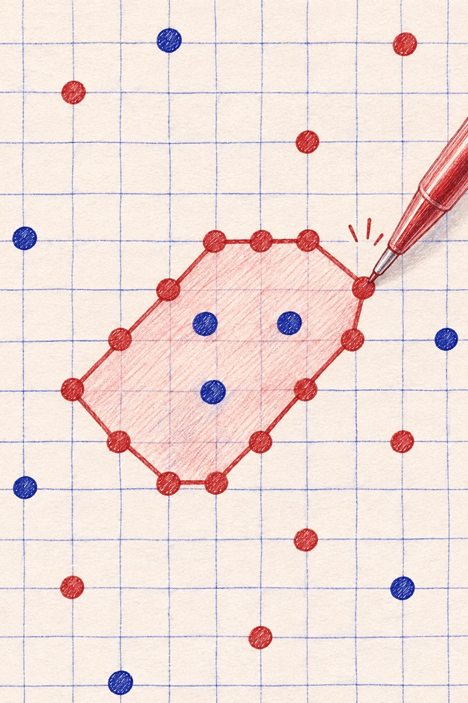
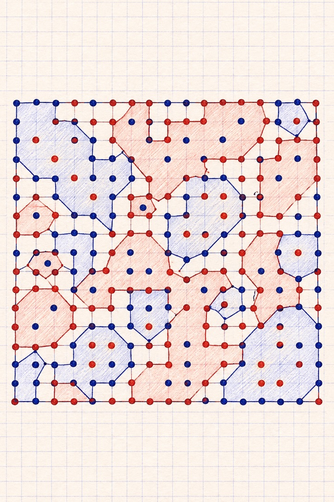
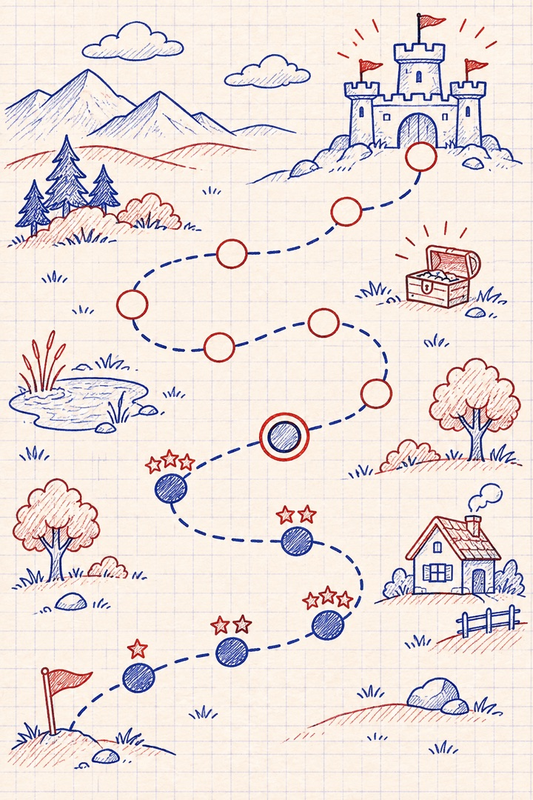
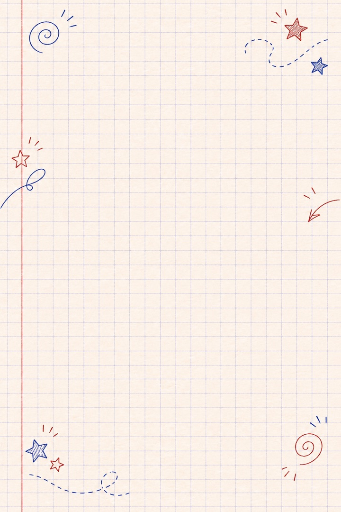
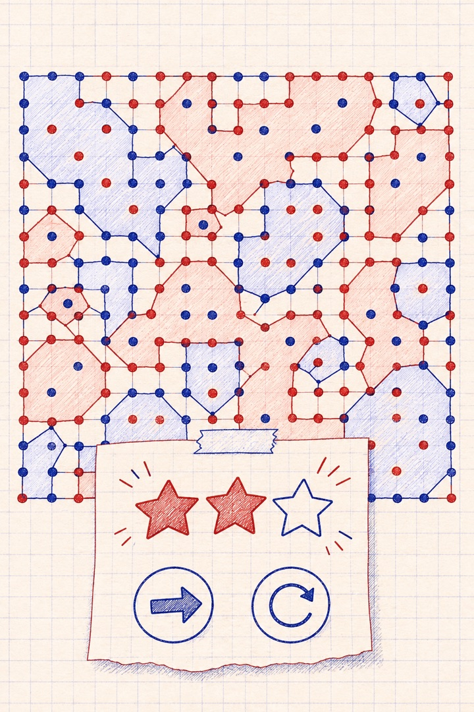
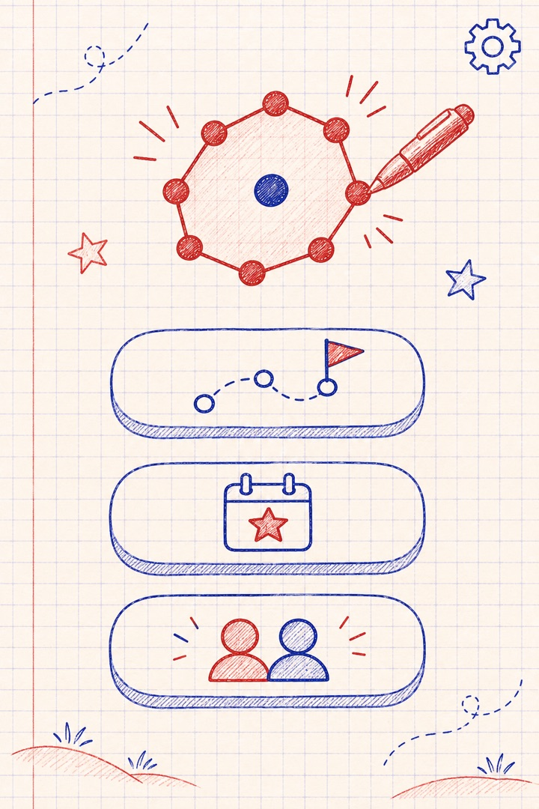
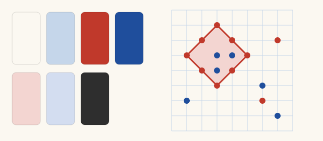

# Mood board: Notebook

Ink on squared paper, the way the game is played at school. Red and blue ballpoint dots, rings drawn
like a pen stroke, captured areas washed in light ink.

Part of the [mood boards](README.md). Pictures 1 to 7 come from the prompts below, pasted into
ChatGPT exactly as written. Picture 8 is drawn in code.

## 1. The board in play



Prompt:

```text
Tall portrait image, shaped like a phone screen. A mobile game screen, seen straight on, flat and clean. The look is ink on squared school paper: off-white paper with a faint pale-blue square grid and a soft paper grain. One player draws in warm red ballpoint ink, the other in deep blue ballpoint ink. Dots are small filled ink circles; outlines look drawn with a pen, slightly uneven but neat. Calm, warm and nostalgic, with plenty of empty paper. It shows a two-player board game: players take turns placing pieces on the crossings of the grid lines. When one player's pieces form a closed loop around the other player's pieces, the loop is drawn as an outline and the area inside is lightly shaded in the capturing player's colour; the surrounded pieces stay visible inside. The board fills the middle of the screen: a square grid of about 15 by 15 lines with around 40 dots placed, two small captured areas, and the most recent dot marked with a small ring around it. Above the board, a red dot and a blue dot with tally marks for each player's score; the player whose turn it is is underlined. Below the board, a slim bar with four simple hand-drawn icons: a short wall, a light bulb, a round bomb and a pair of dots. No text, letters, numbers, logos or signatures anywhere in the image.
```

## 2. A capture



Prompt:

```text
Tall portrait image, shaped like a phone screen. A close-up of part of a mobile game board, seen straight on. The look is ink on squared school paper: off-white paper with a faint pale-blue square grid and a soft paper grain. One player draws in warm red ballpoint ink, the other in deep blue ballpoint ink. Dots are small filled ink circles; outlines look drawn with a pen, slightly uneven but neat. Calm, warm and nostalgic, with plenty of empty paper. It shows a two-player board game: players take turns placing pieces on the crossings of the grid lines. When one player's pieces form a closed loop around the other player's pieces, the loop is drawn as an outline and the area inside is lightly shaded in the capturing player's colour; the surrounded pieces stay visible inside. The moment of a capture: a red pen stroke is just closing a diagonal loop of red dots around three blue dots. Inside the loop, a light red wash spreads into the paper like ink soaking in. The three blue dots stay clearly visible under the wash. A few other red and blue dots are scattered around. No text, letters, numbers, logos or signatures anywhere in the image.
```

## 3. A crowded late game



Prompt:

```text
Tall portrait image, shaped like a phone screen. A mobile game screen, seen straight on, flat and clean. The look is ink on squared school paper: off-white paper with a faint pale-blue square grid and a soft paper grain. One player draws in warm red ballpoint ink, the other in deep blue ballpoint ink. Dots are small filled ink circles; outlines look drawn with a pen, slightly uneven but neat. Calm, warm and nostalgic, with plenty of empty paper. It shows a two-player board game: players take turns placing pieces on the crossings of the grid lines. When one player's pieces form a closed loop around the other player's pieces, the loop is drawn as an outline and the area inside is lightly shaded in the capturing player's colour; the surrounded pieces stay visible inside. The whole board late in a game: the grid of about 15 by 15 lines is crowded with about 150 red and blue dots and many captured areas of both colours, some large and irregular with narrow necks, some tiny pockets around a single dot. Every dot is still easy to see: the washes are light and the outlines are crisp. No text, letters, numbers, logos or signatures anywhere in the image.
```

## 4. The world map



Prompt:

```text
Tall portrait image, shaped like a phone screen. A mobile game world map, seen from above, drawn in pen on squared notebook paper with a faint pale-blue grid, in warm red and deep blue ballpoint lines. A winding dotted path of about twelve small round level stops crosses the page through little doodled landscapes: hills, a pond, a few trees, a house. Finished stops are filled in with ink and carry one to three small doodled stars; the next stop is circled twice; later stops are empty circles. A bigger stop near the top is drawn as a small fortress for the boss level, and a treasure chest doodle sits beside the path. Calm, warm and nostalgic. No text, letters, numbers, logos or signatures anywhere in the image.
```

## 5. A world background



Prompt:

```text
Tall portrait image, shaped like a phone screen. A background for a mobile game menu: a sheet of squared notebook paper with a faint pale-blue grid, a thin red margin line on the left, a soft paper grain and a few light pen doodles around the edges: small spirals, stars, arrows and loops in faded red and blue ballpoint ink. The centre stays mostly empty and quiet. No text, letters, numbers, logos or signatures anywhere in the image.
```

## 6. A won level



Prompt:

```text
Tall portrait image, shaped like a phone screen. A mobile game screen after a won level, seen straight on, flat and clean. The look is ink on squared school paper: off-white paper with a faint pale-blue square grid and a soft paper grain. One player draws in warm red ballpoint ink, the other in deep blue ballpoint ink. Dots are small filled ink circles; outlines look drawn with a pen, slightly uneven but neat. Calm, warm and nostalgic, with plenty of empty paper. The finished board stays visible underneath, slightly faded: a grid of about 15 by 15 lines with red and blue dots and several captured areas washed in light ink. Over its lower half, a small paper card like a sticky note shows three hand-drawn stars, two filled with red ink and one outline only, and below them two round buttons with simple hand-drawn icons: an arrow pointing right and a circular arrow. No text, letters, numbers, logos or signatures anywhere in the image.
```

## 7. The home screen



Prompt:

```text
Tall portrait image, shaped like a phone screen. A mobile game home screen, seen straight on, flat and clean. The look is ink on squared school paper: off-white paper with a faint pale-blue square grid and a soft paper grain. One player draws in warm red ballpoint ink, the other in deep blue ballpoint ink. Dots are small filled ink circles; outlines look drawn with a pen, slightly uneven but neat. Calm, warm and nostalgic, with plenty of empty paper. In the upper part, a large emblem: a red pen loop closing around a single blue dot, drawn with confident ink strokes. Below it, three large rounded buttons drawn in ink outline, one above the other, each with one simple doodled icon: a winding path with a flag, a calendar page with a star, and two small figures side by side. A small gear icon in one corner. No text, letters, numbers, logos or signatures anywhere in the image.
```

## 8. Colours and type



| Role | Colour |
| --- | --- |
| Paper | `#FBF8F1` |
| Grid | `#C5D6EA` |
| Red ink | `#C0392B` |
| Blue ink | `#1F4E9C` |
| Red wash (captured area) | `#F3D5D1` |
| Blue wash (captured area) | `#D3DDF0` |
| Pencil (text) | `#2E2E2E` |

Fonts (Google Fonts, Open Font License):

- [Caveat](https://fonts.google.com/specimen/Caveat): headings, a handwritten feel
- [Atkinson Hyperlegible](https://fonts.google.com/specimen/Atkinson+Hyperlegible): everything else, built to be easy to read

The colours and fonts are a first proposal. The final ones, with contrast checks, are in the
[Notebook theme](../theme-notebook.md).
