# Motion

This page describes every animation in Pinfold before it is built: what moves, in which order,
for how long, and what the player can do meanwhile. The animations are built in V-05 (the board
and the screens), V-06 (the booster effects) and A-14 (the computer's last move). They follow the
times on this page.

Every time is in milliseconds (ms), counted from the moment's start, which each section names.
Colours and sizes are those of the [Notebook theme](theme-notebook.md) and
[Piece shapes](pieces.md). The [canvas](canvas/README.md) shows the still frames these
animations start and end on.

Each moment has a strip of key frames and a GIF made from the canvas mock-ups. The GIFs have a dark
band above the frame that names the step and shows the time since it started. The band and the
grey thumb are part of the mock-up, not the game. Each GIF also exists in the dark version.

## Rules for all motion

1. **The board never waits.** It takes every tap at once. A tap during an animation finishes that
   animation (everything jumps to its end state), and the tap still counts. No animation holds
   the next tap back.
2. **The computer waits for the player.** The computer's dot lands at least 500 ms after the
   player's dot, and not before the player's capture has finished. The player sees their own move
   settle first, and has time to lift their finger.
3. **The board stays solid.** On the board things grow, shrink, are drawn like a pen stroke, or
   blend from one theme colour to another. Nothing on the board turns see-through, as on the theme
   page. Notes and the dimmed background over the map may fade.
4. **Movement stops on its own.** Nothing moves for longer than 5 seconds. The threat pulse stops
   after three beats. This follows the WCAG rule that moving content must stop or be stoppable.
5. **With animations removed.** When the phone's **Remove animations** setting is on (Android
   Settings, Accessibility), every moment shows its end state at once. The information stays: the
   marks on the computer's move, the threat rings, the counter's colour, "Last dot!", the stars. Only
   the ripples, pulses, shakes, bursts and flights go.
6. **Touch.** A light vibration when a dot lands, a medium one when a ring closes, a strong one for
   a big capture and a bomb. The vibration setting turns them off. Sounds, when they come, start
   at the same moments.

**Easing.** How a movement speeds up and slows down:

| Name on this page | What it does | In Compose |
| --- | --- | --- |
| ease out | starts fast, settles gently; things arriving | `LinearOutSlowInEasing` |
| ease in | starts gently, leaves fast; things leaving | `FastOutLinearInEasing` |
| ease in-out | gentle at both ends; things moving across | `FastOutSlowInEasing` |
| linear | the same speed throughout; handwriting, counting | `LinearEasing` |

Times are exact, so the build uses timed animations (`tween` and `keyframes`), not springs.

## Timing table

"Next tap waits" is how long the player has to wait before a tap counts. "A tap" says what a tap
does while the animation runs.

| Moment | Starts when | Length | Next tap waits | A tap | With animations removed |
| --- | --- | --- | --- | --- | --- |
| [Placing a dot](#placing-a-dot-and-chain-lines) | a dot is confirmed | 200 ms | 0 | counts as usual | the dot at once |
| [Chain lines](#placing-a-dot-and-chain-lines) | with placing | 80 to 230 ms | 0 | counts as usual | the links at once |
| [The computer's move](#the-computers-move) | 500 ms or more after the player's dot | 900 ms; the edge marks stay | 0 | counts as usual | dot and edge marks at once, no ripple |
| [Capture](#capture) | the closing dot lands | 1250 ms | 0 | finishes it | the captured area and score at once |
| [Big capture](#big-capture), 5 dots or more | the closing dot lands | 1400 ms | 0 | finishes it | as a capture, no shake or burst |
| [Threat pulse](#threat-pulse) | 200 ms after the dot that makes the threat | 5050 ms, then still | 0 | counts as usual | still rings at once |
| [Dots running out](#dots-running-out) | 5 dots left | 300 ms per dot | 0 | counts as usual | colour, row and "Last dot!" at once |
| [Wall](#boosters) | Confirm | 400 ms | 0 | counts as usual | the wall at once |
| [Hint](#boosters) | Confirm | 500 ms | 0 | counts as usual | the circles at once |
| [Bomb](#boosters) | Confirm | 450 ms | 0 | finishes it | the dots gone at once |
| [Double dot](#boosters) | Confirm | 300 ms, then 250 ms per dot | 0 | counts as usual | the chip at once |
| [Undo](#boosters) | Confirm | 600 ms | 0 | finishes it | the turn gone at once |
| [End of game](#end-of-game) | the game is over and the last move has played out | 1400 ms to the result note | the game is over | jumps to the note | the note at once |
| [Star reveal](#star-reveal) | the result note has settled | 1100 ms | 0: the buttons work at once | finishes it | the stars at once |
| [Level unlock](#level-unlock) | the map shows after Next | 2100 ms | 0 | jumps to the Level card | the new state and the card at once |
| [Level opening](#level-opening-notes-and-cards) | the board shows | 1500 ms | 0 | finishes it and counts | the corner note at once |
| [Notes and cards](#level-opening-notes-and-cards) | a note is opened or closed | 300 ms in, 200 ms out | 0: the buttons work at once | counts as usual | the note at once |

## Placing a dot and chain lines

0 ms is the moment the dot is placed: the second tap, or the finger lifting when placing by drag
(decision 0024).

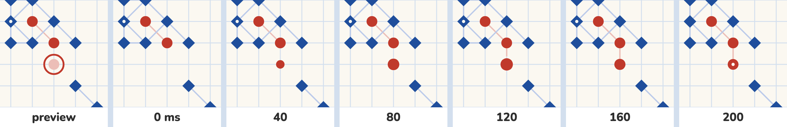

| Time | What moves | Easing |
| --- | --- | --- |
| 0 | The preview ring goes. The dot starts to grow from nothing. The dots-left count goes down by one. Light vibration. | |
| 0 to 120 | The dot grows to 115% of its size. | ease out |
| 120 to 200 | It settles to 100%. | ease in-out |
| 0 to 200 | The pen stroke under the name moves to the side to move: it is drawn left to right under the new name. | ease out |
| 80 to 230 | A link grows from each neighbouring dot of the same side to the new dot. Several links grow together. | ease out |
| 200 | The last-move pinhole moves to the new dot. | |

## The computer's move

The P-10 testers often missed the computer's dot, because their finger hid it. The dot therefore
announces itself around the finger and away from it:

- **Two ripples** in the computer's ink grow to 96 dp across. A fingertip covers about 10 mm, about
  60 dp, so the ripple shows around it.
- **Edge marks**: a short stroke on the top edge of the board above the dot's column, and one on the
  left edge beside its row. A hand coming from below rarely covers the top edge. The marks stay
  until the player's next dot lands, so a player who looked away can still find the move.

0 ms is the moment the computer's dot lands. A-14 settles the still mark for the last move; this is
its motion.

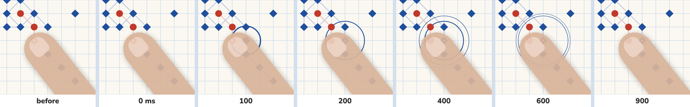

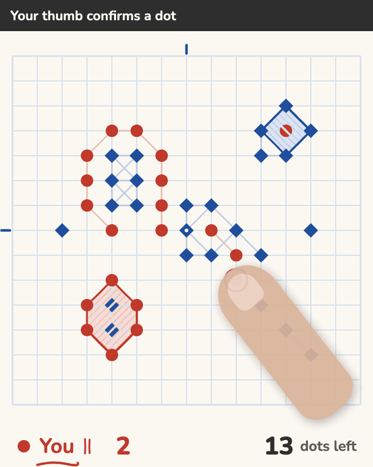

[Same in the dark version](motion/turn-dark.gif)

| Time | What moves | Easing |
| --- | --- | --- |
| 0 to 200 | The dot lands, as in placing. | as placing |
| 80 to 230 | Its links grow. | ease out |
| 0 to 700 | First ripple: a ring in the computer's ink grows from 22 dp to 96 dp across. Its line thins from 3 dp to 0.5 dp, and then it is gone. | ease out |
| 200 to 900 | Second ripple, the same. | ease out |
| 0 to 150 | The edge marks grow in from the edges: 8 dp long, 2.5 dp thick, in the computer's ink, in the half spacing of paper outside the grid. | ease out |
| 200 | The pinhole moves to the new dot. | |
| Player's next dot, 0 to 150 | The edge marks shrink back into the edges. | ease in |

The ripples are drawn under the pieces, so they never hide a dot. In a two-player game every dot
lands this way, in its side's ink: the player who looks next did not see it placed.

## Capture

For captures of 1 to 4 dots. 0 ms is the moment the closing dot lands. Several areas closed by one
dot play at the same time, and their dots add up to one +N.

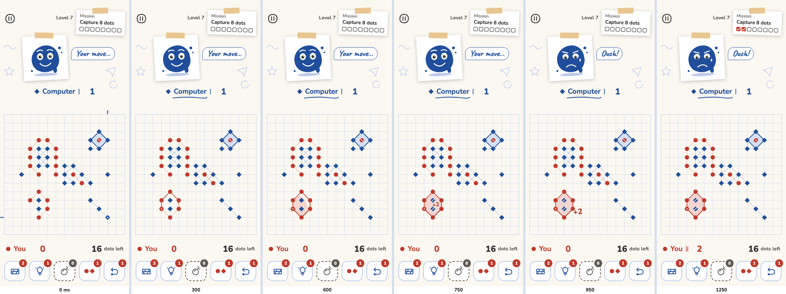

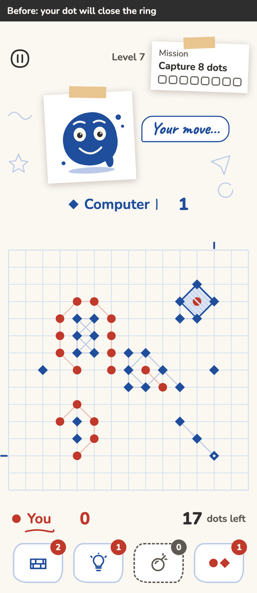

[Same in the dark version](motion/capture-dark.gif)

| Time | What moves | Easing |
| --- | --- | --- |
| 0 to 200 | The closing dot lands, as in placing. | as placing |
| 150 to 550 | The ring is drawn like a pen stroke: from the closing dot, around the area, back to it. It is the final ring, with the same bow and thickness. | ease in-out |
| 550 | Medium vibration. | |
| 500 to 800 | The wash and the hatching spread from the closing dot as a growing circle, kept inside the ring. | ease out |
| 600 onwards | Each captured dot's cut is drawn across it in 100 ms, the nearest dot first, 40 ms apart. | linear |
| 700 to 850 | "+N" grows in over the area, in the Score style and the captor's ink. | ease out |
| 800 | The opponent's face changes: upset when the player captured, smug when the computer did. | |
| 850 to 1100 | +N flies along a curve to the captor's tally and shrinks to 55%. | ease in |
| 1100 | The tally and the score take the N points, and the mission note ticks its boxes. | |
| 1100 to 1250 | The score swells to 130% and back; the mission note to 106% and back. | |

## Big capture

For 5 dots or more in one move. It is the capture with more weight, and under 1.5 s. 0 ms is the
moment the closing dot lands.

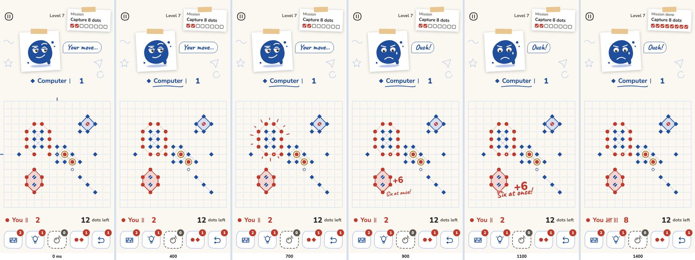

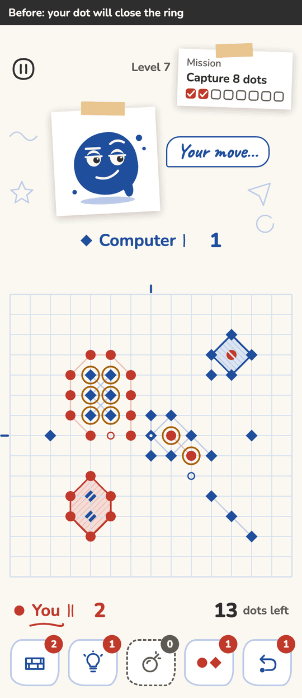

[Same in the dark version](motion/big-capture-dark.gif). The GIF plays the capture twice: in
full, then with a tap at 500 ms, which shows the end state at once.

| Time | What moves | Easing |
| --- | --- | --- |
| 0 to 200 | The closing dot lands. | as placing |
| 150 to 650 | The ring is drawn, as in a capture. | ease in-out |
| 650 | Strong vibration. | |
| 650 to 830 | The board shakes sideways: 2 dp, three swings, each smaller. | |
| 650 to 900 | A burst: 14 short strokes in the captor's ink around the area move outwards, grow and shrink away. None crosses a dot. | ease out |
| 650 to 950 | The wash and the hatching spread. | ease out |
| 700 onwards | The cuts, 30 ms apart. | linear |
| 850 to 1000 | "+N" grows in below the area at 40 sp, with "Six at once!" under it (Caveat, the Headline size). The number of dots is a word there: Caveat is never used for figures. | ease out |
| 900 | The opponent's face falls. | |
| 1000 to 1250 | +N flies to the tally. "Six at once!" stays. | ease in |
| 1250 to 1400 | The tally, score and mission note take it and swell as in a capture. "Six at once!" shrinks away. | ease in |

## Threat pulse

A group one move from capture gets a Highlighter ring, and the point that would close it a small
circle. 0 ms is 200 ms after the dot that makes the threat lands, when that dot has settled.

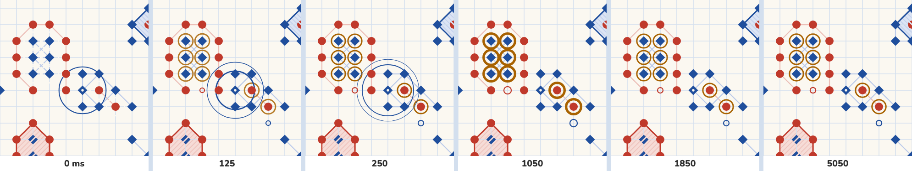

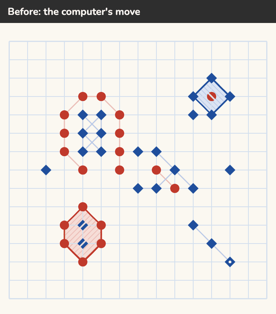

[Same in the dark version](motion/threat-dark.gif)

| Time | What moves | Easing |
| --- | --- | --- |
| 0 to 250 | The rings draw in: each shrinks from 130% to its size while its colour blends from Paper to Highlighter. The closing points grow from nothing. | ease out |
| 250 to 5050 | Three pulses of 1600 ms. The ring's line goes from 2 dp to 3.5 dp and back, and the ring from 100% to 108% of its size and back. The closing point goes from 100% to 135% and back, in step. | ease in-out |
| 5050 | Everything is still. | |

- A faint ring (two moves from capture) draws in the same way but never pulses.
- A new threat pulses only its own group. The others stay still.
- When the player's group is in danger, the opponent's face turns smug.

## Dots running out

The P-10 testers asked to see when their dots are running out. From 5 dots left, the count turns
Highlighter, the colour that means "look here, act soon", and the last dots show as a row. Each side's
count does this for its own dots. 0 ms is the moment a dot is placed.


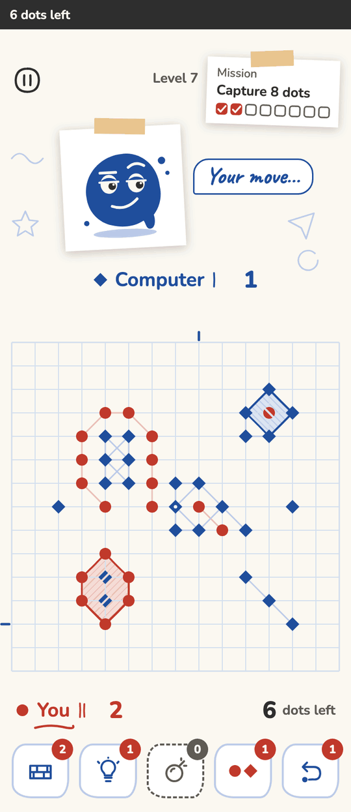

[Same in the dark version](motion/running-out-dark.gif)

| When | What moves | Easing |
| --- | --- | --- |
| The count reaches 5 | The number blends from Pencil to Highlighter in 200 ms. A row of five small pieces (8 dp, the side's shape and ink) writes in beside it, 50 ms apart, 150 ms each. | linear; ease out |
| Each dot after that | The number swells to 130% and back in 300 ms. The last small piece in the row shrinks away in 150 ms. | ease in |
| 3 left, mission not done | The mission note swings once, 3° each way, in 400 ms. | |
| 1 left | "Last dot!" writes in, left to right, in 300 ms, in place of the number: Caveat 24 sp, Highlighter. | linear |

Both the number (24 sp, extra bold) and "Last dot!" (24 sp) are large text, so their target is 3:1.
Highlighter on paper is 4.48 in light and 9.02 in dark.

## Boosters

0 ms is the moment the player taps Confirm in the booster preview (A-05). In every case the
booster's count drops at 0 ms and swells to 135% and back in 200 ms. At 0 left, the button turns
dashed and grey.

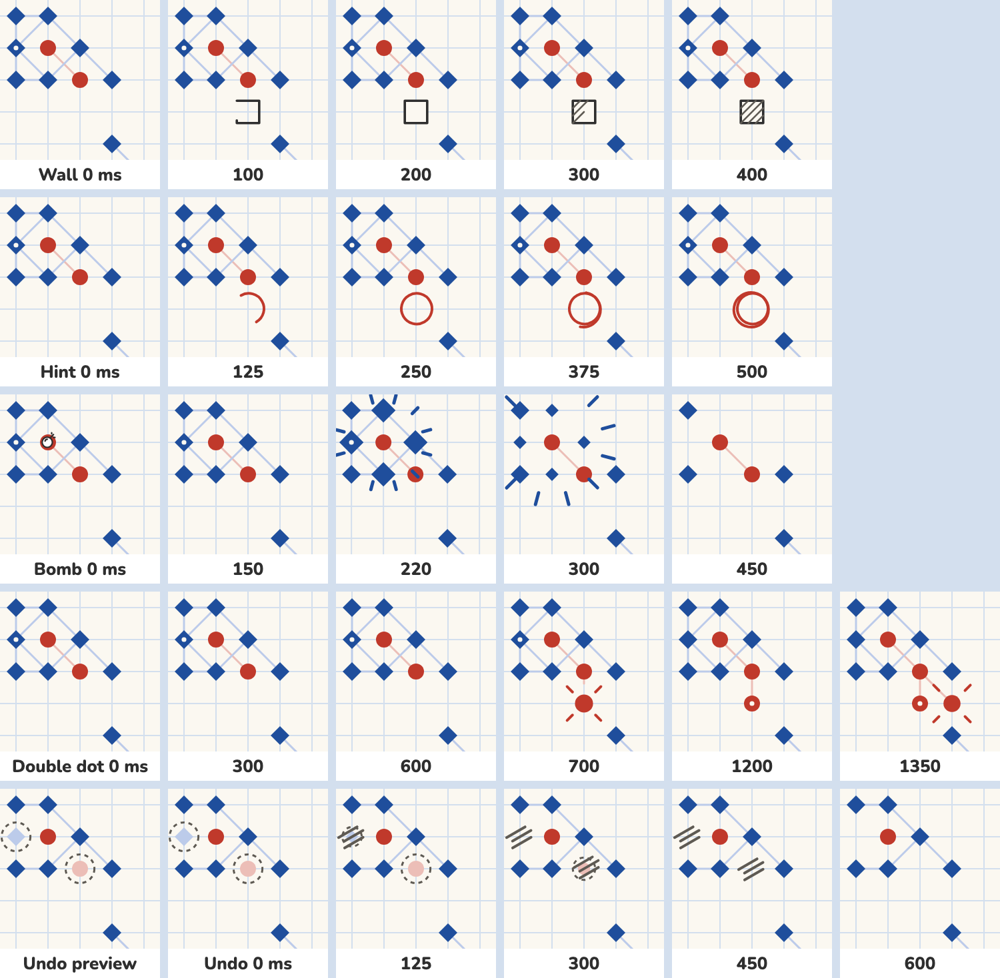

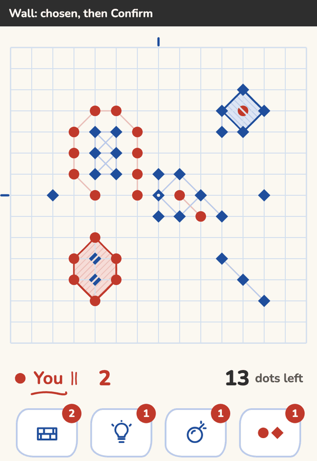

[Same in the dark version](motion/boosters-dark.gif)

**Wall** blocks one empty point.

| Time | What moves | Easing |
| --- | --- | --- |
| 0 to 200 | A square, 0.7 of the spacing (17 dp), is drawn round the point in one Pencil stroke, 1.8 dp. | ease in-out |
| 200 to 400 | Five hatch lines in Graphite fill it, one after another. It stays. | linear |

**Hint** shows the player's best move.

| Time | What moves | Easing |
| --- | --- | --- |
| 0 to 500 | The point is circled twice in the player's ink, 250 ms per loop: the same mark as the next level on the map. | linear |
| Player's dot lands, 0 to 150 | The circles shrink away. | ease in |

**Bomb** removes the opponent's dots in a plus of 5 points.

| Time | What moves | Easing |
| --- | --- | --- |
| 0 to 150 | The bomb drops on the centre point: it grows from 60% to 100%. | ease out |
| 150 | The blast. Strong vibration. The bomb is gone, and the links of the hit dots go with it. | |
| 150 to 300 | The board shakes: 2 dp, two swings, each smaller. | |
| 150 to 220 | The hit dots swell to 130%. | ease out |
| 220 to 350 | They shrink to nothing. | ease in |
| 150 to 450 | Twelve specks in the opponent's ink fly out from the centre, growing and then shrinking away. | ease out |

**Double dot** lets the player place two dots in one turn.

| Time | What moves | Easing |
| --- | --- | --- |
| 0 to 300 | A small "×2" chip in the player's ink grows in beside their name. | ease out |
| First dot lands, 0 to 250 | The dot lands as usual, and four short strokes spark out from it. The chip turns to "×1" and swells to 125% and back in 200 ms. | ease out |
| Second dot lands, 0 to 250 | The same sparks. The chip shrinks away in 150 ms, and the turn passes. | ease in |

**Undo** takes back the player's last turn: their dot (both after a double dot), any booster used
in that turn, and the computer's answer (decision 0023). It has no point to aim at, so its preview
shows the turn it takes back: each of those pieces in its pale colour (Red pale, Blue pale) inside
a dashed Graphite ring, and the threat marks that turn made are gone. The note over the player's
line and the tool bar says "Undo takes back the pale dots." with Cancel and Take back, the canvas
frame "Game: Undo's preview". The turn is rubbed out newest first, like a pencil eraser.

| Time | What moves | Easing |
| --- | --- | --- |
| 0 to 250 | The computer's answer is rubbed out: three short Graphite strokes scrub back and forth across it while the piece shrinks to nothing and its links pull back. A capture it made goes with it: the ring undraws, the wash blends back to paper, the cuts go, and its score counts back. | ease in |
| 200 to 450 | The player's dot is rubbed out the same way, both dots together after a double dot, and any capture it made. A booster used in that turn flies back to its button, whose count swells to 135% and back in 200 ms. | ease in |
| 450 to 600 | The scrub strokes shrink away. The dots-left count goes up, the pen stroke sits under "You", and the opponent's face goes back to how it looked before its answer. | ease out |

Undo's button waits until there is a turn to take back: before the player's first move it shows
its icon in Graphite on paper, with its count still red, as on the canvas frame "Game: the level
opens". A tap on it then does nothing. Each level allows one Undo, so after it the button turns
dashed and grey with 0, like any booster.

## End of game

0 ms is the moment the game is over and the last move has played out. In a mission level that is
when the capture that finishes the mission ends.

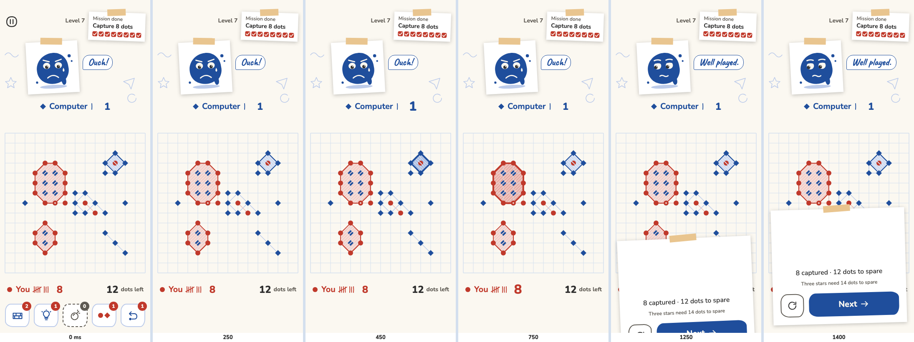

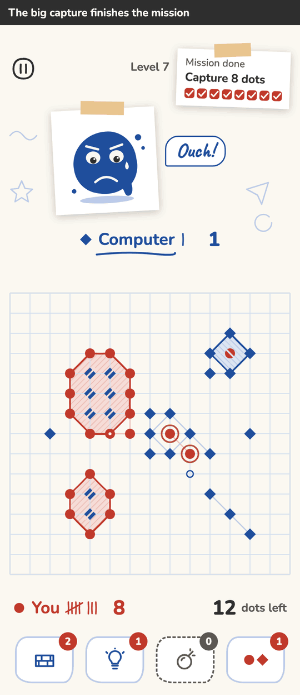

[Same in the dark version](motion/end-dark.gif)

| Time | What moves | Easing |
| --- | --- | --- |
| 0 to 250 | The pause icon slides up off the screen and the tool bar slides down off it. | ease in |
| 300 onwards | Each captured area lights up in the order it was captured, for 300 ms each, 150 ms apart: its ring thickens to 190% and back, and its wash blends towards the pale colour and back. Its side's score swells to 130% and back. | ease in-out |
| | If there are many areas, the gap shrinks so that all of them fit in 1500 ms. | |
| last area + 200 | The result note slides up from below in 300 ms. | ease out |
| last area + 200 to + 500 | It tips to −2.5° and settles at its −1.5° slant in the last 100 ms. The opponent's face changes. | ease in-out |

With the three areas of Level 7, the note starts at 1100 ms and has settled at 1400 ms.

## Star reveal

0 ms is the moment the result note has settled.

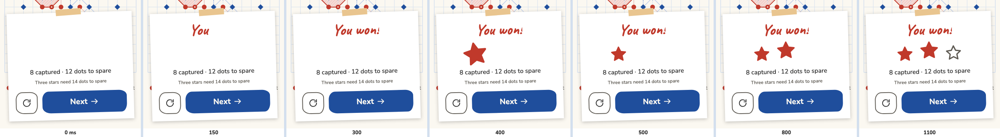

| Time | What moves | Easing |
| --- | --- | --- |
| 0 to 300 | The headline writes in, left to right. | linear |
| 300 + 300 per star | An earned star is stamped: it shrinks from 180% to its size and turns from −15° to straight, in 200 ms. A tick and a light vibration as it lands. | ease in |
| | A star not earned is drawn in outline in 200 ms. | linear |
| 1100 | Done, with three stars. | |

The score lines and the buttons are there as soon as the note appears, and the buttons work at once.
A tap elsewhere on the note finishes the reveal.

## Level unlock

After Next, the map shows the finished level and the way on. 0 ms is the moment the map shows.

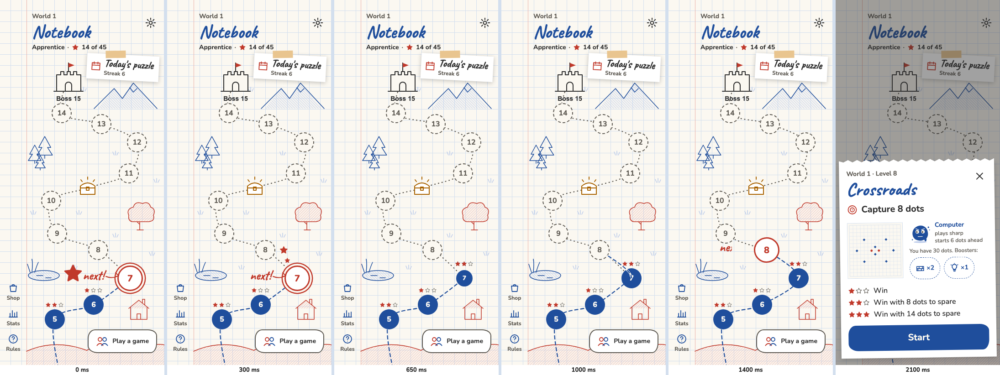

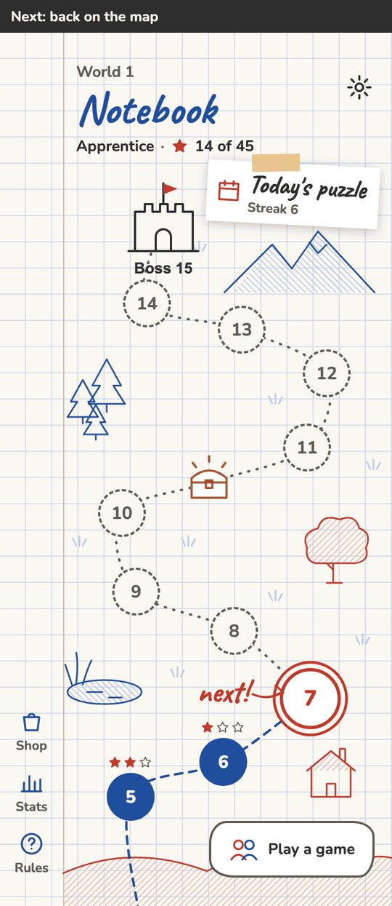

[Same in the dark version](motion/unlock-dark.gif)

| Time | What moves | Easing |
| --- | --- | --- |
| 0 to 500 | The new stars fly, 100 ms apart and 400 ms each, from where the result note showed them to the level's stop, shrinking to the map's star size. | ease in-out |
| 500 to 800 | The stop fills: a blue disc grows from its centre. Its red "next" rings shrink away in the first 150 ms. | ease out; ease in |
| 800 to 1200 | The path to the next level inks in as a blue dashed line. | ease in-out |
| 1200 to 1600 | The next level is circled twice in red, 200 ms per loop. | linear |
| 1300 to 1600 | "next!" writes in beside it. | linear |
| 1800 to 2100 | The next level's card slides up and the map dims behind it. | ease out |

**A world opens.** When these stars open the next world, the page turns before the path inks in:
the new world's page slides in from the right in 600 ms (ease in-out). Everything after it moves
600 ms later.

A tap at any time shows the end state with the card up.

## Level opening, notes and cards

These have no GIF. The canvas frame "Game: the level opens" shows the opening.

- **Level opening.** The mission note sits big over the board for 1200 ms, then shrinks into its
  corner in 300 ms (ease in-out). A tap ends it at once and counts as a tap.
- **Notes and cards** over the map or the board (Level card, Pause, Result, Chest, Today's
  puzzle, Play a game, the booster preview): they slide up from below in 300 ms (ease out) while
  the background dims; they leave by sliding down in 200 ms (ease in). Their buttons work at once.

## Checks

- **No animation holds the next tap for more than 0.3 s.** The board takes every tap at once, and a
  tap finishes whatever is running. Notes and cards take taps while they slide in. The longest wait
  for a tap is 0 ms.
- **A big capture is under 1.5 s and can be skipped.** It takes 1400 ms, and a tap shows its end at
  once (second half of the big-capture GIF).
- **Booster effects are under 1.5 s** (the V-06 check): Wall 400 ms, Hint 500 ms, Bomb 450 ms,
  Double dot 300 ms and then 250 ms per dot, Undo 600 ms.

## New in this storyboard

These looks are new here. They are proposals for the owner to accept or change:

- The computer's move: two ripples and the edge marks on the top and left edges.
- Dots running out: the Highlighter count, the row of small pieces, the mission-note nudge and
  "Last dot!".
- The wall: a square in pencil, hatched.
- The hint: the point circled twice, like the next level on the map.
- The double dot: the "×2" chip beside the player's name.
- A big capture's +N and words below the area, where the canvas frame shows them.

## The mock-ups

[`motion/draw.py`](motion/draw.py) draws every GIF and strip on this page from the times above,
using the canvas drawing ([`canvas/draw.py`](canvas/draw.py)). It draws 25 frames a second;
Google Chrome renders them and ffmpeg makes the GIFs.

```sh
python3 docs/design/motion/draw.py            # every GIF and strip (about 7 minutes)
python3 docs/design/motion/draw.py capture    # only the ones named
```

It needs Python 3, Google Chrome, ffmpeg and a network connection (the fonts come from Google
Fonts). Change a time on this page and in the script together.

**On a phone.** Every GIF frame is 360 dp wide, drawn at 1.5 px per dp. Open a GIF on the phone
and fit it to the screen width. On a phone about 360 dp wide it then shows at the size the game
will have, so the ripple can be checked against a real thumb.
