# Piece shapes

The two sides differ by shape as well as by colour. **Red pieces are round dots. Blue pieces
are diamonds.** A player who can't tell red from blue, or who plays in greyscale, can still read
the board. This page gives the shapes, the mark for the last move, the mark for a captured piece
and the placement preview. Colours and every other board size are on the
[Notebook theme](theme-notebook.md) page.

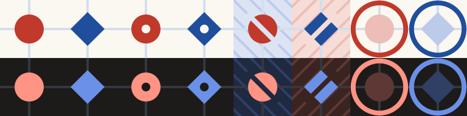

From left to right: red piece, blue piece, red and blue last move, a captured red piece (in a
blue area), a captured blue piece (in a red area), red and blue preview. Top row light, bottom
row dark. Each cell is one 24 dp grid square. The same sheet at 1 px per dp is
[`pieces/pieces-1x.svg`](pieces/pieces-1x.svg); the one above is
[`pieces/pieces-4x.svg`](pieces/pieces-4x.svg).

## The pieces

Sizes follow the **dot size**: half the spacing, at least 9 dp, at most 20 dp (12 dp at the usual
24 dp spacing; see [The board](theme-notebook.md#the-board)).

| Element | Shape | Size at 24 dp spacing | Other spacings | Colour |
| --- | --- | --- | --- | --- |
| Red piece | Round dot | 12 dp across | the dot size | Red ink |
| Blue piece | Diamond: a square turned 45°, sharp corners pointing along the grid lines | 14 dp corner to corner | 7/6 of the dot size | Blue ink |
| Last move | Pinhole: a small round dot in the middle of the newest piece, either side | 3.6 dp across | 0.3 of the dot size | Paper |
| Captured piece | Cut: a straight band through the middle of the piece, across its whole width | 2 dp wide, 18 dp long | 1/6 of the dot size wide, 1.5 dot sizes long | Wash of the side that captured it |
| Preview | The moving side's shape, pale, inside the round preview ring | piece as above; ring as on the theme page | as above | Red pale or Blue pale; ring in the ink of the side to move |

**The cut runs along the captor's hatching.** A captured red piece lies in a blue area, hatched
falling to the right (`\`), so its cut falls to the right. A captured blue piece lies in a red
area, hatched rising (`/`), so its cut rises. The piece looks as if the hatching runs across it.

**Drawing order.** The pinhole and the cut are drawn straight on top of their piece, before the
closing points and the preview. The full order is on the theme page.

## Why these shapes

- **Round and diamond, not filled and hollow.** Rings already mean something on the board: the
  threat rings, the closing point and the preview ring. A hollow piece would look like one of
  them, and it carries less ink, so it fades at small sizes.
- **The diamond's corners point along the grid lines.** That is where a round dot and a diamond
  differ most, and where the eye runs when it follows a line of pieces.
- **Equal weight.** At 7/6 of the dot size the darker blue diamond looks as heavy as the red dot.
  A diamond exactly as wide as the dot looked smaller; one with the same area as the dot looked
  bigger.
- **Red keeps the round dot**, the dot of the paper game.
- **A pinhole, not a ring, for the last move.** It works for both shapes, stays inside the piece,
  and doesn't look like a threat ring. It is Paper-coloured, so it shows in greyscale.
- **A cut, not a fade, for captured pieces.** Captured pieces keep their full ink, so they still
  stand out (theme page, "Captured dots"). The cut adds a mark that doesn't rely on colour.

## Beyond the board

Wherever the game names a side by colour, its shape stands beside the name: the score row, the
turn indicator, the result screen, the rules and the tutorial. Draw it at the dot size used
there, in the side's ink.

## Colour-blindness check

The check draws a mid-game 15x15 board at **4 mm per point**: 25.2 dp spacing on a 420 dpi
phone, 992 px wide. It shows every piece and mark on this page, both kinds of capture, both
threat rings and a closing point. Each version is shown as seen, in greyscale, and as seen by
someone with each of the three common types of colour blindness: protanopia (no red cones),
deuteranopia (no green cones) and tritanopia (no blue cones).

The simulations use the matrices of Machado, Oliveira and Fernandes (2009) at full strength,
applied in linear RGB. Greyscale keeps only each colour's relative luminance. Android's
**Developer options → Simulate colour space** shows similar views on a phone.

| | As seen | Greyscale | Protanopia | Deuteranopia | Tritanopia |
| --- | --- | --- | --- | --- | --- |
| Light | 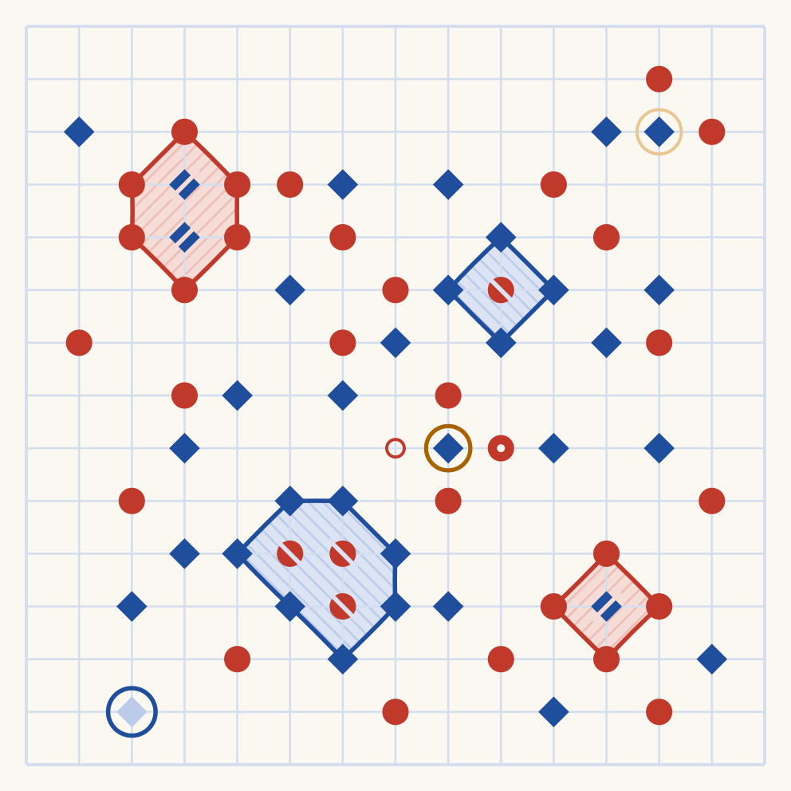 | 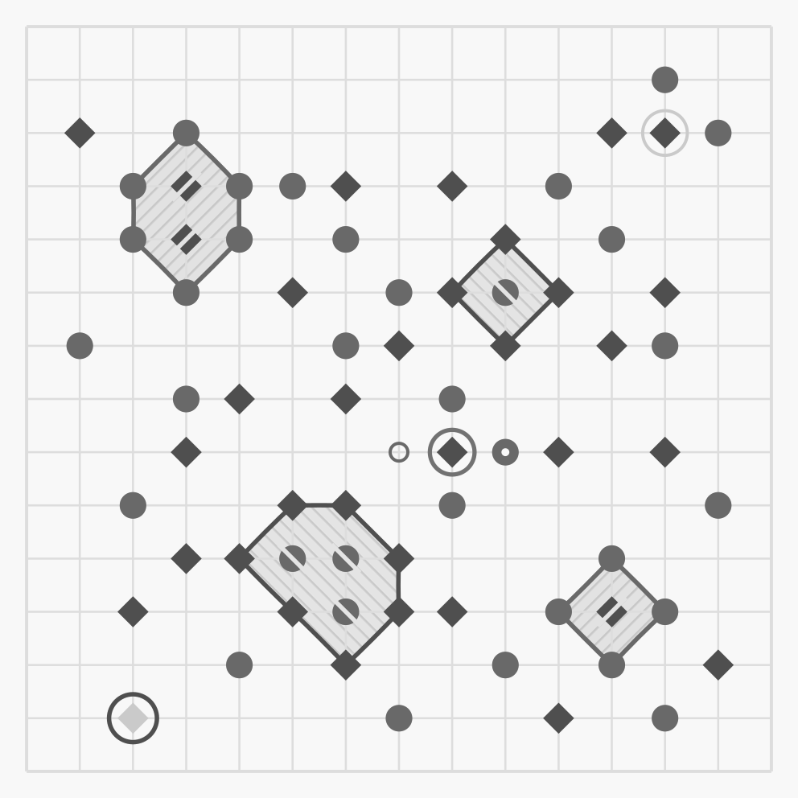 | 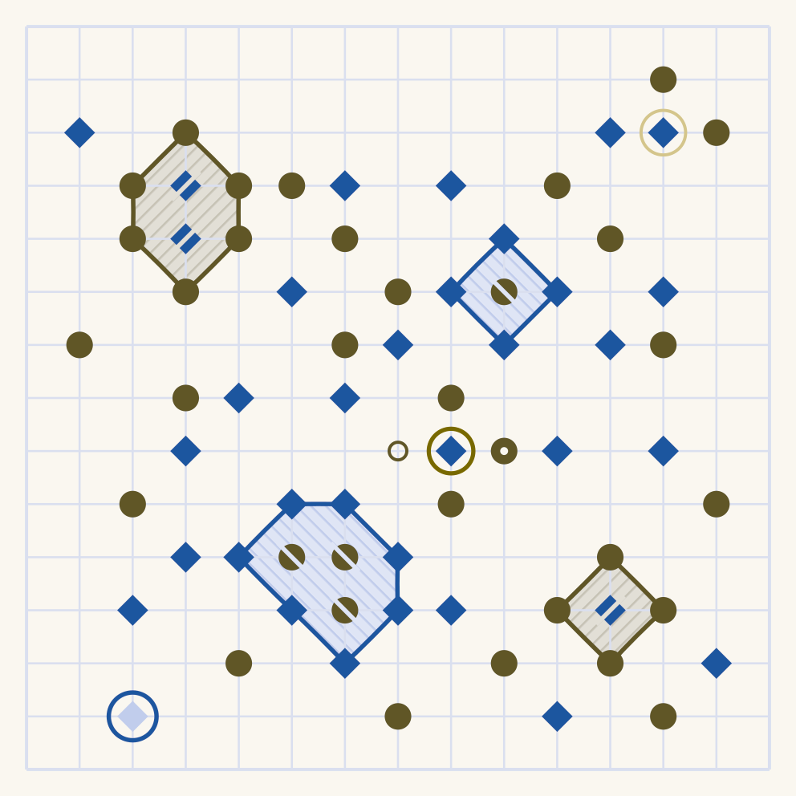 | 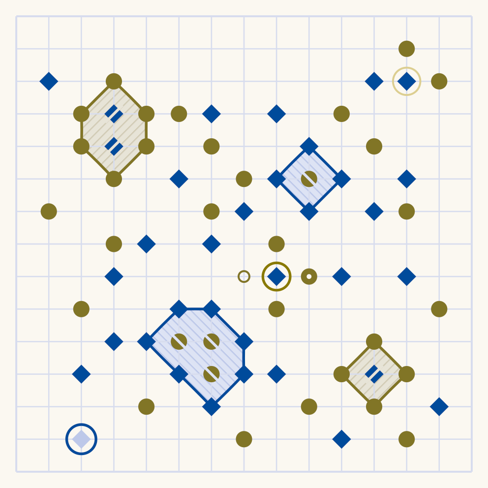 | 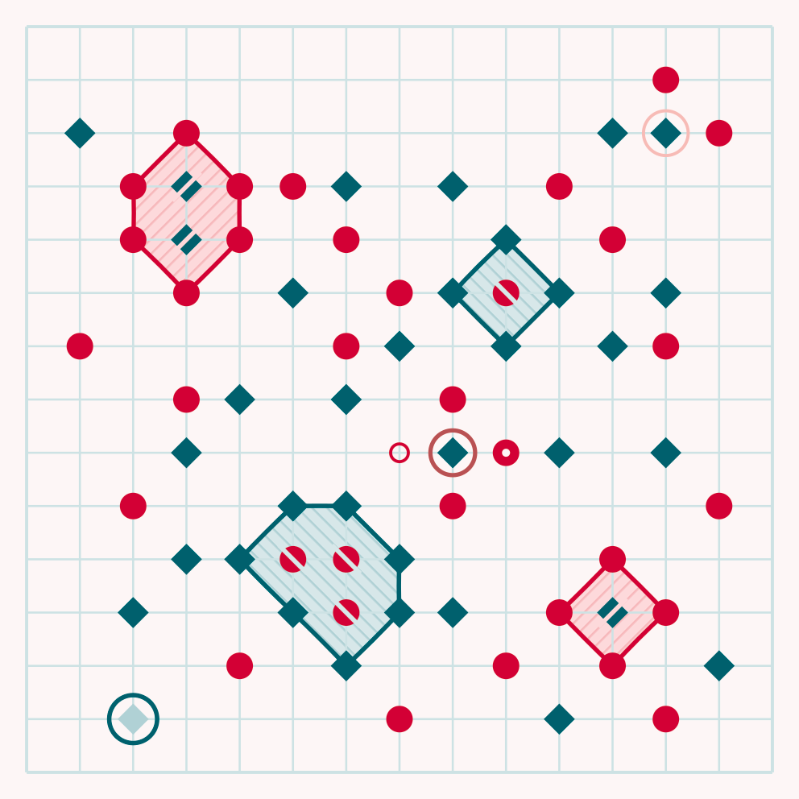 |
| Dark | 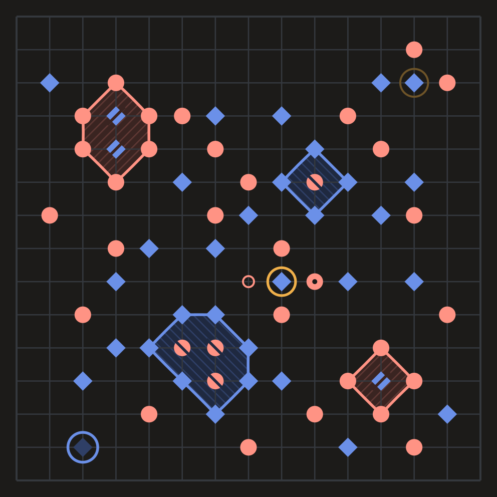 | 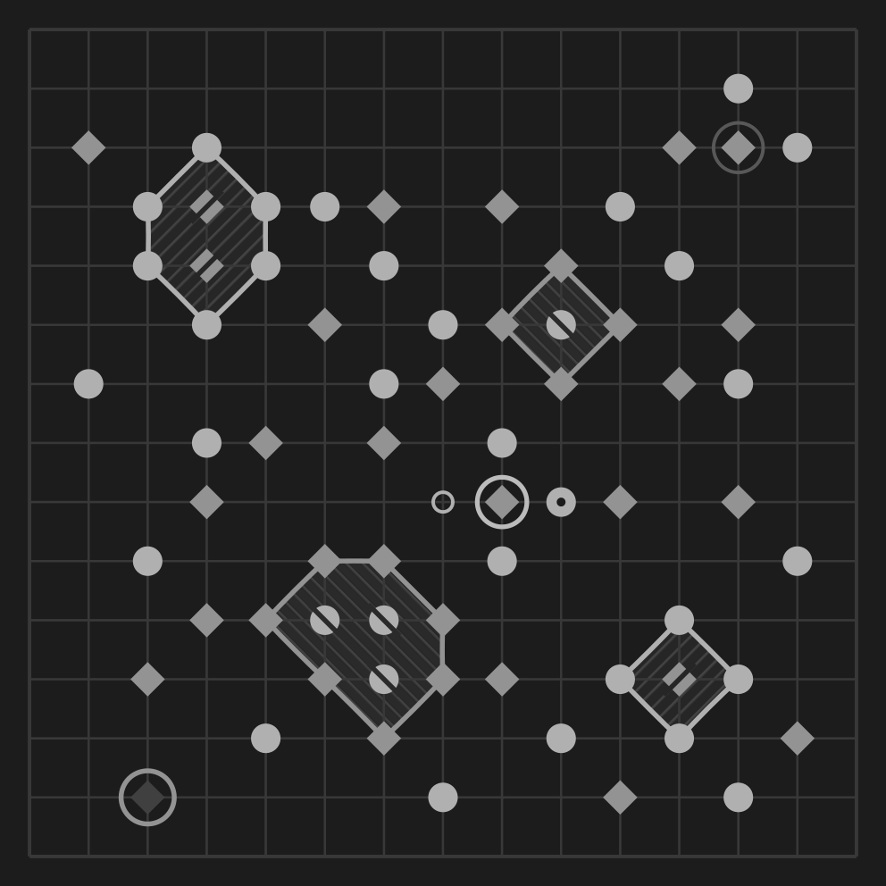 | 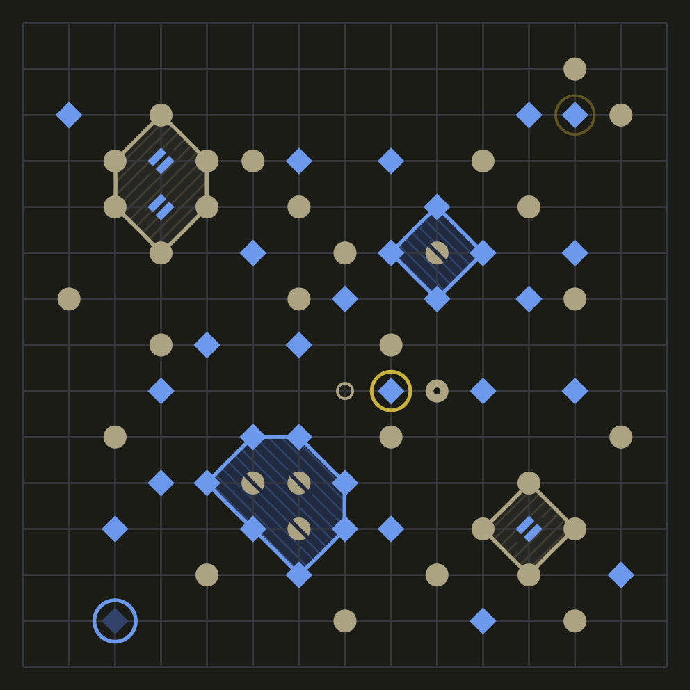 | 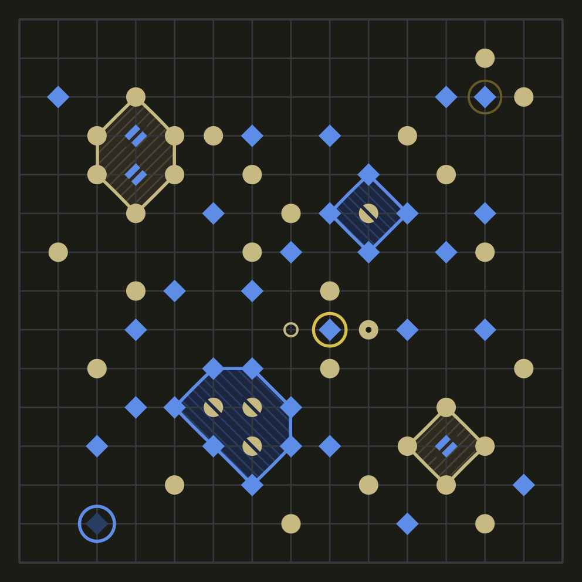 | 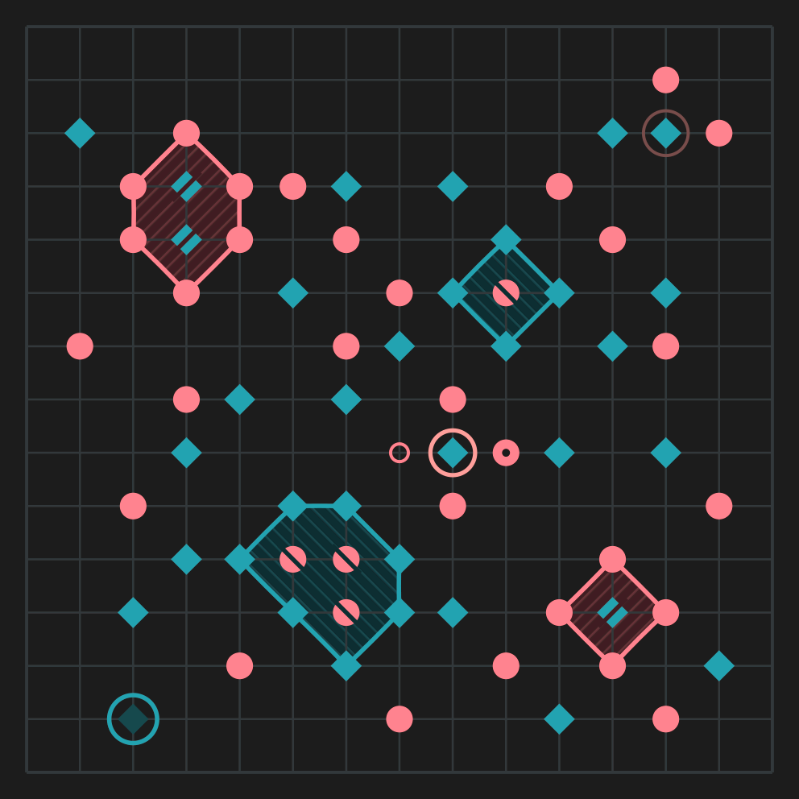 |

Open an image to see it at full size.

**Colour alone is not enough.** The contrast between the two inks in each view, using the WCAG 2
formula and cut to two decimals as on the theme page:

| View | Light | Dark |
| --- | --- | --- |
| As seen | 1.46 | 1.43 |
| Greyscale | 1.46 | 1.43 |
| Protanopia | 1.00 | 1.12 |
| Deuteranopia | 1.81 | 1.66 |
| Tritanopia | 1.31 | 1.27 |

In the three colour-blind views the inks keep different hues (red turns olive in protanopia and
deuteranopia, blue turns teal in tritanopia). In greyscale only the small lightness difference is
left, and in light protanopia the two inks have the same lightness. In every view the shapes
still separate the sides.

**The marks** keep their contrast in every view, because each is a light colour on a dark ink:

| Mark | Pair | Light | Dark |
| --- | --- | --- | --- |
| Pinhole | Paper on red ink | 5.12 | 7.99 |
| Pinhole | Paper on blue ink | 7.53 | 5.55 |
| Cut | Blue wash on red ink | 4.25 | 6.73 |
| Cut | Red wash on blue ink | 6.14 | 4.66 |

**On a phone.** Open each board image on the phone, fitted to the screen width. A 15x15 board
then has about 4 mm between points, as in the game. Check that red and blue pieces, the pinhole
and the cuts are easy to tell apart at arm's length, in every image.

**Redrawing.** [`pieces/draw.py`](pieces/draw.py) draws the sheets and the board images from the
values on this page and the theme page. Run `python3 docs/design/pieces/draw.py` from the
repository root; it needs Python 3 and `rsvg-convert` (from librsvg).
