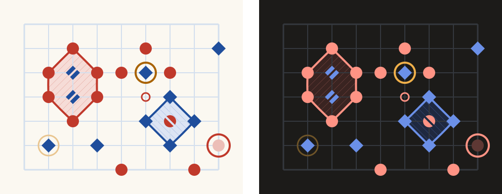
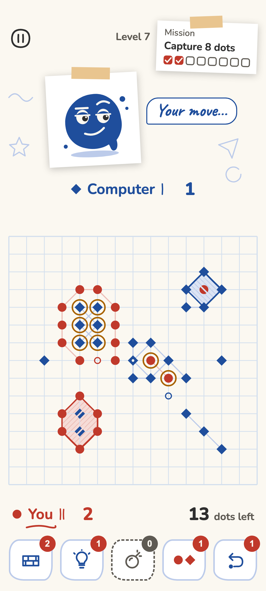
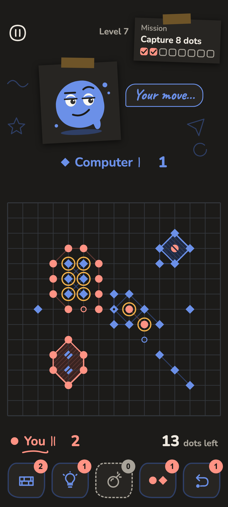
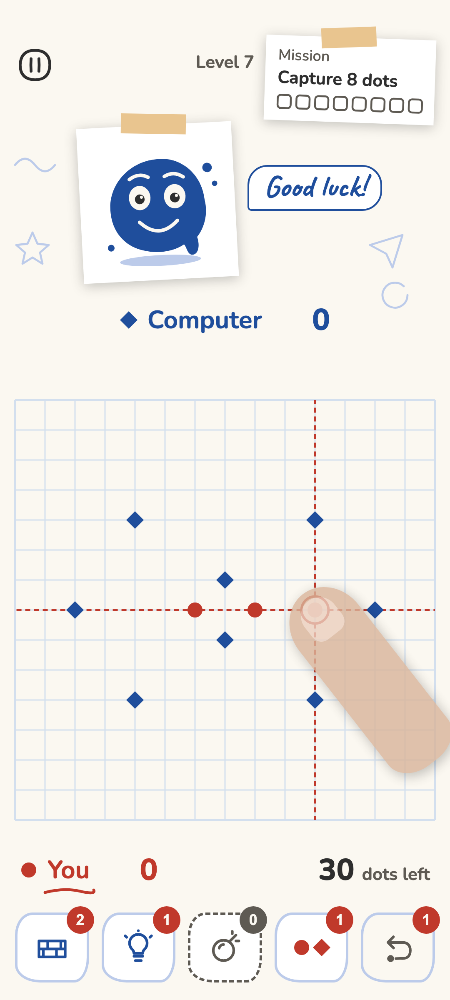
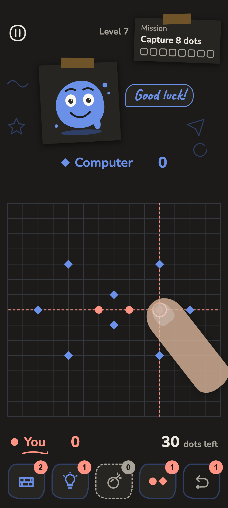
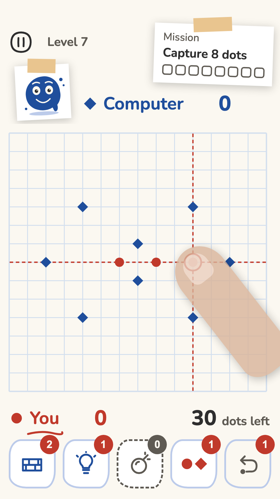

# Notebook theme

Notebook is the launch look (decision 0012,
[`docs/decisions/0012-launch-theme-and-first-boosters.md`](../decisions/0012-launch-theme-and-first-boosters.md)):
red and blue ink on squared school paper, with rings drawn like a pen stroke. This page gives
every value the app needs to draw it, in a light and a dark version. The
[Notebook mood board](moodboards/notebook.md) shows the feel. This page gives the exact values.

The sample above is drawn from the values on this page, at 2 px per dp. It shows a red capture
around two blue pieces, a blue capture around one red piece, a blue piece one move from capture
(solid ring) and one two moves away (faint ring), the point that would close the ring (small red
circle), and the dot the player is about to place (bottom right).

## Rules of the look

- **The board stays calm.** The grid is much paler than the ink, and washes are light, so every
  dot stands out, even on a crowded 15x15 board.
- **Three weights.** Grid lines are thin, rings are twice as thick, and dots are solid. Nobody
  should confuse one for another.
- **Never colour alone.** Red areas are hatched one way, blue areas the other way, so a player
  who can't tell red from blue can still tell the areas apart. For the same reason red pieces are
  round and blue pieces are diamonds ([Piece shapes](pieces.md)).
- **Light or dark follows the phone.** The game uses the dark version when the phone's dark theme
  is on.
- **No texture on the board.** Paper grain, doodles and pictures belong to the world backgrounds
  around the board, never under the points.

## Colours

| Name | Light | Dark | Used for |
| --- | --- | --- | --- |
| Paper | `#FBF8F1` | `#1C1B19` | The board and the screen background |
| Card | `#FFFFFF` | `#272522` | Cards, dialogs and sheets that sit on the paper |
| Grid | `#D3DFEE` | `#34383E` | Grid lines on the board and on menu screens; dividers |
| Red ink | `#C0392B` | `#FF9384` | Red dots and rings; red player's name and score; error text |
| Blue ink | `#1F4E9C` | `#6B90E8` | Blue dots and rings; blue player's name and score; main buttons |
| Red wash | `#F6DCD7` | `#3A2421` | Fill of an area red has captured |
| Blue wash | `#DCE4F4` | `#1F2940` | Fill of an area blue has captured |
| Red pale | `#ECBEB7` | `#5E3834` | Hatching in red areas; links between red dots; red preview dot |
| Blue pale | `#BCCBEA` | `#2F3F66` | Hatching in blue areas; links between blue dots; blue preview dot |
| Highlighter | `#A86200` | `#F0B04A` | Ring around a group one move from capture |
| Highlighter faint | `#E9C58F` | `#6E5428` | Ring around a group two moves from capture |
| Pencil | `#2E2E2E` | `#EDE8DF` | Main text and icons |
| Graphite | `#5E5A53` | `#A8A399` | Secondary text, hints, outlines of secondary buttons |
| Margin | `#EBB2AA` | `#5A3531` | The notebook margin line on menu screens; decoration only |

Every colour is solid. Nothing on the board is drawn see-through, so the numbers in the contrast
table are the colours the player sees.

## The board

Board sizes depend on the **spacing**, the distance between two neighbouring points. The app
picks the largest spacing that fits the board on the screen. A 15-point-wide board on a 360 dp
wide phone gets 24 dp, so the table gives each size at 24 dp and says how it changes for a
smaller or larger spacing.

| Element | Size at 24 dp spacing | Other spacings | Colour |
| --- | --- | --- | --- |
| Grid line | 1 dp | always 1 dp | Grid |
| Board edge (outermost grid lines) | 1.5 dp | always 1.5 dp | Grid |
| Dot size (red dot across) | 12 dp | half the spacing, at least 9 dp, at most 20 dp | Red ink |
| Blue diamond, corner to corner | 14 dp | 7/6 of the dot size | Blue ink |
| Ring (capture outline) | 2 dp | 1/12 of the spacing, at least 1.5 dp, at most 3 dp | Ink of the side that captured |
| Hatch line | 1 dp, one line every 5 dp | always the same | Red pale or Blue pale |
| Link between two dots of one side (only when shown; see below) | 1.5 dp | always 1.5 dp | Red pale or Blue pale |
| Threat ring, one move from capture | 20 dp across, 2 dp line | 0.84 of the spacing across | Highlighter |
| Threat ring, two moves from capture | 20 dp across, 1.5 dp line | 0.84 of the spacing across | Highlighter faint |
| Closing point (where the attacker would close the ring) | 8 dp across, 1.5 dp line | a third of the spacing across | Ink of the attacker |
| Preview (the piece about to be placed) | the moving side's piece inside a 22 dp ring, 2 dp line | piece as above; ring 0.9 of the spacing across | Piece: Red pale or Blue pale; ring: ink of the side to move |
| Drag's guides (the preview's row and column, while the finger is down) | 1.5 dp line, dashes 4 dp long with 3 dp gaps | always the same | Ink of the side to move |

Paper fills the board and half a spacing around its outermost points. Outside the board the screen
is plain paper without a grid, so the board's edge is clear.

**Drawing order**, from the back: paper, washes, hatching, grid, links, drag's guides, rings,
threat rings, pieces, last-move pinhole and captured cuts, closing points, preview. The grid lies on
top of the washes, so the squared paper shows through a captured area.

**Links** are pale lines between two touching dots of one side, across or diagonally, between
live dots only. The game board draws them only when the player turns on "Links between dots" in
Settings; they are off by default, so the board shows only the dots and the rings of real
captures. Some players read links as rings. Places that teach the rules always draw them: the
tutorial's linking level (1-2) while its steps are guided, and the pictures on How to play. The
level card's small board never does.

 

**Captured dots** keep their full ink colour. The wash and the hatching around them show that they
are captured, and they stay at least 3:1 against both (see the contrast table). A cut across
each captured piece marks it too.

**Piece shapes, the last-move pinhole, the captured cut and the preview** are on
[Piece shapes](pieces.md).

## Drag's guides

A player can place dots by drag instead of two taps (decision 0024, chosen in Settings). While the
finger is down, the preview sits on the point under it, and the guides show which row and column
that is. The finger hides the point itself, so the guides are what the player aims with.

  

The canvas frames "Game: placing by drag" and "Small phone: placing by drag" show them. The thumb
there is drawn a little see-through, so the preview under it shows.

- **Four arms.** Each guide runs from the preview ring along the point's row or column to the
  board's outermost grid line. It stops at the ring, so the pale piece inside stays clean.
- **Dashed, in the ink of the side to move.** 1.5 dp, dashes 4 dp long with 3 dp gaps, each arm's
  dashes starting at the ring. The guide lies on a grid line and is wider than it, so the grid
  line shows only in the gaps, like a pen line traced over the ruled paper.
- **Under the marks that matter.** The guides are drawn after the links and before the rings, so
  rings, threat rings, pieces and closing points all lie on top. A guide never hides a dot.
- **Solid colour.** The ink is drawn as it is, not see-through, like everything on the board.
- **The same at every spacing.** The line width and the dashes don't change with the spacing, so
  there are about three dashes between two points. At 21 dp, on a 320 x 568 phone, the arms still
  show on both sides of a fingertip, which covers about 60 dp.
- **Only on a free point.** Over a point that is taken, or off the board, there is no preview, so
  there are no guides: lifting there places nothing.

**Why dashed ink.** Three looks were tried on the canvas board. Solid ink running through a row of
red dots looked like a red ring joining them. Red pale or Blue pale nearly disappeared on the dark
board. A dashed ink line is plainly not a ring or a link, and dashes already mean "not placed yet"
on the board, as in Undo's dashed rings.

**Contrast.** The guides use the two inks, so their contrast is that of the dots in the contrast
table: at least 4.17 against paper and either wash, and at least 3.24 where they cross a hatch
line, in both versions.

How the guides appear and follow the finger is on the [motion page](motion.md#placing-by-drag).

## The ring

The ring is the outline of a captured area. It is drawn like a pen stroke, not like a ruler:

- It runs through the centres of the capturing dots, in the ink of the side that captured.
- Round ends and round corners.
- Each straight side bows slightly, by up to 0.4 dp to either side of the straight line, like a
  hand-drawn line.
- The line thickness varies by up to 15% along each side (2 dp ± 0.3 dp at 24 dp spacing), as a
  ballpoint does.
- The bow and the thickness come from a seed taken from the area itself (for example its first
  point). The same ring looks the same on every frame and after the game is reopened. It never
  shimmers.

## Captured areas

A captured area has two layers inside its ring:

1. **Wash:** a flat fill in Red wash or Blue wash.
2. **Hatching:** straight lines in Red pale or Blue pale, 1 dp thick, one every 5 dp, clipped to
   the ring. Red areas are hatched rising to the right (`/`, 45°). Blue areas are hatched falling
   to the right (`\`, 135°).

Hatching keeps its 5 dp gap at every spacing. It is paper texture, not part of the board's scale.

## Menu screens

- **Paper:** the screen background is Paper.
- **Grid:** Grid-coloured lines, 1 dp, one every 24 dp, behind everything. Text may sit
  directly on it: Pencil and Graphite stay above 4.5:1 against the lines.
- **Margin line:** one vertical Margin-coloured line, 1 dp, as decoration. It never crosses
  text or buttons.
- **Cards and dialogs:** Card colour, so they read as a separate sheet laid on the page.

## Type

Both fonts are on Google Fonts under the SIL Open Font License, which allows use in a commercial app.
Both cover English, Polish, Russian and Ukrainian (decision 0007), and both draw all digits at
the same width, so a score counting up does not jump about.

| Font | Use | Why |
| --- | --- | --- |
| [Caveat](https://fonts.google.com/specimen/Caveat) (variable, 400 to 700) | Big headings only | Looks handwritten, like notes in a notebook |
| [Nunito](https://fonts.google.com/specimen/Nunito) (variable, 200 to 1000) | Everything else | Rounded and friendly, easy to read at small sizes |

The mood board suggested Atkinson Hyperlegible for body text. It has no Cyrillic letters, so it
can't show Russian or Ukrainian. Nunito replaces it.

| Style | Font | Weight | Size | Line height | Used for |
| --- | --- | --- | --- | --- | --- |
| Display | Caveat | 700 | 40 sp | 48 sp | The result headline; world names |
| Headline | Caveat | 600 | 28 sp | 36 sp | Screen titles |
| Title | Nunito | 700 | 20 sp | 28 sp | Card and dialog titles |
| Score | Nunito | 800 | 24 sp | 28 sp | Scores, counters, move numbers |
| Body | Nunito | 500 | 16 sp | 24 sp | Running text, level goals |
| Label | Nunito | 700 | 14 sp | 20 sp | Buttons, tabs, chips |
| Small | Nunito | 500 | 12 sp | 16 sp | Captions; the smallest text in the game |

Text sizes are in sp: they are dp at the phone's normal font size and grow when the player picks
larger text. Board sizes are in dp and don't grow with the font size.

Caveat appears only at 24 sp and above, and never for numbers, buttons or anything a player has
to read quickly.

## Interface colours

How the colours fill the Material colour roles that the app's screens use:

| Material role | Colour |
| --- | --- |
| `background`, `surface` | Paper |
| `surfaceContainer` (and its lower and higher steps) | Card |
| `onBackground`, `onSurface` | Pencil |
| `onSurfaceVariant` | Graphite |
| `primary` | Blue ink |
| `onPrimary` | Paper |
| `secondary` | Red ink |
| `onSecondary` | Paper |
| `outline` | Graphite |
| `outlineVariant` | Grid |
| `error` | Red ink |
| `onError` | Paper |

Errors share their colour with the red side, so an error always has an icon or words too, never
colour alone.

## Contrast

Ratios use the WCAG 2 formula, the same one the
[WebAIM Contrast Checker](https://webaim.org/resources/contrastchecker/) uses, and are cut (not
rounded) to two decimals as WebAIM shows them. Targets: text at least 4.5:1; dots, rings and
marks at least 3:1. "Quiet" pairs are meant to be low, and have no target.

| Kind | Pair | Target | Light | Dark |
| --- | --- | --- | --- | --- |
| Text | Pencil on paper | 4.5 | 12.80 | 14.10 |
| Text | Graphite on paper | 4.5 | 6.46 | 6.85 |
| Text | Pencil on card | 4.5 | 13.57 | 12.52 |
| Text | Graphite on card | 4.5 | 6.85 | 6.08 |
| Text | Pencil on grid | 4.5 | 10.06 | 9.66 |
| Text | Graphite on grid | 4.5 | 5.07 | 4.69 |
| Text | Red ink on paper | 4.5 | 5.12 | 7.99 |
| Text | Blue ink on paper | 4.5 | 7.53 | 5.55 |
| Text | Red ink on card | 4.5 | 5.43 | 7.10 |
| Text | Blue ink on card | 4.5 | 7.99 | 4.93 |
| Text | Paper on blue ink (main button) | 4.5 | 7.53 | 5.55 |
| Text | Paper on red ink | 4.5 | 5.12 | 7.99 |
| Dot | Red ink on paper | 3 | 5.12 | 7.99 |
| Dot | Blue ink on paper | 3 | 7.53 | 5.55 |
| Dot | Red ink on card | 3 | 5.43 | 7.10 |
| Dot | Blue ink on card | 3 | 7.99 | 4.93 |
| Dot | Red ink on grid | 3 | 4.02 | 5.47 |
| Dot | Blue ink on grid | 3 | 5.92 | 3.80 |
| Dot | Red ink on red wash | 3 | 4.17 | 6.71 |
| Dot | Blue ink on red wash | 3 | 6.14 | 4.66 |
| Dot | Red ink on blue wash | 3 | 4.25 | 6.73 |
| Dot | Blue ink on blue wash | 3 | 6.25 | 4.67 |
| Dot | Red ink on red pale (hatch line) | 3 | 3.26 | 4.66 |
| Dot | Blue ink on red pale (hatch line) | 3 | 4.80 | 3.24 |
| Dot | Red ink on blue pale (hatch line) | 3 | 3.33 | 4.82 |
| Dot | Blue ink on blue pale (hatch line) | 3 | 4.89 | 3.35 |
| Mark | Highlighter on paper | 3 | 4.48 | 9.02 |
| Mark | Highlighter on red wash | 3 | 3.65 | 7.57 |
| Mark | Highlighter on blue wash | 3 | 3.72 | 7.59 |
| Quiet | Grid on paper | – | 1.27 | 1.45 |
| Quiet | Red wash on paper | – | 1.22 | 1.19 |
| Quiet | Blue wash on paper | – | 1.20 | 1.18 |
| Quiet | Red pale on red wash | – | 1.27 | 1.43 |
| Quiet | Blue pale on blue wash | – | 1.27 | 1.39 |
| Quiet | Margin on paper | – | 1.72 | 1.62 |
| Quiet | Red ink on blue ink | – | 1.46 | 1.43 |

Every pair with a target meets it. The dot rows cover every surface a dot can sit on: paper, card,
a grid crossing, either wash and either hatch line.

The last row shows the two inks differ in lightness too, in both versions (red is the lighter
one), so they don't turn into the same grey. That alone is not enough to tell the sides apart,
which is why the sides also differ in shape ([Piece shapes](pieces.md)).

The grid is deliberately quiet. It guides the eye but carries no game information; the dots and
rings do. The mood boards showed that a grid as dark as the ink makes the board hard to read. The faint threat ring
(Highlighter faint) is a soft hint. The solid ring for a group one move from capture is the one
that has to be seen, and it meets 3:1.
