# Notebook theme

Notebook is the launch theme (decision 0012,
[`docs/decisions/0012-launch-theme-and-first-boosters.md`](../decisions/0012-launch-theme-and-first-boosters.md)):
red and blue ink on squared school paper, with rings drawn like a pen stroke. This page gives
every value the app needs to draw it, in a light and a dark version. The
[Notebook mood board](moodboards/notebook.md) shows the feel. This page gives the exact values.

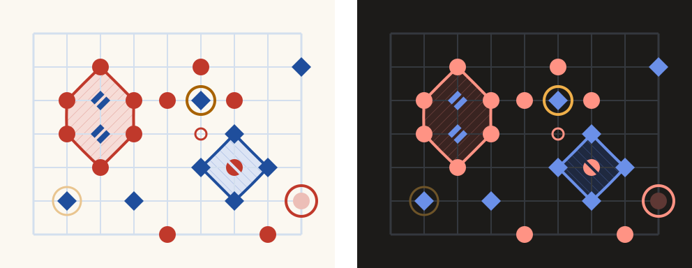

The sample above is drawn from the values on this page, at 2 px per dp. It shows a red capture
around two blue pieces, a blue capture around one red piece, a blue piece one move from capture
(solid ring) and one two moves away (faint ring), the point that would close the ring (small red
circle), and the dot the player is about to place (bottom right).

## Rules of the theme

- **The board stays calm.** The grid is much paler than the ink, and washes are light, so every
  dot stands out, even on a crowded 15x15 board.
- **Three weights.** Grid lines are thin, rings are twice as thick, and dots are solid. Nobody
  should confuse one for another.
- **Never colour alone.** Red areas are hatched one way, blue areas the other way, so a player
  who can't tell red from blue can still tell the areas apart. For the same reason red pieces are
  round and blue pieces are diamonds ([Piece shapes](pieces.md)).
- **Light or dark follows the phone.** The game uses the dark version when the phone's dark theme
  is on.
- **No texture on the board.** Paper grain, doodles and pictures belong to the map pages and to
  a world's board touches around the board, never under the points
  ([decision 0028](../decisions/0028-worlds-and-themes.md)).

## Colours

| Name | Light | Dark | Used for |
| --- | --- | --- | --- |
| Paper | `#FBF8F1` | `#1C1B19` | The board and the screen background |
| Card | `#FFFFFF` | `#272522` | Cards, dialogs and sheets that sit on the paper |
| Grid | `#D3DFEE` | `#34383E` | Grid lines on the board and on menu screens; dividers |
| Red ink | `#C0392B` | `#FF9384` | Red dots and rings; red player's name and score; error text |
| Blue ink | `#1F4E9C` | `#6B90E8` | Blue dots and rings; blue player's name and score; main buttons |
| Red wash | `#F6DCD7` | `#3A2421` | Fill of an area red has captured |
| Blue wash | `#DCE4F4` | `#1F2940` | Fill of an area blue has captured |
| Red pale | `#ECBEB7` | `#5E3834` | Hatching in red areas; links between red dots; red preview dot |
| Blue pale | `#BCCBEA` | `#2F3F66` | Hatching in blue areas; links between blue dots; blue preview dot |
| Highlighter | `#A86200` | `#F0B04A` | Ring around a group one move from capture |
| Highlighter faint | `#E9C58F` | `#6E5428` | Ring around a group two moves from capture |
| Pencil | `#2E2E2E` | `#EDE8DF` | Main text and icons |
| Graphite | `#5E5A53` | `#A8A399` | Secondary text, hints, outlines of secondary buttons |
| Margin | `#EBB2AA` | `#5A3531` | The notebook margin line on menu screens; decoration only |

Every colour is solid. Nothing on the board is drawn see-through, so the numbers in the contrast
table are the colours the player sees.

## The board

Board sizes depend on the **spacing**, the distance between two neighbouring points. The app
picks the largest spacing that fits the board on the screen. A 15-point-wide board on a 360 dp
wide phone gets 24 dp, so the table gives each size at 24 dp and says how it changes for a
smaller or larger spacing.

| Element | Size at 24 dp spacing | Other spacings | Colour |
| --- | --- | --- | --- |
| Grid line | 1 dp | always 1 dp | Grid |
| Board edge (outermost grid lines, and the lines round each hole) | 1.5 dp | always 1.5 dp | Grid |
| Hole (a place with no point) | no grid line reaches it; plain paper | always the same | Paper |
| Rock (blocked point): the wall's mark | a 16.8 dp square round the point, 1.8 dp line; five hatch lines rising to the right, 1.08 dp | square 0.7 of the spacing; line 0.075 of the spacing, at least 1.5 dp; hatch lines 0.6 of the line | Square: Pencil; hatching: Graphite |
| Pearl (bonus point) | a circle 16.8 dp across, 1.8 dp line; a shine inside its upper left, an arc 9.6 dp across from 195° to 255°, 1.44 dp, round ends | circle 0.7 of the spacing, line as the rock's; shine 0.4 of the spacing across, 0.8 of the line | Circle: Pencil; shine: Graphite |
| Dot size (red dot across) | 12 dp | half the spacing, at least 9 dp, at most 20 dp | Red ink |
| Blue diamond, corner to corner | 14 dp | 7/6 of the dot size | Blue ink |
| Ring (capture outline) | 2 dp | 1/12 of the spacing, at least 1.5 dp, at most 3 dp | Ink of the side that captured |
| Hatch line | 1 dp, one line every 5 dp | always the same | Red pale or Blue pale |
| Link between two dots of one side (only when shown; see below) | 1.5 dp | always 1.5 dp | Red pale or Blue pale |
| Threat ring, one move from capture | 20 dp across, 2 dp line | 0.84 of the spacing across | Highlighter |
| Threat ring, two moves from capture | 20 dp across, 1.5 dp line | 0.84 of the spacing across | Highlighter faint |
| Closing point (where the attacker would close the ring) | 8 dp across, 1.5 dp line | a third of the spacing across | Ink of the attacker |
| Preview (the piece about to be placed) | the moving side's piece inside a 22 dp ring, 2 dp line | piece as above; ring 0.9 of the spacing across | Piece: Red pale or Blue pale; ring: ink of the side to move |
| Drag's guides (the preview's row and column, while the finger is down) | 1.5 dp line, dashes 4 dp long with 3 dp gaps | always the same | Ink of the side to move |
| Drag's guides while Wall or Bomb is aimed | as above | always the same | Pencil |

Paper fills the board and half a spacing around its outermost points. Outside the board the screen
is plain paper without a grid, so the board's edge is clear.

**Drawing order**, from the back: paper, washes, hatching, grid, rocks and pearls, links, drag's guides, the bands
round the pieces (only with high-contrast pieces; [Piece shapes](pieces.md#high-contrast)), rings,
threat rings, pieces, last-move pinhole and captured cuts, closing points, preview. The grid lies on
top of the washes, so the squared paper shows through a captured area.

**Links** are pale lines between two touching dots of one side, across or diagonally, between
live dots only. The game board draws them only when the player turns on "Links between dots" in
Settings; they are off by default, so the board shows only the dots and the rings of real
captures. Some players read links as rings. Places that teach the rules always draw them: the
tutorial's linking level (1-2) while its steps are guided, and the pictures on How to play. The
level card's small board never does.

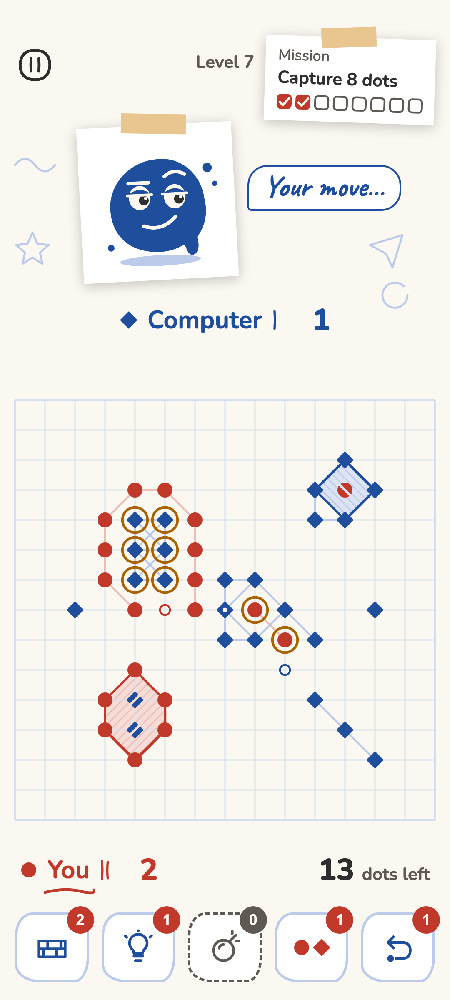 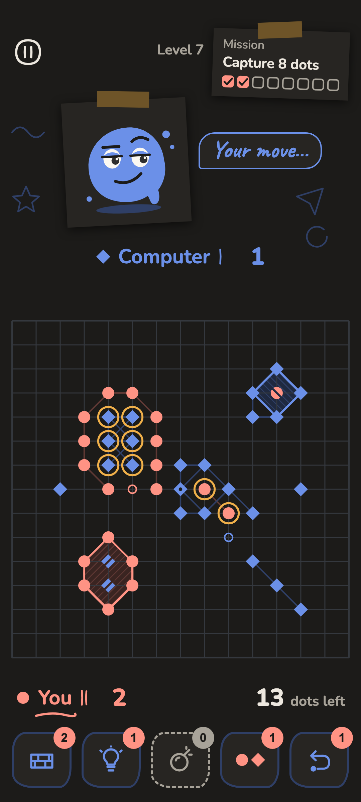

**Captured dots** keep their full ink colour. The wash and the hatching around them show that they
are captured, and they stay at least 3:1 against both (see the contrast table). A cut across
each captured piece marks it too.

**Piece shapes, the last-move pinhole, the captured cut and the preview** are on
[Piece shapes](pieces.md).

**Holes, rocks and pearls** have [their own section](#holes-rocks-and-pearls).

## Holes, rocks and pearls

World 3's boards have holes, places with no point. World 4 adds rocks, points where nobody may
place a dot, and pearls, points where a dot captured counts 2; its level Reef (4-18) has all three. The README's
[Board shapes and special points](../../README.md#board-shapes-and-special-points) gives the rules.

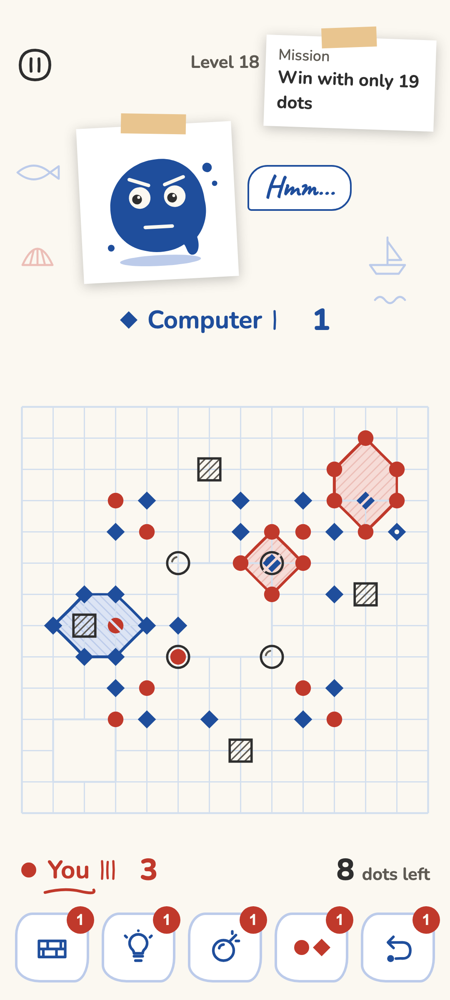 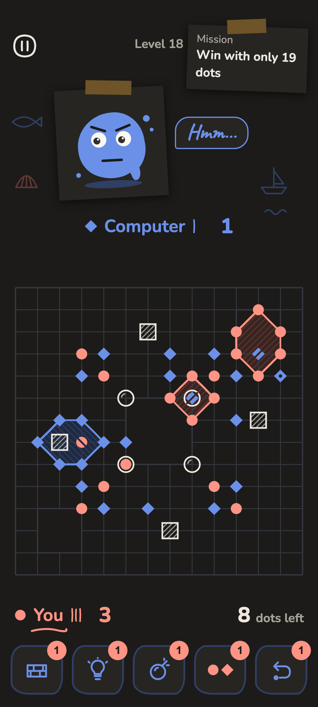 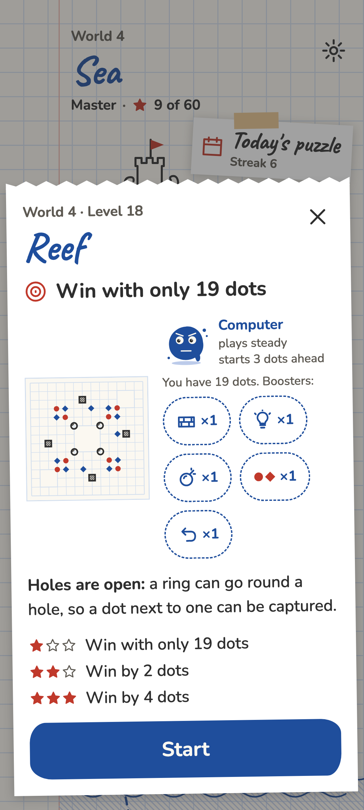

The canvas frames "Game: Reef, holes, rocks and pearls" and "Level card: Reef, a board with holes"
show them, each in the dark version too.

- **A hole is a gap in the board.** It has no point, so no grid line reaches it. The board's edge
  line, 1.5 dp, runs round the board's outline and round each hole inside it, so a hole looks like
  the paper outside the board. A single hole leaves a gap of 2 x 2 squares; a 2 x 2 hole leaves
  3 x 3.
- **Safe and open holes look the same** (decision 0034). The level card says which one the level
  uses; the board does not.
- **A capture round an open hole** covers it with the wash and the hatching, since the hole is
  inside the captured area. The grid lies on top of washes, so the hole's edge lines still show
  there, very faintly.
- **A rock carries the wall's mark,** the square a wall booster leaves. A rock and a wall play the
  same, so they look the same. A ring passes over a rock, and a rock inside a captured area stays
  drawn on the wash.
- **A pearl is a Pencil circle** with a short Graphite shine, the same size and line as the rock's
  square. A piece placed on a pearl sits inside the circle, clear of its line, and the circle
  stays round a captured piece, so the player sees it counted 2. An empty pearl inside a captured area
  stays drawn; it is out of play.
- **In Pencil, under the pieces.** Rocks and pearls belong to neither side, so they take Pencil,
  as the booster guides do. They lie on the grid and under the links, the rings and the pieces.
- **Not taken for other marks.** A threat ring is Highlighter, 0.84 of the spacing across, and
  lies over the rings; a pearl is Pencil, 0.7 across, under them. The preview ring is in the ink of
  the side to move, and the closing point is a third of the spacing.
- **The level card's picture** draws holes, rocks and pearls by the same rules at its own spacing.
  The rock's and the pearl's line stays at least 1.5 dp, so at about 8.6 dp spacing they show as
  small dark marks.

**The holes line on the level card.** A level with holes adds one line under the row with the
board picture, above the star targets, in Body (Nunito 500, 16 sp) in Pencil, its first words in
Nunito 700:

- **Holes are safe:** a dot next to a hole can never be captured.
- **Holes are open:** a ring can go round a hole, so a dot next to one can be captured.

A level without holes has no line.

**Contrast.** The square's and the circle's Pencil outline carries each mark: 12.80 light and 14.10
dark on paper, at least 10.43 and 11.83 on either wash, and at least 8.15 and 8.22 where it crosses
a hatch line. The Graphite hatching and shine are detail inside the outline: 6.46 and 6.85 on
paper, at least 5.26 and 5.75 on a wash. The hole's edge is Grid, a quiet 1.27 and 1.45 on paper:
the gap in the grid shows the hole, not its line.

## Drag's guides

Dots are placed by drag unless the player chooses two taps in Settings (decision 0026). While the
finger is down, the preview sits on the point under it, and the guides show which row and column
that is. The finger hides the point itself, so the guides are what the player aims with.

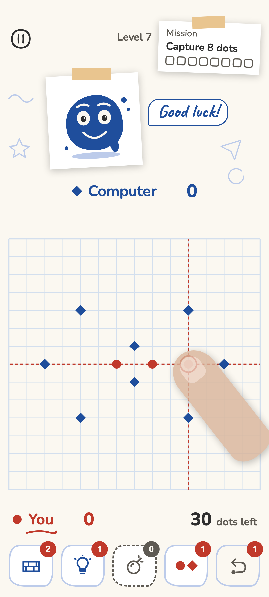 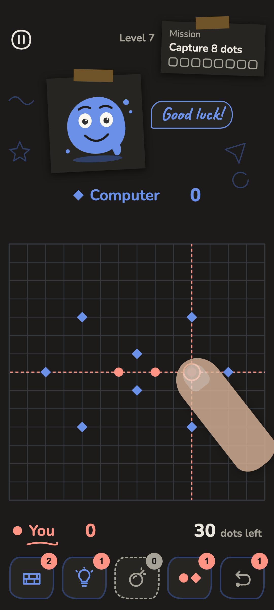 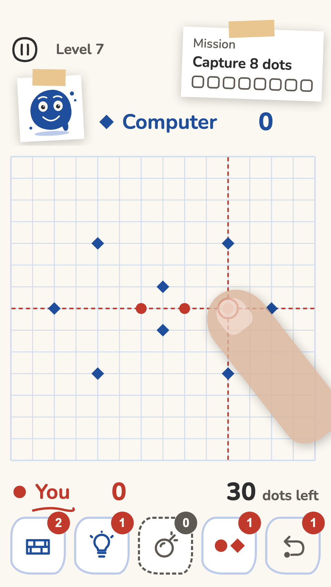

The canvas frames "Game: placing by drag" and "Small phone: placing by drag" show them. The thumb
there is drawn a little see-through, so the preview under it shows.

- **Four arms.** Each guide runs from the preview ring along the point's row or column to the
  board's outermost grid line. It stops at the ring, so the pale piece inside stays clean.
- **Dashed, in the ink of the side to move.** 1.5 dp, dashes 4 dp long with 3 dp gaps, each arm's
  dashes starting at the ring. The guide lies on a grid line and is wider than it, so the grid
  line shows only in the gaps, like a pen line traced over the ruled paper.
- **Under the marks that matter.** The guides are drawn after the links and before the rings, so
  rings, threat rings, pieces and closing points all lie on top. A guide never hides a dot.
- **Solid colour.** The ink is drawn as it is, not see-through, like everything on the board.
- **The same at every spacing.** The line width and the dashes don't change with the spacing, so
  there are about three dashes between two points. At 21 dp, on a 320 x 568 phone, the arms still
  show on both sides of a fingertip, which covers about 60 dp.
- **Only on a free point.** Over a point that is taken, or off the board, there is no preview, so
  there are no guides: lifting there places nothing.

**Why dashed ink.** Three looks were tried on the canvas board. Solid ink running through a row of
red dots looked like a red ring joining them. Red pale or Blue pale nearly disappeared on the dark
board. A dashed ink line is plainly not a ring or a link, and dashes already mean "not placed yet"
on the board, as in Undo's dashed rings.

**Contrast.** The guides use the two inks, so their contrast is that of the dots in the contrast
table: at least 4.17 against paper and either wash, and at least 3.24 where they cross a hatch
line, in both versions.

### Aiming Wall or Bomb by drag

In a booster preview, Wall and Bomb are aimed the way a dot is placed: with drag, the finger
slides to the point and lifts. The finger hides the point here too, so the guides show while a
booster is aimed. Hint, Double dot and Undo have no point to aim at, so they have no guides.

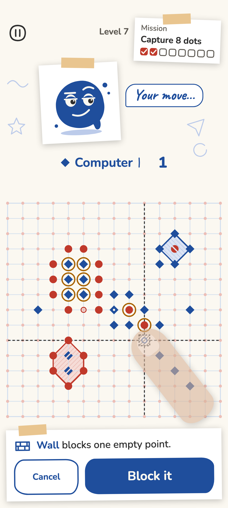 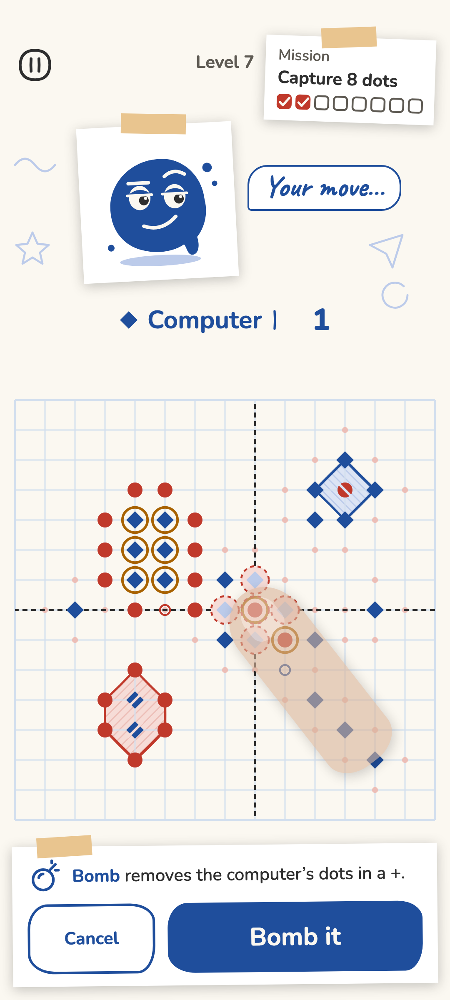 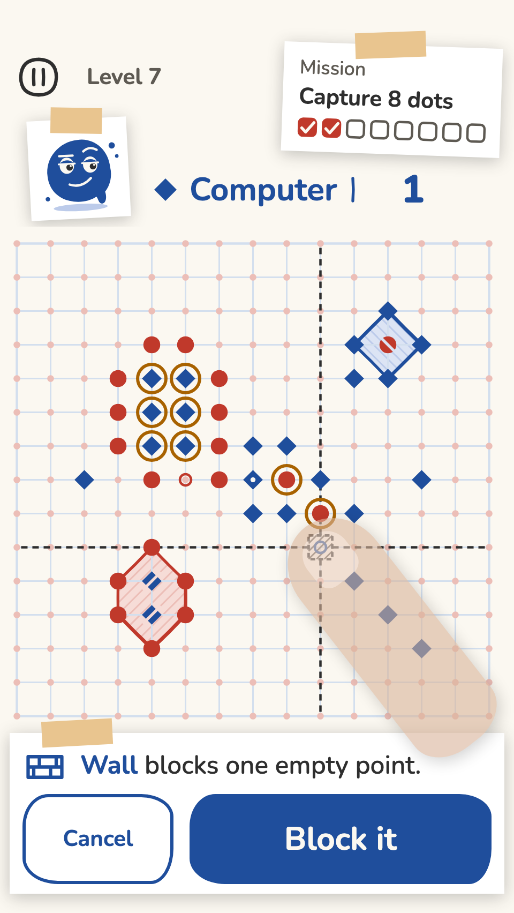

The canvas frames "Game: Wall aimed by drag", "Game: Bomb aimed by drag" and "Small phone: Wall
aimed by drag" show them, each in the dark version too. The thumb there is drawn lighter than on
the drag frames, since the booster's mark is larger than a preview and lies mostly under it.

- **In Pencil.** A booster is not a piece, so its guides are not in the side's ink. Red guides
  mean "your dot goes here"; Pencil guides mean "your booster goes here", and the wall's square is
  drawn in Pencil too. Width and dashes are those of the dot's guides.
- **From the booster's mark.** Each arm starts where the mark ends, so the mark stays clean:
  - **Wall:** at the side of the wall's dashed square, 0.35 of the spacing from the point (8.4 dp
    at 24 dp).
  - **Bomb:** past the plus, at the outer edge of the ring of the plus's point on that side, 1.46
    of the spacing from the centre (35 dp at 24 dp). Where the plus has no point on a side (a
    hole), the arm starts at the centre's ring, 0.46 of the spacing out. At the board's edge that
    arm has no room and is not drawn.
- **Only over a target.** The targets are the small pale dots of the booster preview: every
  empty point for a wall, every point whose plus holds an opponent's live dot for a bomb. Over a
  target the mark and the guides sit on it. Over any other point, or off the board, there are no guides, and
  the mark goes back to the point chosen before (or there is none yet). Lifting there keeps that
  point, so the board always shows what lifting would leave.
- **Lifting on a target chooses it.** The guides go; the mark stays until Confirm or Cancel.
- **Under the marks that matter,** in the same layer as the dot's guides: rings, threat rings,
  pieces and closing points lie on top.

**The marks they lead to.** The booster preview draws the targets, the wall's square with a
dashed outline, and for a bomb the plus: each of its 5 points on a disc of Red wash, 0.92 of the
spacing across, in a dashed Red ink ring (1.5 dp, 3 dp dashes and gaps). The discs lie under the
grid, like a captured area's wash; the rings lie with the rings. The pieces stay on top: the
player's own in full ink, the opponent's dots the bomb would take in their pale colour. A captured
area the bomb would break (decision 0042) is drawn at half strength, its wash, hatching and ring
together, like the pale dots: it is going too.

**Contrast.** Pencil is the strongest colour on the board. Against paper it is 12.80 light and
14.10 dark; against either wash at least 10.43 and 11.83; where it crosses a hatch line (Red pale
or Blue pale) at least 8.15 and 8.22.

How the guides appear and follow the finger is on the [motion page](motion.md#placing-by-drag).

## The ring

The ring is the outline of a captured area. It is drawn like a pen stroke, not like a ruler:

- It runs through the centres of the capturing dots, in the ink of the side that captured.
- Round ends and round corners.
- Each straight side bows slightly, by up to 0.4 dp to either side of the straight line, like a
  hand-drawn line.
- The line thickness varies by up to 15% along each side (2 dp ± 0.3 dp at 24 dp spacing), as a
  ballpoint does.
- The bow and the thickness come from a seed taken from the area itself (for example its first
  point). The same ring looks the same on every frame and after the game is reopened. It never
  shimmers.

## Captured areas

A captured area has two layers inside its ring:

1. **Wash:** a flat fill in Red wash or Blue wash.
2. **Hatching:** straight lines in Red pale or Blue pale, 1 dp thick, one every 5 dp, clipped to
   the ring. Red areas are hatched rising to the right (`/`, 45°). Blue areas are hatched falling
   to the right (`\`, 135°).

Hatching keeps its 5 dp gap at every spacing. It is paper texture, not part of the board's scale.

## Menu screens

- **Paper:** the screen background is Paper.
- **Grid:** Grid-coloured lines, 1 dp, one every 24 dp, behind everything. Text may sit
  directly on it: Pencil and Graphite stay above 4.5:1 against the lines.
- **Margin line:** one vertical Margin-coloured line, 1 dp, as decoration. It never crosses
  text or buttons.
- **Cards and dialogs:** Card colour, so they read as a separate sheet laid on the page.

## Type

Both fonts are on Google Fonts under the SIL Open Font License, which allows use in a commercial app.
Nunito draws all ten digits at the same width, so a score counting up does not jump about.
Caveat's digits have five different widths, which is one more reason numbers stay in Nunito.

| Font | Use | Why |
| --- | --- | --- |
| [Caveat](https://fonts.google.com/specimen/Caveat) (variable, 400 to 700) | Big headings only | Looks handwritten, like notes in a notebook |
| [Nunito](https://fonts.google.com/specimen/Nunito) (variable, 200 to 1000) | Everything else | Rounded and friendly, easy to read at small sizes |

The mood board suggested Atkinson Hyperlegible for body text. Nunito is used instead: its
rounded letters suit the friendly tone, and its digits share one width.

| Style | Font | Weight | Size | Line height | Used for |
| --- | --- | --- | --- | --- | --- |
| Display | Caveat | 700 | 40 sp | 48 sp | The result headline; world names |
| Headline | Caveat | 600 | 28 sp | 36 sp | Screen titles |
| Title | Nunito | 700 | 20 sp | 28 sp | Card and dialog titles |
| Score | Nunito | 800 | 24 sp | 28 sp | Scores, counters, move numbers |
| Body | Nunito | 500 | 16 sp | 24 sp | Running text, level goals |
| Label | Nunito | 700 | 14 sp | 20 sp | Buttons, tabs, chips |
| Small | Nunito | 500 | 12 sp | 16 sp | Captions; the smallest text in the game |

Text sizes are in sp: they are dp at the phone's normal font size and grow when the player picks
larger text. Board sizes are in dp and don't grow with the font size.

Caveat appears only at 24 sp and above, and never for numbers, buttons or anything a player has
to read quickly.

## Interface colours

How the colours fill the Material colour roles that the app's screens use:

| Material role | Colour |
| --- | --- |
| `background`, `surface` | Paper |
| `surfaceContainer` (and its lower and higher steps) | Card |
| `onBackground`, `onSurface` | Pencil |
| `onSurfaceVariant` | Graphite |
| `primary` | Blue ink |
| `onPrimary` | Paper |
| `secondary` | Red ink |
| `onSecondary` | Paper |
| `outline` | Graphite |
| `outlineVariant` | Grid |
| `error` | Red ink |
| `onError` | Paper |

Errors share their colour with the red side, so an error always has an icon or words too, never
colour alone.

## Contrast

Ratios use the WCAG 2 formula, the same one the
[WebAIM Contrast Checker](https://webaim.org/resources/contrastchecker/) uses, and are cut (not
rounded) to two decimals as WebAIM shows them. Targets: text at least 4.5:1; dots, rings and
marks at least 3:1. "Quiet" pairs are meant to be low, and have no target.

| Kind | Pair | Target | Light | Dark |
| --- | --- | --- | --- | --- |
| Text | Pencil on paper | 4.5 | 12.80 | 14.10 |
| Text | Graphite on paper | 4.5 | 6.46 | 6.85 |
| Text | Pencil on card | 4.5 | 13.57 | 12.52 |
| Text | Graphite on card | 4.5 | 6.85 | 6.08 |
| Text | Pencil on grid | 4.5 | 10.06 | 9.66 |
| Text | Graphite on grid | 4.5 | 5.07 | 4.69 |
| Text | Red ink on paper | 4.5 | 5.12 | 7.99 |
| Text | Blue ink on paper | 4.5 | 7.53 | 5.55 |
| Text | Red ink on card | 4.5 | 5.43 | 7.10 |
| Text | Blue ink on card | 4.5 | 7.99 | 4.93 |
| Text | Paper on blue ink (main button) | 4.5 | 7.53 | 5.55 |
| Text | Paper on red ink | 4.5 | 5.12 | 7.99 |
| Dot | Red ink on paper | 3 | 5.12 | 7.99 |
| Dot | Blue ink on paper | 3 | 7.53 | 5.55 |
| Dot | Red ink on card | 3 | 5.43 | 7.10 |
| Dot | Blue ink on card | 3 | 7.99 | 4.93 |
| Dot | Red ink on grid | 3 | 4.02 | 5.47 |
| Dot | Blue ink on grid | 3 | 5.92 | 3.80 |
| Dot | Red ink on red wash | 3 | 4.17 | 6.71 |
| Dot | Blue ink on red wash | 3 | 6.14 | 4.66 |
| Dot | Red ink on blue wash | 3 | 4.25 | 6.73 |
| Dot | Blue ink on blue wash | 3 | 6.25 | 4.67 |
| Dot | Red ink on red pale (hatch line) | 3 | 3.26 | 4.66 |
| Dot | Blue ink on red pale (hatch line) | 3 | 4.80 | 3.24 |
| Dot | Red ink on blue pale (hatch line) | 3 | 3.33 | 4.82 |
| Dot | Blue ink on blue pale (hatch line) | 3 | 4.89 | 3.35 |
| Mark | Highlighter on paper | 3 | 4.48 | 9.02 |
| Mark | Highlighter on red wash | 3 | 3.65 | 7.57 |
| Mark | Highlighter on blue wash | 3 | 3.72 | 7.59 |
| Quiet | Grid on paper | – | 1.27 | 1.45 |
| Quiet | Red wash on paper | – | 1.22 | 1.19 |
| Quiet | Blue wash on paper | – | 1.20 | 1.18 |
| Quiet | Red pale on red wash | – | 1.27 | 1.43 |
| Quiet | Blue pale on blue wash | – | 1.27 | 1.39 |
| Quiet | Margin on paper | – | 1.72 | 1.62 |
| Quiet | Red ink on blue ink | – | 1.46 | 1.43 |

Every pair with a target meets it. The dot rows cover every surface a dot can sit on: paper, card,
a grid crossing, either wash and either hatch line.

The last row shows the two inks differ in lightness too, in both versions (red is the lighter
one), so they don't turn into the same grey. That alone is not enough to tell the sides apart,
which is why the sides also differ in shape ([Piece shapes](pieces.md)).

The grid is deliberately quiet. It guides the eye but carries no game information; the dots and
rings do. The mood boards showed that a grid as dark as the ink makes the board hard to read. The faint threat ring
(Highlighter faint) is a soft hint. The solid ring for a group one move from capture is the one
that has to be seen, and it meets 3:1.
