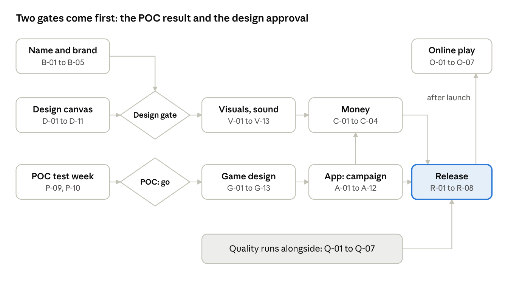

# Pinfold: the plan

This plan takes the proof of concept (POC) to a free-to-play Android game on Google Play. It says
what we are building, in what order and with which tools. The tasks themselves, and whether each
one is finished, live only in [GitHub Issues](https://github.com/Pavelya/dots/issues), grouped by
[milestone](https://github.com/Pavelya/dots/milestones).

## The game in one paragraph

Pinfold is the classic paper game *Dots* on a 15x15 board that starts with four crosses. Solo play
is a campaign of worlds. Each world teaches one new idea (a mission type, a board shape, a booster)
and ends with an announced boss. Difficulty comes from the levels, not from a picker. Two people
can play on one phone, and later online. At launch it looks like ink on squared paper; other
themes are cosmetics. It earns money from cosmetics and optional rewarded ads, and nothing can be
bought that helps you win.

## Phases

Each phase is a milestone. Its issues hold the task cards: goal, dependencies, steps, checks,
"Done when" and who verifies it.

| Phase | What it delivers |
| --- | --- |
| [0 POC](https://github.com/Pavelya/dots/milestone/2) | A plain Android version and a one-week test with 5 to 10 people: do they enjoy the core game enough to come back? Charter and test plan: [`docs/poc/`](poc/README.md). |
| [1 Brand](https://github.com/Pavelya/dots/milestone/3) | A name nobody else owns, the permanent app ID, a logo and the game's own accounts. "Dots" is another company's trademark for a game, so it can only describe the game, not name it. |
| [2 Design](https://github.com/Pavelya/dots/milestone/4) | References, mood boards, the Notebook theme, screens and flows, wireframes, a canvas of the game in its final look, a motion storyboard, a sound list and a clickable prototype. Everything lands in `docs/design/`. |
| [3 Game design](https://github.com/Pavelya/dots/milestone/5) | The campaign in the engine: levels as data, mission types, boosters, boss rules, special board points, 75 launch levels and a daily puzzle, all with tests. |
| [4 App](https://github.com/Pavelya/dots/milestone/6) | The screens around the board: world map, level card and result, progress, boosters, tutorial, daily puzzle, settings, languages, stats. They use the plain POC look until phase 5 restyles them. |
| [5 Visuals](https://github.com/Pavelya/dots/milestone/7) | The look and feel the canvas promised: theme system, Notebook theme, pieces, animations, haptics, sound effects, music, world backgrounds. The asset register (V-01) starts at once, because it guards every asset. |
| [6 Money](https://github.com/Pavelya/dots/milestone/8) | Cosmetics for sale and optional rewarded ads (decision 0004). No advantages for money, no loot boxes, no forced ads. |
| [7 Online](https://github.com/Pavelya/dots/milestone/9) | Leaderboards first (they can ship with the launch), then games with friends, turn by turn, after the launch. Ranked games only once enough people play (decision 0014). Online games use the pure rules, without boosters. |
| [8 Quality](https://github.com/Pavelya/dots/milestone/10) | Test coverage, speed on a cheap phone, accessibility, play-tests, crash reports, analytics, offline play. It runs beside phases 3 to 7 and must pass before the closed test. |
| [9 Release](https://github.com/Pavelya/dots/milestone/11) | Play Console, release signing, privacy policy, age rating, store listing, the closed test, the launch and the work after it. |

[F Foundation](https://github.com/Pavelya/dots/milestone/1) holds work on the repository itself
(CI, workflow, docs).

## Two gates

- **POC "go"** ([P-10](https://github.com/Pavelya/dots/issues/29)). The test week ends with a
  decision: go, change and retest, or stop. Engine work for the campaign (phase 3) waits for "go".
- **Design gate** ([D-12](https://github.com/Pavelya/dots/issues/46)). The owner approves the
  look from the canvas and the prototype. Visual coding (phase 5, except the asset register) waits
  for it.

Naming and design run beside the POC test week. Money, the app and quality all feed the release.
Online play follows the launch, except leaderboards, which can ship with it.

The P-10 testers can also be the 12 testers Google Play requires for the closed test
([R-06](https://github.com/Pavelya/dots/issues/108)), so recruit with that in mind.

## How we work

The working rules are in [`CLAUDE.md`](../CLAUDE.md): one issue per session and per pull request,
CI green before merge, the asset register, decision records, and an engine free of Android code.
New tasks use the issue template, which has the same card format as the existing issues.

## Decisions

Settled decisions are in [`docs/decisions/`](decisions/), one file each. The POC's own decisions
(D-POC-1 to D-POC-3) are in the [POC charter](poc/README.md). Open questions are issues with the
[`decision`](https://github.com/Pavelya/dots/issues?q=label%3Adecision) label; each one closes
with a new record in `docs/decisions/`.

## Tools, accounts and configuration

Everything is free except the one-time Play account ($25) and one month of Suno Pro (about $10).
Ownership notes for each tool are in the [design investigation](design/investigation.md),
section 8. "First needed in" names the task that first needs the tool or account.

### Tools

| Tool | Used for | Cost | First needed in |
| --- | --- | --- | --- |
| Android Studio (stable) with its JDK, SDK and emulator | Build, run, debug, profile | Free | In use |
| Git, GitHub Actions | Version control, CI, APK builds | Free | In use |
| A real Android phone, plus an old cheap one | Touch, feel, speed on low-end hardware | Own devices | In use / [Q-02](https://github.com/Pavelya/dots/issues/97) |
| ChatGPT image generation | Mood boards, concept art, backgrounds, portraits | Owner's Pro plan | [D-02](https://github.com/Pavelya/dots/issues/36) |
| Figma (free plan); Penpot as a fallback | Wireframes, canvas mock-ups, clickable prototype | Free | [D-06](https://github.com/Pavelya/dots/issues/40) |
| Krita, Inkscape, GIMP | Clean-up, piece shapes as SVG, icons, textures | Free | [D-04](https://github.com/Pavelya/dots/issues/38) |
| Google Fonts (OFL), Material Symbols (Apache 2.0) | Type and interface icons | Free | [D-03](https://github.com/Pavelya/dots/issues/37) |
| WebAIM Contrast Checker, Coblis, Android "Simulate color space" | Contrast and colour-blindness checks | Free | [D-04](https://github.com/Pavelya/dots/issues/38) |
| Google Lens, TinEye | Reverse image search for key art | Free | [V-01](https://github.com/Pavelya/dots/issues/72) |
| Audacity, a phone recorder, jsfxr | Recording and editing sound effects | Free | [V-08](https://github.com/Pavelya/dots/issues/79) |
| Kenney packs, Freesound (CC0 only) | Extra sound effects | Free | [V-08](https://github.com/Pavelya/dots/issues/79) |
| Suno Pro (one month) | Music for menu, worlds and boss | About $10 once | [V-09](https://github.com/Pavelya/dots/issues/80) |
| A song-recognition app (for example Shazam) | Check AI music does not match a known song | Free | [V-09](https://github.com/Pavelya/dots/issues/80) |
| Robolectric, Compose UI test, Roborazzi | Unit, UI and screenshot tests | Free | In use |
| Macrobenchmark, Baseline Profiles, Profiler | Frame time, start-up, AI speed | Free | [Q-02](https://github.com/Pavelya/dots/issues/97) |
| Accessibility Scanner (Play app) | Accessibility audit on the phone | Free | [Q-03](https://github.com/Pavelya/dots/issues/98) |
| Firebase Emulator Suite | Testing online rules locally | Free | [O-03](https://github.com/Pavelya/dots/issues/91) |
| Shotcut or DaVinci Resolve | Store video | Free | [R-05](https://github.com/Pavelya/dots/issues/107) |
| Bitwarden (or another password manager) | Account and signing-key passwords | Free | [B-05](https://github.com/Pavelya/dots/issues/34) |

### Accounts

| Account | Why | Cost | First needed in |
| --- | --- | --- | --- |
| GitHub | Code, CI, releases, issues | Free | In use |
| A Google account just for the game | Owns Play Console, Firebase, AdMob, Play Games | Free | [B-05](https://github.com/Pavelya/dots/issues/34) |
| A support email address on that account: `pinfoldsupport@gmail.com` | Shown in the store, answers players | Free | [B-05](https://github.com/Pavelya/dots/issues/34) |
| Figma | Design files | Free | [D-06](https://github.com/Pavelya/dots/issues/40) |
| Freesound | Downloading CC0 sounds | Free | [V-08](https://github.com/Pavelya/dots/issues/79) |
| Suno (Pro for one month, then cancel) | Music with commercial rights | About $10 | [V-09](https://github.com/Pavelya/dots/issues/80) |
| Google Play Console, personal, with identity check | Publishing; Play Games Services; in-app purchases | $25 once | [R-01](https://github.com/Pavelya/dots/issues/103) |
| Google payments profile (merchant) | Selling cosmetics | Free; Google keeps a share of each sale | [C-02](https://github.com/Pavelya/dots/issues/86) |
| AdMob | Rewarded ads | Free | [C-03](https://github.com/Pavelya/dots/issues/87) |
| Firebase project (Spark plan first) | Crash reports, analytics, online play | Free; Blaze only if server checks need it | [Q-05](https://github.com/Pavelya/dots/issues/100) / [O-01](https://github.com/Pavelya/dots/issues/89) |

### Configuration

- **Repository:** design files in `docs/design/`, decisions in `docs/decisions/`, the asset
  register in `docs/assets.md`, issue and pull-request templates in `.github/`.
- **Build:** one version catalog (`gradle/libs.versions.toml`), kept current by Dependabot;
  `minSdk` 24 (Android 7); `targetSdk` the newest Android. The store app adds a release build type
  with code shrinking.
- **CI:** engine and CLI tests, app and screenshot tests, lint and the debug APK on every pull
  request and push to `main`; the POC test build on a `poc-v*` tag. A release build on tags comes
  with the store app.
- **Secrets:** only in GitHub Actions secrets, never in the repository (decision 0017). The store
  upload key and its passwords go there too, with an offline backup; Play App Signing keeps the
  real signing key.
- **Web pages:** a privacy policy and a small game page on GitHub Pages (the repository is public)
  or Google Sites.
