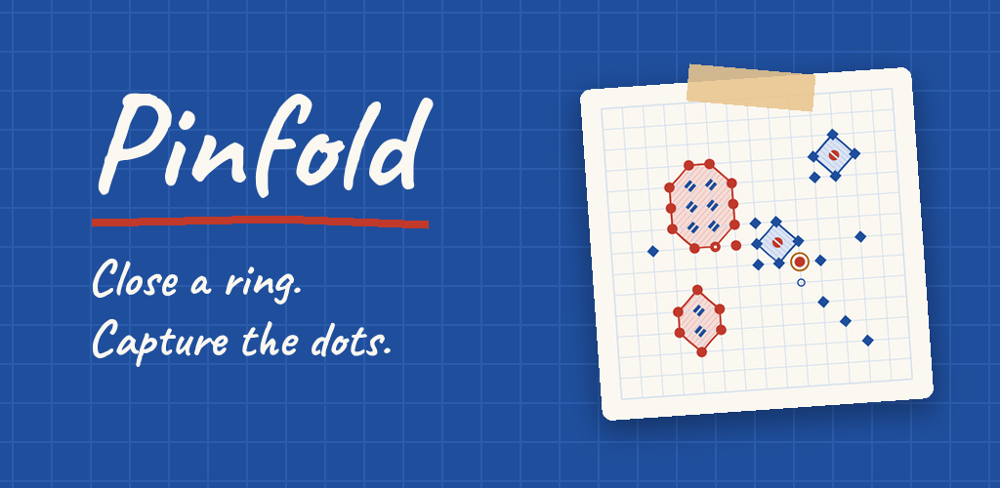
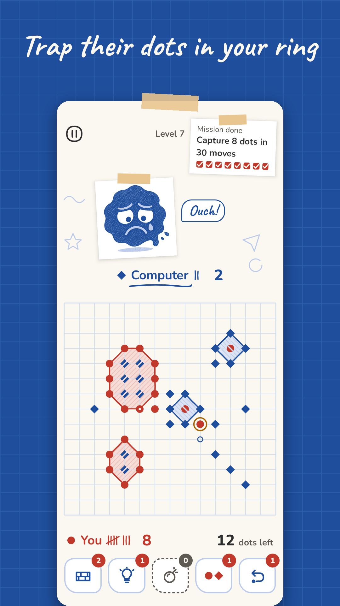
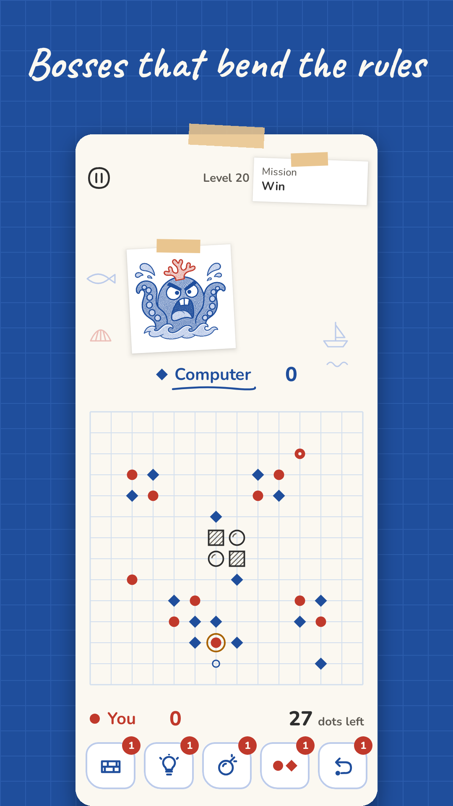
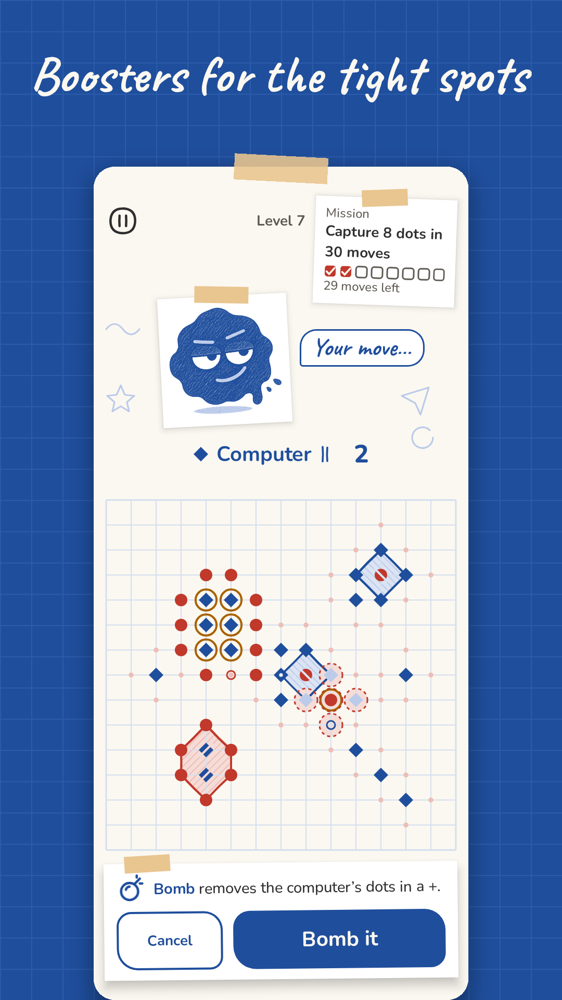
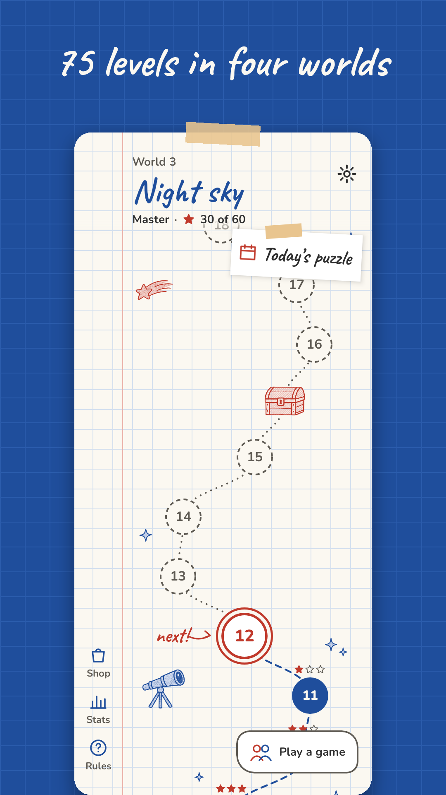
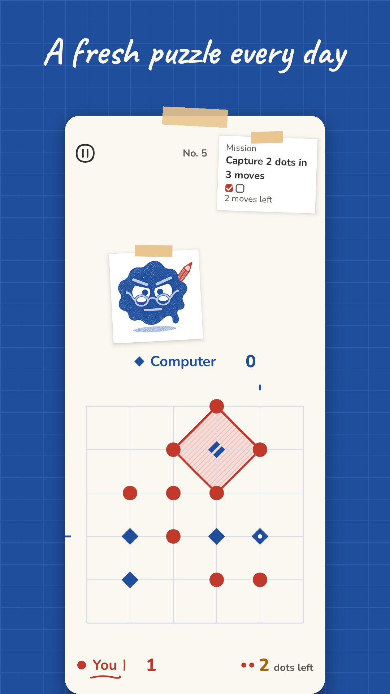
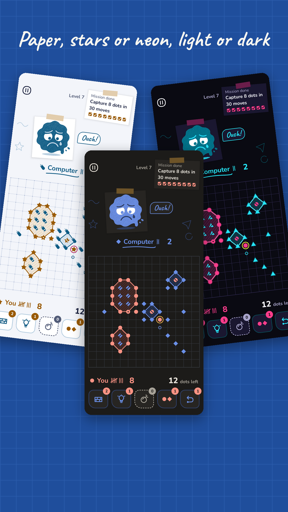
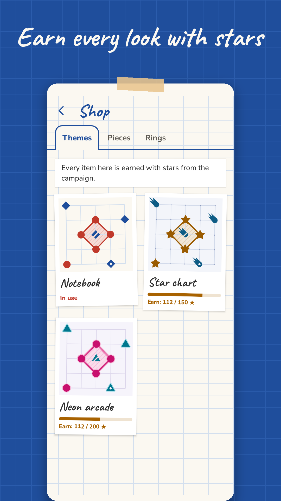
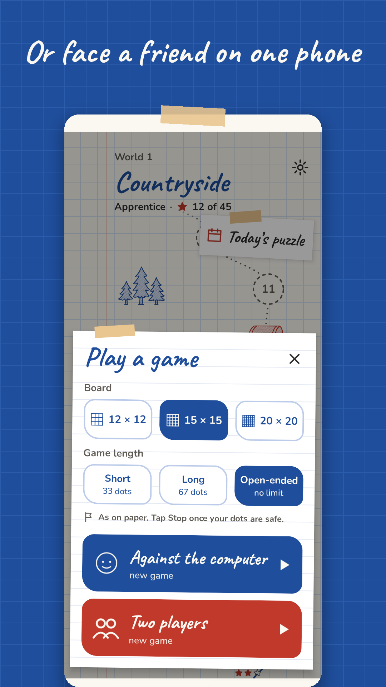

# Store listing

Everything Pinfold's Google Play listing holds, in English only (decision 0036): the text, the
images and their alt texts, the video, and where each goes in Play Console. Google's rules for
these assets: [preview assets](https://support.google.com/googleplay/android-developer/answer/9866151)
and the [metadata policy](https://support.google.com/googleplay/android-developer/answer/9898842).



       

## Rules the listing keeps

- **"dots" is a plain word.** "DOTS" is another company's game trademark (decision 0010). The
  listing says "dots" only for the pieces on the board, never as a name or a title.
- **No ranking, price or pressure words** anywhere: not "best", "#1", "top", "new", "free",
  "sale", and no calls to action such as "play now" or "download".
- **One message per place.** The short description, the feature graphic and the captions say
  different things, because Play may show them side by side.
- **The images show the game itself.** Every screenshot is the app's own screen, drawn by the
  screenshot tests. No phone frames, no prices on screen, captions under 20% of the image.

## Text

**App name** (30 characters at most): `Pinfold`

**Short description** (80 at most; this one is 75):

```text
Ring the other side's dots to capture them in a pen and paper strategy game
```

**Full description** (4,000 at most). Paste it as it is; Play keeps the blank lines.

```text
Pinfold is a strategy game born on squared school paper. Two sides take turns placing dots on the crossings of the grid. Close a ring around the other side's dots and they are yours. The side that captures more wins.

The rules take a minute to learn. Then every move is a choice: chase a capture, or close the gap before the other side closes it around you.

A campaign of 75 levels
Travel through four worlds: Countryside, Garden, Night sky and Sea. Each level has a mission and up to three stars to earn. A short tutorial teaches the rules as you play.

Bosses with their own rules
The Ink Bottle, the Mole, the Comet and the Kraken each break the rules in their own way: a double move every few turns, a head start, a round board, two dots every turn. A counter shows when the next trick comes.

Boosters for the tight spots
Wall, Hint, Bomb, Double dot and Undo. You earn them by playing, with stars, chests and the daily streak. They are never sold, and every level can be won without them.

A puzzle every day
One short puzzle a day, the same for everyone. Keep your streak going.

Play your way
Outside the campaign, take on the computer on a 12 x 12, 15 x 15 or 20 x 20 board, short, long or open-ended. Or pass the phone to a friend and play two players on one phone.

Three looks
Red and blue ink on a notebook page, gold stars on a chart of the night sky, or neon light. Each comes in light and dark, following your phone. Piece styles and ring effects change how your dots and rings look.

Fair by design
Everything the shop sells is a look: themes, piece styles and ring effects. Nothing you can buy helps you win, and every item can also be earned with the stars you collect. Ads appear only when you choose one for a reward, and saying no costs nothing.

Made for everyone
High-contrast pieces, round and diamond shapes for the two sides so colour is never the only clue, and settings for music, sounds and vibration.
```

**Contact details** (Store settings): the email the owner uses for Pinfold, and the website
`https://pavelya.github.io/dots/`.

**Category** (Store settings): app type **Game**, category **Board**. Pinfold is an abstract
strategy game for two sides on a grid, like Go; Board is where players look for that. **Tags**:
pick up to five from Play's list, for example *Abstract strategy*, *Board*, *Puzzle*,
*Single player*, *Offline* (only if the offline check below passes).

## Images

| Play Console field | File | Size |
| --- | --- | --- |
| App icon | [`docs/design/brand/pinfold-store-512.png`](../design/brand/pinfold-store-512.png) | 512 x 512, PNG with alpha |
| Feature graphic | [`feature-graphic.png`](feature-graphic.png) | 1024 x 500, PNG, no alpha |
| Phone screenshots, in this order | [`screenshot-1.png`](screenshot-1.png) to [`screenshot-8.png`](screenshot-8.png) | 1080 x 1920 (9:16), PNG, no alpha |

Eight portrait screenshots of 1080 x 1920 meet Play's bar for games to be promoted: at least
three 9:16 screenshots of at least 1080 x 1920 that show the game. The first three show play.

### Captions and alt texts

Play asks for an alt text for each image: 140 characters at most, not starting "image of" or
"photo of". Paste each one into the image's alt text field.

| Image | Caption | Game screen | Alt text |
| --- | --- | --- | --- |
| Feature graphic | Close a ring. Capture the dots. | `game_big_capture` (the board) | The name Pinfold in handwriting beside a taped notebook page where red rings have captured blue dots |
| 1 | Trap their dots in your ring | `game_big_capture` | A game in progress: two red rings have captured eight blue dots, and a worried blue ink blot says Ouch |
| 2 | Bosses that bend the rules | `game_kraken_attacks` | A boss level against the Kraken, an angry octopus, with the booster bar under the board |
| 3 | Boosters for the tight spots | `game_bomb_aimed` | A bomb booster aimed at the opponent's dots, with a Bomb it button under the board |
| 4 | 75 levels in four worlds | `map_world_3_page` | The Night sky world map: a dotted path of numbered levels with stars, a chest and a telescope |
| 5 | A fresh puzzle every day | `daily_board` | The daily puzzle on a small board: one red ring has captured a blue dot, with two moves left |
| 6 | Paper, stars or neon, light or dark | three `game_big_capture` themes | Three game screens side by side in the Star chart, Notebook dark and Neon arcade dark looks |
| 7 | Earn every look with stars | `shop_earn_only` | The shop's themes page, where each theme shows how many stars earn it |
| 8 | Or face a friend on one phone | `play_setup` | The game setup: board size, game length, and a choice of the computer or two players |

## Making the images again

The images are drawn by [`draw.py`](draw.py) from the screenshots CI records for the screenshot
tests (`app/src/test/screenshots/`, decision 0021), so they always show the app as it is. When the
app's look changes, record the screenshots (CLAUDE.md, "Recording screenshots"), then run from the
repository root:

```sh
python3 -m venv /tmp/pinfold-venv && /tmp/pinfold-venv/bin/pip install pillow
/tmp/pinfold-venv/bin/python docs/store/draw.py
```

The captions live in `draw.py` and in the table above; change both together. To show a different
screen, put another screenshot name in `SCREENS` in `draw.py`. Any name in
`app/src/test/screenshots/` works.

## The video

Play shows the video on top of the feature graphic, and autoplays its first 30 seconds without
sound. Google's rules: the game itself within the first 10 seconds, at least 80% real play, no
fingers on a phone, no black bars beside a portrait video, the same word rules as the screenshots.
On YouTube it must be public or unlisted, without ads, not age-restricted and embeddable.

**Shot list** (portrait, 30 seconds; captions are the screenshot captions):

| Seconds | Shot | Where in the game |
| --- | --- | --- |
| 0 to 4 | A red ring closes around a group of blue dots, the capture fills | Level 1-7, the eighth capture |
| 4 to 9 | A few quick turns: dots go down, a threat lights up, the other side escapes | Any World 1 level |
| 9 to 14 | A boss turn: the Kraken places two dots, its face reacts | Level 4-20 |
| 14 to 18 | A bomb or wall booster dragged onto the board | A level that allows them |
| 18 to 22 | The map scrolls through a world to the next level | Map, World 2 or 3 |
| 22 to 26 | The same capture in Star chart, then Neon arcade | Settings > Theme, then a level |
| 26 to 30 | "You won!" with three stars, then the logo on paper | The result of any won level |

**How to make it.**

1. **Record.** On the phone, turn on Do not disturb, and set Settings > Developer options >
   Demo mode (it shows a full battery and clean status bar). Then either use the phone's own
   screen recorder (quick settings > Screen record, without touches shown), or from a computer:
   `adb shell screenrecord --bit-rate 16000000 /sdcard/pinfold-1.mp4` (stops after 3 minutes or
   on Ctrl+C), then `adb pull /sdcard/pinfold-1.mp4`. Record each shot several times and keep the
   best take.
2. **Edit** in [Shotcut](https://shotcut.org) (free): a new project at **Vertical HD 30 fps**
   (1080 x 1920). Cut each take to its seconds, add the captions as text in Caveat (in
   `app/src/main/res/font/`), white on a blue band like the screenshots. For sound, use one of the
   game's own music tracks (`docs/design/sound.md`, Music), quiet, so the video also works muted.
   Export as H.264 MP4. [DaVinci Resolve](https://www.blackmagicdesign.com/products/davinciresolve)
   works too.
3. **Upload** to YouTube (the owner's channel). Visibility **Unlisted**. Audience: **No, it's not
   made for kids**. Show more > **Allow embedding** on. Monetization stays off (a new channel has
   none). No age restriction.
4. **Paste** the video's plain URL (`https://www.youtube.com/watch?v=...`, no time or playlist
   part) into Play Console > Main store listing > Video.
5. Add the video to the [asset register](../assets.md) only if its file enters the repository;
   the YouTube link alone needs no row.

## Putting it in Play Console

1. Play Console > Pinfold > **Grow users > Store presence > Main store listing**. Paste the app
   name, short description and full description from above.
2. **Graphics:** upload the icon, the feature graphic and the eight screenshots in order, each
   with its alt text. Add the video URL once it exists. **Save**.
3. **Store settings** (same menu): app category and tags, then the contact email and website.
   **Save**.
4. **Preview on a phone.** Open the internal test's opt-in link on a tester's phone (Play
   Console > Test and release > Internal testing > Testers > Copy link) and tap through to Google
   Play: the listing there shows the text and images as players will see them. Check that each
   caption is readable at the phone's size.
5. **Offline check**, before choosing the *Offline* tag: put the phone in airplane mode, open
   Pinfold, play a campaign level, the daily puzzle and a free game.
